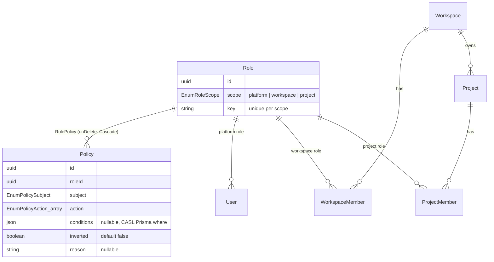
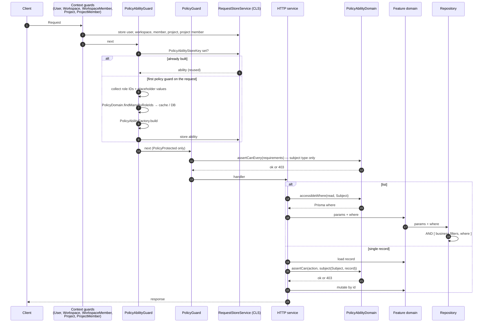
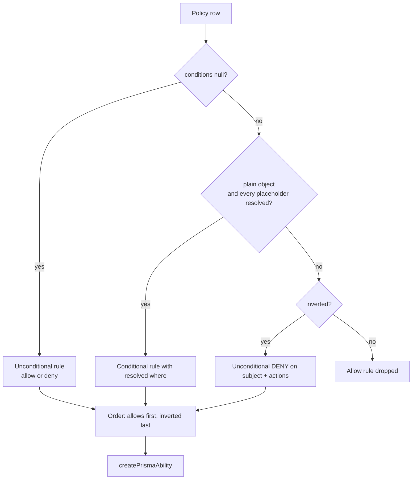
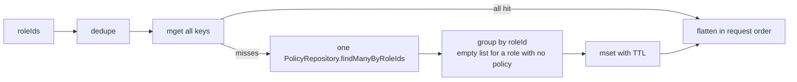
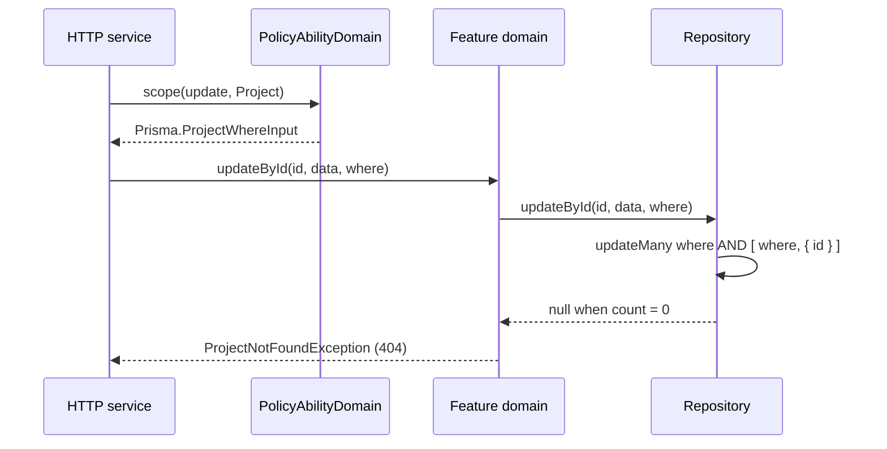
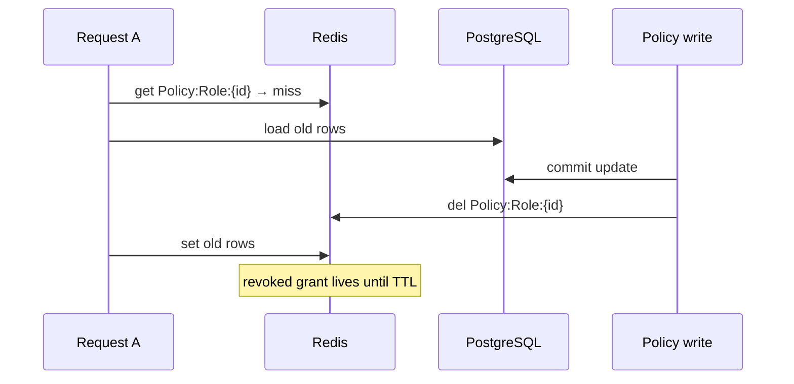

# CASL Authorization

<!-- cspell:ignore autonumber dbgenerated mget mset revisioned revisioning -->

This document explains how database-backed CASL authorization works on PostgreSQL, how to extend
it, and where it is going. It has two parts that never mix:

- **[Part I — Current implementation](#part-i--current-implementation)** describes the code as it
  runs. Every symbol and path in it exists.
- **[Part II — Upcoming design](#part-ii--upcoming-design)** describes the target architecture.
  Nothing in Part II is implemented unless Part I also says so.

Decorator stacking order and the other route guards (user, term policy, feature flag) are covered
in [Authorization](../authorization.md). This document covers the policy layer only.

## Table of Contents

- [Part I — Current implementation](#part-i--current-implementation)
  - [Building Blocks](#building-blocks)
  - [Request Lifecycle](#request-lifecycle)
  - [Ability Construction](#ability-construction)
  - [Policy Cache](#policy-cache)
  - [Authorization API](#authorization-api)
  - [Repository Composition](#repository-composition)
  - [Denied Results](#denied-results)
  - [Policy Administration and Seeds](#policy-administration-and-seeds)
  - [Enforcement Matrix](#enforcement-matrix)
  - [Extension Guide](#extension-guide)
- [Part II — Upcoming design](#part-ii--upcoming-design)
  - [Goals and Non-Goals](#goals-and-non-goals)
  - [Unified Authorization API](#unified-authorization-api)
  - [Scoped Mutations](#scoped-mutations)
  - [Optional Memberships](#optional-memberships)
  - [Policy Authoring](#policy-authoring)
  - [Revisioned Policy Cache](#revisioned-policy-cache)
  - [Known Gaps](#known-gaps)
  - [Cleanup Inventory](#cleanup-inventory)
  - [Test Strategy and Acceptance](#test-strategy-and-acceptance)

---

# Part I — Current implementation

## Building Blocks

### Data model



Source: `prisma/schema.prisma` (`Role`, `Policy`, `EnumRoleScope`, `EnumPolicyAction`,
`EnumPolicySubject`).

| Concept | Values |
| --- | --- |
| Role scope | `platform` (on `User.roleId`), `workspace` (on `WorkspaceMember.roleId`), `project` (on `ProjectMember.roleId`) |
| Actions | `manage`, `read`, `create`, `update`, `delete` — `manage` is CASL's wildcard action |
| Model subjects | `ApiKey`, `Role`, `User`, `Session`, `ActivityLog`, `PasswordHistory`, `TermPolicy`, `FeatureFlag`, `Device`, `DeviceOwnership`, `Workspace`, `Project`, `WorkspaceMember`, `WorkspaceInvite`, `WorkspaceJoinRequest`, `ProjectMember` |
| Non-model subjects | `all` (CASL wildcard subject), `Analytic`, `WorkspaceAnalytic` |

A model subject has the same name as a Prisma model, so CASL can turn its rules into a Prisma
`where` (`PolicyModelSubject = Extract<EnumPolicySubject, Prisma.ModelName>` in
`src/modules/policy/interfaces/policy.interface.ts`). A non-model subject is a capability: it is
only ever checked by name.

### Components

| Component | File | Role |
| --- | --- | --- |
| `PolicyAbilityGuard` | `src/modules/policy/guards/policy.ability.guard.ts` | Builds one ability per request and stores it under `PolicyAbilityStoreKey` |
| `PolicyGuard` | `src/modules/policy/guards/policy.guard.ts` | Enforces the route's declared `{ subject, action[] }` requirements |
| `PolicyAbilityFactory` | `src/modules/policy/factories/policy.factory.ts` | Turns policy rows into CASL rules, resolving placeholders |
| `PolicyAbilityDomain` | `src/modules/policy/domains/policy.ability.domain.ts` | Request-scoped API used by HTTP services |
| `PolicyDomain` | `src/modules/policy/domains/policy.domain.ts` | Policy reads (through the cache) and administration writes |
| `PolicyCache` | `src/modules/policy/caches/policy.cache.ts` | Read-through Redis cache of raw policy rows per role |
| `PolicyRepository` | `src/modules/policy/repositories/policy.repository.ts` | Prisma access for `Policy` |
| Decorators | `src/modules/policy/decorators/policy.decorator.ts` | `PolicyProtected`, `PolicyAbilityProtected`, `PlatformPolicyProtected` |
| Scoped decorators | `src/modules/workspace/decorators/workspace.decorator.ts`, `src/modules/project/decorators/project.decorator.ts` | `WorkspacePolicyProtected`, `ProjectPolicyProtected` |
| CASL Prisma extension | `src/common/database/factories/database.client.factory.ts` | `$extends(createCaslExtension())` |

### Decorators

| Decorator | Guards | Use |
| --- | --- | --- |
| `@PolicyProtected(...requirements)` | `PolicyAbilityGuard`, `PolicyGuard` | Generic form. Accepts any `PolicySubject` |
| `@PlatformPolicyProtected(...)` | same | `PolicyProtected` narrowed to `EnumPolicyPlatformSubject` |
| `@WorkspacePolicyProtected(...)` | same | `PolicyProtected` narrowed to `EnumPolicyWorkspaceSubject` |
| `@ProjectPolicyProtected(...)` | same | `PolicyProtected` narrowed to `EnumPolicyProjectSubject` |
| `@PolicyAbilityProtected()` | `PolicyAbilityGuard` | Builds the ability with no route requirement; the HTTP service makes the decision |

The three scoped decorators differ only in their TypeScript constraint
(`src/modules/policy/enums/policy.enum.ts`). Nothing checks the subject subsets at runtime.

## Request Lifecycle

Context guards run before the policy guards (see the decorator order in
[Authorization](../authorization.md#decorator-order)), so the ability sees every role the
request has resolved.



### Context loading

| Guard | Missing resource | Missing membership | Stores |
| --- | --- | --- | --- |
| `WorkspaceGuard` | 404 `WorkspaceNotFoundException` | — | `WorkspaceStoreKey` |
| `WorkspaceMemberGuard` | — | 403 `WorkspaceMemberForbiddenException` | `WorkspaceMemberStoreKey` (member with role) |
| `ProjectGuard` | 404 `ProjectNotFoundException` | — | `ProjectStoreKey` |
| `ProjectMemberGuard` (default) | — | 403 `ProjectMemberForbiddenException` | `ProjectMemberStoreKey` |
| `ProjectMemberGuard` with `@ProjectMemberProtected({ required: false })` | — | continues, stores nothing | `ProjectMemberStoreKey` when present |

`WorkspaceGuard` reads `:workspaceId` from the path, else the `x-workspace-id` header value.
`ProjectMemberRequiredMetaKey` carries the `required` flag. A workspace route therefore always has
a workspace role in its ability; a project route with `required: false` may run with only the
platform and workspace roles, which is how a workspace admin reaches a project they are not a
member of.

## Ability Construction

### Role IDs and placeholder values

`PolicyAbilityGuard.canActivate` reads the request store:

```ts
const roleIds = [
    user.roleId,
    workspaceMember?.roleId,
    projectMember?.roleId,
].filter(roleId => roleId != null);
const placeholders: PolicyPlaceholderValues = {
    [EnumPolicyConditionPlaceholder.userId]: user.id,
    [EnumPolicyConditionPlaceholder.workspaceId]: workspace?.id,
    [EnumPolicyConditionPlaceholder.projectId]: project?.id,
};
```

`UserStoreKey` is required (`requireStored` throws `RequestContextMissingException`); every other
key is optional. The guard returns early when `PolicyAbilityStoreKey` is already set, so stacked
policy decorators reuse one ability.

### Placeholders

`EnumPolicyConditionPlaceholder` (`src/modules/policy/constants/policy.constant.ts`):

| Placeholder | Value |
| --- | --- |
| `${userId}` | Authenticated user ID |
| `${workspaceId}` | `WorkspaceStoreKey` workspace ID, when resolved |
| `${projectId}` | `ProjectStoreKey` project ID, when resolved |

Rules of resolution (`PolicyAbilityFactory.interpolate` / `interpolateValue`):

- Resolution walks objects and arrays at any depth, so a relational condition such as
  `{ members: { some: { userId: '${userId}' } } }` resolves.
- A string is a placeholder only when the whole value matches `/^\$\{[^}]+\}$/`
  (`isPolicyPlaceholder`). `'prefix-${userId}'` stays a literal.
- A known placeholder without a value, or an unknown `${...}` token, is **unresolved**. One
  unresolved value anywhere makes the whole condition unresolved.

### Fail-closed rule conversion



| Rule | Unresolved or malformed condition |
| --- | --- |
| Allow | Omitted |
| Inverted | Emitted as an unconditional deny |

Inverted rules are appended after allow rules. CASL gives precedence to later rules, so a matching
deny wins. `reason` is attached only when it is non-empty.

## Policy Cache

The cache stores **raw policy rows** per role. Placeholders are resolved after the read, so one
entry serves every user, workspace, and project that shares the role.

| Setting | Value (`src/configs/policy.config.ts`) |
| --- | --- |
| `policy.keyPattern` | `Policy:Role:{roleId}` |
| `policy.cacheTtlInMs` | 5 minutes |
| Store | `CacheMainProvider` (Redis `db:0`) |



| Operation | Failure behavior |
| --- | --- |
| `getCacheByRoleIds` (mget) | Logged; every role treated as a miss |
| `setCacheByRoleIds` (mset) | Logged; database result returned |
| `deleteCacheByRoleId` (del) | Rejects |

Writers and invalidation:

| Writer | Cache effect |
| --- | --- |
| `PolicyDomain.createByAdmin` / `updateByAdmin` / `deleteByAdmin` | Repository write, then `deleteCacheByRoleId(roleId)`, then `activityLogDomain.stagePrepared` |
| `RoleDomain` delete (policies removed by cascade) | None — entry expires with the TTL |
| `MigrationPolicySeed` seed / remove | None — entries expire with the TTL |

## Authorization API

`PolicyAbilityDomain` reads the stored ability through `requireStored(PolicyAbilityStoreKey)`.
An HTTP service calls it; feature domains and repositories never import CASL.

| Method | Purpose | Denial |
| --- | --- | --- |
| `accessibleWhere(action, ModelSubject)` | Returns `accessibleBy(ability, action).ofType(subject)` for a list query | 403 when the ability has **no** rule for the pair; otherwise rows are filtered |
| `assertCan(action, target)` | Checks a subject name or a `subject(Subject, record)` object | 403 `PolicyForbiddenException` with `missing` and the inverted rule's `reason` |
| `assertCanEvery(requirements)` | Type-level check of every `{ subject, action[] }`; used by `PolicyGuard` | One 403 listing every missing pair |
| `getEffectivePermissions(targets)` | Actions the ability grants per target; empty targets omitted | — |
| `requireStored(key)` | Reads required request context | `RequestContextMissingException` |

Typical record check, from `src/modules/project/services/project.http.service.ts`:

```ts
this.policyAbilityDomain.assertCan(
    EnumPolicyAction.update,
    subject(EnumPolicySubject.Project, project)
);
```

Prospective create — the object carries the attributes that will be persisted:

```ts
this.policyAbilityDomain.assertCan(
    EnumPolicyAction.create,
    subject(EnumPolicySubject.Project, { workspaceId })
);
```

`assertCan` evaluates conditions **in memory** against the object passed. A relational condition
(`members.some`) cannot match a record loaded without that relation; such rules only take effect
through `accessibleWhere` in a list query.

Effective permissions routes use `@PolicyAbilityProtected()`:

| Route | Targets |
| --- | --- |
| `GET /user/workspace/permissions` | `subject(Workspace, workspace)` |
| `GET /user/project/get/:projectId/permissions` | `subject(Project, project)`, `subject(ProjectMember, { projectId })` |

## Repository Composition

A repository list method takes an optional, model-typed `where` and adds it to its `AND`. From
`src/modules/project/repositories/project.repository.ts`:

```ts
where: {
    AND: [
        filters ?? {},
        { workspaceId },
        ProjectActiveFilter,
        where ?? {},
    ],
},
```

- The policy `where` is appended to `AND` alongside business filters.
- A nested subject is filtered through its relation: the policy list composes
  `AND: [{ roleId }, { role: where }]` with a `Role` predicate.
- Single-record writes take `{ id }` only; the HTTP service has already run `assertCan`.
- Trusted callers (auth, guards, processors, seeds, `/system` routes, self-scoped `/shared`
  routes) call the same repository methods without a policy `where`.

`createCaslExtension()` on the Prisma client normalizes CASL's impossible-query shape — produced
when only inverted rules match — so Prisma returns no rows instead of a validation error.

## Denied Results

| Situation | Result |
| --- | --- |
| Route requirement fails in `PolicyGuard` | 403 `PolicyForbiddenException` |
| `accessibleWhere` with no rule for the action/subject | 403 `PolicyForbiddenException` |
| List item excluded by a condition | Row absent |
| `assertCan` denies a loaded or prospective record | 403 `PolicyForbiddenException` |
| Record does not exist | Feature 404 (`*NotFoundException`) from the load |
| `@PolicyProtected` without requirements | 500 `PolicyPredefinedNotFoundException` |
| Ability missing when `PolicyAbilityDomain` is called | `RequestContextMissingException` |
| Unresolved allow condition | Rule omitted |
| Unresolved inverted condition | Unconditional deny |

`PolicyForbiddenException` carries `metadata.missing` (subject + actions) and `metadata.reason`.

## Policy Administration and Seeds

Routes in `src/modules/policy/controllers/policy.admin.controller.ts`, mounted at
`/admin/v1/role/:roleId/policy`:

| Route | Requirement | Service check |
| --- | --- | --- |
| `GET /list` | `Role: read` | `accessibleWhere(read, Role)` nested on `Policy.role` |
| `POST /create` | `Role: read, update` | `assertCan(update, subject(Role, role))` |
| `PUT /update/:policyId` | `Role: read, update` | `assertCan(update, subject(Role, role))` |
| `DELETE /delete/:policyId` | `Role: read, update` | `assertCan(update, subject(Role, role))` |

`GET /system/role/:roleId/policy/list` uses `@ApiKeySystemProtected()` and no policy.

- `PolicyDomain.validateRoleWritable` rejects writes to the platform `superAdmin` role
  (403 `PolicyImmutableException`).
- `PolicyCreateRequestSchema` accepts `conditions` as a **flat** record of scalar values. A
  `${...}` value must be a known placeholder. The update schema is the create schema without
  `subject`.
- Anyone who can update a role can author any policy on it, including grants above their own.

Seed data lives in `src/migration/data/migration.policy.data.ts` and is written by
`src/migration/seeds/migration.policy.seed.ts` in one transaction (delete the seeded roles'
policies, then create). Seeded shapes:

| Role | Policies |
| --- | --- |
| platform `superAdmin` | `manage all` |
| platform `admin` | all actions on platform subjects; `read` on `Analytic`, `Workspace`, `WorkspaceMember`, `Project` |
| platform `user` | none |
| workspace `owner` / `admin` | workspace subjects with `{ workspaceId: '${workspaceId}' }` (`{ id }` for `Workspace`); `ProjectMember` with `{ projectId: '${projectId}' }` |
| workspace `member` | `Workspace`, `WorkspaceMember` read; `Project` read with `{ workspaceId, members: { some: { userId } } }` |
| project `admin` / `member` / `viewer` | `Project` and `ProjectMember` with `{ id \| projectId: '${projectId}' }` |

## Enforcement Matrix

Abbreviations: **AW** = `accessibleWhere`, **AC** = `assertCan`. "Load + AC" means the record is
loaded unscoped (404 when missing), checked with `assertCan` (403 when denied), and written by
`{ id }`. Every authenticated route also carries `ApiKeyProtected`, `AuthJwtAccessProtected`,
`UserProtected` and, unless stated, `TermPolicyAcceptanceProtected`.

### Platform administration (`/admin`, `@PlatformPolicyProtected`)

| Surface | Route requirement | Service | Denied |
| --- | --- | --- | --- |
| API key list | `ApiKey: read` | AW(read, ApiKey) | filtered |
| API key create | `ApiKey: read, create` | — | guard 403 |
| API key reset / update / date / status | `ApiKey: read, update` | Load + AC(update) | 404 / 403 |
| API key delete | `ApiKey: read, delete` | Load + AC(delete) | 404 / 403 |
| Role list | `Role: read` | AW(read, Role) | filtered |
| Role get | `Role: read` | Load + AC(read) | 404 / 403 |
| Role create | `Role: read, create` | — | guard 403 |
| Role update / delete | `Role: read, update` / `read, delete` | Load + AC | 404 / 403 |
| Policy list / create / update / delete | see [Policy Administration](#policy-administration-and-seeds) | | |
| User list / export | `User: read` | AW(read, User) | filtered |
| User get | `User: read` | Load + AC(read) | 404 / 403 |
| User create / import | `User: read, create` | — | guard 403 |
| User status / password / 2FA reset | `User: read, update` | Load + AC(update) | 404 / 403 |
| Session list | `User: read` + `Session: read` | AW(read, Session) | filtered |
| Session revoke | `User: read` + `Session: read, delete` | Load + AC(delete, Session) | 404 / 403 |
| Session revoke-all | `User: read` + `Session: read, delete` | Load user + AC(update, User) | 404 / 403 |
| Device list | `User: read` + `Device: read` | AW(read, DeviceOwnership) | filtered |
| Device remove | `User: read` + `Device: read, delete` | Load + AC(delete, DeviceOwnership) | 404 / 403 |
| Feature flag list | `FeatureFlag: read` | AW(read, FeatureFlag) | filtered |
| Feature flag status / metadata | `FeatureFlag: read, update` | Load + AC(update) | 404 / 403 |
| Password history list | `User: read` + `PasswordHistory: read` | AW(read, PasswordHistory) | filtered |
| Activity log (user / workspace) | `User` or `Workspace: read` + `ActivityLog: read` | AW(read, ActivityLog) | filtered |
| Term policy list | `TermPolicy: read` | AW(read, TermPolicy) | filtered |
| Term policy create / content presign | `TermPolicy: read, create` (+ `update` for presign) | — | guard 403 |
| Term policy delete | `TermPolicy: read, delete` | Load + AC(delete) | 404 / 403 |
| Term policy content update / add / remove, publish | `TermPolicy: read, update` | Load + AC(update) | 404 / 403 |
| Term policy content get | `TermPolicy: read` | Load + AC(read) | 404 / 403 |
| Workspace list | `Workspace: read` | AW(read, Workspace) | filtered |
| Workspace get | `Workspace: read` | Load + AC(read) | 404 / 403 |
| Workspace members | `WorkspaceMember: read` | AW(read, WorkspaceMember) | filtered |
| Project list | `Project: read` | AW(read, Project) | filtered |
| Project get | `Project: read` | Load + AC(read) | 404 / 403 |

### Workspace (`/user/workspace`, `WorkspaceProtected` + `WorkspaceMemberProtected`)

| Surface | Route requirement | Service | Denied |
| --- | --- | --- | --- |
| Workspace get | `Workspace: read` | returns the stored workspace | guard 403 |
| Workspace permissions | `@PolicyAbilityProtected()` | `getEffectivePermissions` | — |
| Workspace update / visibility / slug | `Workspace: update` | AC(update, workspace) | 403 |
| Ownership transfer | `Workspace: update` | AC(update, workspace) + transaction | 403 |
| Workspace delete | `Workspace: delete` | AC(delete, workspace) | 403 |
| Leave | member guards only | — | — |
| Member list | `WorkspaceMember: read` | AW(read, WorkspaceMember) | filtered |
| Member role update / remove | `WorkspaceMember: update` / `delete` | Load + AC | 404 / 403 |
| Invite list | `WorkspaceInvite: read` | AW(read, WorkspaceInvite) | filtered |
| Invite create | `WorkspaceInvite: create` | AC(create, `{ workspaceId }`) | 403 |
| Invite resend / revoke | `WorkspaceInvite: update` / `delete` | Load + AC | 404 / 403 |
| Join request list | `WorkspaceJoinRequest: read` | AW(read, WorkspaceJoinRequest) | filtered |
| Join request accept / reject | `WorkspaceJoinRequest: update` | Load + AC(update) | 404 / 403 |
| Workspace list / create / switch, invite claim, join request create | no policy | self-scoped | — |

### Project (`/user/project`, workspace guards + optional project membership)

| Surface | Route requirement | Service | Denied |
| --- | --- | --- | --- |
| Project list | `@PolicyAbilityProtected()` | AW(read, Project) | 403 if no rule, else filtered |
| Project create | `Project: create` (workspace decorator) | AC(create, `{ workspaceId }`) | 403 |
| Project get | `Project: read` | AC(read, project) | 404 (guard) / 403 |
| Project permissions | `@PolicyAbilityProtected()` | `getEffectivePermissions` | — |
| Project update / slug / delete | `Project: update` / `delete` | AC(project) | 403 |
| Member list | `ProjectMember: read` | AW(read, ProjectMember) | filtered |
| Member assign | `ProjectMember: create` | AC(create, `{ projectId, userId, roleId }`) | 403 |
| Member role update / remove | `ProjectMember: update` / `delete` | Load + AC | 404 / 403 |
| Leave | strict `ProjectMemberProtected()` | — | 403 when not a member |

### Non-model subjects

| Surface | Requirement | Persistence |
| --- | --- | --- |
| `/admin/analytic/*` | `Analytic: read` | unscoped aggregates |
| `/user/analytic/workspace/*` | `WorkspaceAnalytic: read` + workspace guards | scoped by the guard's workspace ID |
| `all` | seeded as `manage all` for `superAdmin` | — |

### Trusted and public flows

| Flow | Authorization source |
| --- | --- |
| Login, token refresh, current-user bootstrap | Authentication protocol |
| Context guards (`WorkspaceGuard`, `ProjectGuard`, member guards) | Request identity |
| Policy cache load | Request role IDs |
| Queue processors (invite expiry, notifications) | Job producer contract |
| Seeds (`src/migration/seeds/*`) | Owner-invoked migration |
| `/system` routes | `@ApiKeySystemProtected()` |
| `/public` and self-scoped `/shared` routes | Route contract, `userId` filter, token validation |

## Extension Guide

### Add a model subject

1. Add the model name to `EnumPolicySubject` in `prisma/schema.prisma`; run `pnpm db:generate`.
   Applying the enum to PostgreSQL is the owner's `pnpm db:migrate`.
2. Add it to the matching subset in `src/modules/policy/enums/policy.enum.ts`
   (`EnumPolicyPlatformSubject`, `EnumPolicyWorkspaceSubject`, `EnumPolicyProjectSubject`).
3. Seed rules for the roles that need it in `src/migration/data/migration.policy.data.ts`. Use
   `workspaceRule` / `projectRule` so the condition key exists on the model.

### Protect a list route

1. Decorate with the scoped policy decorator and `{ subject, action: [read] }`.
2. In the HTTP service, call `accessibleWhere(EnumPolicyAction.read, EnumPolicySubject.X)`.
3. Pass the `where` through the domain to the repository; add it to the query's `AND`.

### Protect a single-record route

1. Decorate with the action the route performs.
2. Load the record through the domain (404 when missing).
3. Call `assertCan(action, subject(EnumPolicySubject.X, record))` before mutating.

### Protect a create

Call `assertCan(EnumPolicyAction.create, subject(EnumPolicySubject.X, { ...attributes }))` with
every attribute the seeded conditions read (`workspaceId`, `projectId`, …).

### Author a conditional policy

- Use a model field name from the subject's Prisma model. Scalars match in both `assertCan` and
  `accessibleWhere`; relation filters match only in `accessibleWhere`.
- Use a whole-value placeholder for request context.
- An inverted rule whose context is missing denies the whole subject and action — prefer
  conditions that resolve on every route the subject appears on.

### Add a placeholder

1. Add the member to `EnumPolicyConditionPlaceholder`.
2. Fill it in the `placeholders` map in `PolicyAbilityGuard`.
3. Add a spec under `test/modules/policy/` for resolution and the unresolved case.

---

# Part II — Upcoming design

> Nothing in this part is implemented. It is the target the branch is moving towards.

## Goals and Non-Goals

Goals:

- One deterministic, fail-closed ability per request (kept).
- Store fully customizable CASL Prisma conditions as JSON.
- Enforce record authorization **in the database statement** that reads or mutates the record.
- Make an inaccessible record indistinguishable from a missing one (feature 404).
- Reuse repository methods for authorized and trusted calls.
- Keep `Role: update` as the policy-administration permission.
- Policy changes take effect without a cache invalidation window.

Non-goals: field-level permissions, PostgreSQL row-level security, a request-aware Prisma
extension that injects authorization, non-JSON policy values, delegated-administration grant
ceilings.

## Unified Authorization API

`PolicyAbilityDomain` exposes two operations:

| Target | Replaces | Contract |
| --- | --- | --- |
| `authorize(action, target)` | `assertCan` | Throws 403 when CASL denies a subject name, loaded record, or prospective record. Creation uses it too; there is no `authorizeCreate` |
| `scope(action, ModelSubject)` | `accessibleWhere` | Returns the typed `accessibleBy` predicate for lists, lookups, updates, and deletes |

`assertCanEvery` becomes a private `PolicyGuard` helper. A route decorator named `PolicyAbility()`
replaces `PolicyAbilityProtected()`. `PlatformPolicyProtected`, `WorkspacePolicyProtected` and
`ProjectPolicyProtected` are removed in favour of `PolicyProtected` with `EnumPolicySubject`.
`RequireAccess` is not introduced: authentication, context loading, feature flags, terms, and CASL
stay separate concerns.



## Scoped Mutations

- The policy predicate is the **first** item of the repository `AND`.
- A lookup is `AND: [scope(read), { id }]`; `null` maps to the feature 404 with no unfiltered
  existence probe.
- An update or delete puts `scope(update | delete)` in the final mutating statement
  (`updateMany` / `deleteMany`, then re-read on `count > 0`). Authorization performed only by a
  preliminary read is not trusted.
- Multi-write operations run in a transaction and reapply the predicate on the final protected
  write.
- `authorize` stays for prospective creates, already-loaded scalar records, and business
  transitions. Domains keep data-integrity invariants such as the last workspace owner.

```ts
public async updateById(
    id: string,
    data: Prisma.ProjectUpdateInput,
    additionalWhere?: Prisma.ProjectWhereInput
): Promise<Project | null> {
    const result = await this.databaseService.client.project.updateMany({
        where: { AND: [additionalWhere ?? {}, { id }] },
        data,
    });
    if (result.count === 0) {
        return null;
    }

    return this.databaseService.client.project.findUnique({ where: { id } });
}
```

Target denied results:

| Situation | Result |
| --- | --- |
| Guard-level or prospective-create denial | 403 |
| Existing record excluded by a condition (read, update, delete) | Feature 404 |
| Collection item excluded | Absent |
| Invalid persisted CASL condition | Internal policy configuration error, never an allow |

## Optional Memberships

`WorkspaceMemberGuard` and `ProjectMemberGuard` become context loaders only: a missing membership
stores nothing and the request continues. A missing membership contributes no role rules, so the
policy decides. `WorkspaceMemberProtected`, `ProjectMemberProtected`, `WorkspaceMemberCurrent`,
`ProjectMemberCurrent` and `ProjectMemberRequiredMetaKey` are removed; `WorkspaceProtected()` and
`ProjectProtected()` compose resource and optional membership loading. A self-service leave loads
the caller's membership as domain data, returns the feature member-not-found result when absent,
then authorizes the loaded membership.

## Policy Authoring

- `PolicyCreateRequestSchema.conditions` accepts any JSON-compatible CASL condition, including
  nested relation filters, matching what seeds already store. The placeholder refinement is
  removed; unknown tokens fail closed at ability build.
- A structural validator checks that the role scope may grant the subject, that the actions are
  valid for the subject, and that at least one action remains. Condition JSON is not validated
  against the model.
- Non-model subjects (`all`, `Analytic`, `WorkspaceAnalytic`) reject conditions.
- `Role: update` on the target role keeps protecting create, update and delete. Strict
  least-privilege delegation would need a root-only subject or a grant-ceiling check.

## Revisioned Policy Cache

### Problems it solves

Stale refill race — key deletion cannot stop a request that already loaded old rows:



Other issues: a cache delete failure after commit returns an error for a committed write (a
retried create duplicates) and skips activity-log staging; seeds and role deletion never
invalidate; concurrent misses stampede the database.

### Design

```prisma
model Role {
  id             String @id @default(dbgenerated("uuidv7()")) @db.Uuid
  policyRevision Int    @default(0)
  // existing fields
}
```

- Every policy writer increments `Role.policyRevision` **in the same transaction** as the policy
  mutation: admin create, update, delete; seed replace and remove; any future writer.
  Repositories expose `createInTx`, `incrementPolicyRevisionInTx`, etc.; the domain owns the
  transaction.
- The key embeds the revision: `Policy:Role:{roleId}:Rev:{policyRevision}`.
- Context guards already load the user, workspace member and project member; their role relation
  includes `policyRevision`, giving `PolicyRoleReference { roleId, policyRevision }`.
- The cache reads exactly the requested revision. A request that saw revision `N + 1` can never
  read the `N` key.
- No post-commit cache delete. Old keys expire; cleanup is optional. Role deletion needs no cache
  action because UUID role IDs are not reused.

```mermaid
sequenceDiagram
    participant A as Request A
    participant C as Redis
    participant D as PostgreSQL
    participant B as Policy write

    A->>D: read role revision 4
    A->>C: get …:Rev:4 → miss
    A->>D: load rows
    B->>D: tx { update policy; revision = 5 }
    A->>C: set …:Rev:4 (harmless)
    Note over C: next request reads revision 5 → …:Rev:5
```

| Operation | Failure behavior |
| --- | --- |
| Cache read | Log; load the requested revision from the database |
| Cache write | Log; return the database result |
| Revision increment | Transaction rolls back with the policy mutation |
| Old-key cleanup | Log; continue |
| Database policy load | Propagate; never fall back to an older revision |

### Stampede control

Performance only, never a correctness boundary:

- In-process single-flight with `Map<key, Promise>`.
- Optional short Redis `SET NX PX` lock per revision key; re-read the key after acquiring; release
  with compare-and-delete; on lock miss, wait briefly, retry the cache, then load directly.

## Known Gaps

Differences between Part I and the target, with the code that shows them:

| # | Gap | Where | Closed by |
| --- | --- | --- | --- |
| 1 | Single-record reads and writes load unscoped, `assertCan`, then write by `{ id }`; an excluded record returns 403, revealing it exists | every `*.http.service.ts` using `assertCan` on a loaded record; repository writes by `id` | [Scoped Mutations](#scoped-mutations) |
| 2 | Policy `where` is appended last in `AND` (second in `workspace.member.repository.ts`) | list repositories | [Scoped Mutations](#scoped-mutations) |
| 3 | Device routes declare `Device` but the service checks `DeviceOwnership`; a role needs both | `device.admin.controller.ts`, `device.http.service.ts` | Declare `DeviceOwnership` on the route |
| 4 | Session revoke-all asserts `User: update`, which the route does not declare | `session.admin.controller.ts`, `session.http.service.ts` | Declare `User: update` or authorize `Session` |
| 5 | Admin workspace members list never checks the workspace exists or is readable | `workspace.member.http.service.ts`, `workspace.member.domain.ts` | `scope(read, Workspace)` on the parent |
| 6 | Admin activity-log routes declare `User` / `Workspace: read` but never load or check the target | `activity-log.http.service.ts` | Parent `scope(read, …)` lookup |
| 7 | `GET /user/workspace/get` performs no record check beyond the guard | `workspace.http.service.ts` (`getCurrentWorkspace`) | `authorize(read, workspace)` |
| 8 | Policy create DTO accepts flat scalar conditions while seeds store nested ones | `policy.create.request.dto.ts`, `migration.policy.data.ts` | [Policy Authoring](#policy-authoring) |
| 9 | No structural validator for scope ↔ subject or actions | `policy.domain.ts` | [Policy Authoring](#policy-authoring) |
| 10 | `WorkspaceAnalytic` is seeded with a `workspaceId` condition that is never evaluated (type-level check only) | `migration.policy.data.ts`, analytic routes | Reject conditions on non-model subjects |
| 11 | Seeded `Project` read with `members.some` cannot match `assertCan` on a loaded project | `migration.policy.data.ts` (`assignedProjectReadRule`) | `scope(read, Project)` on lookups |
| 12 | Cache delete runs after the commit; a Redis failure rejects a committed write and skips activity-log staging | `policy.domain.ts` | [Revisioned Policy Cache](#revisioned-policy-cache) |
| 13 | Seeds and role deletion never invalidate the cache | `migration.policy.seed.ts`, `role.domain.ts` | [Revisioned Policy Cache](#revisioned-policy-cache) |
| 14 | Concurrent misses on one role all hit the database | `policy.cache.ts` | [Stampede control](#stampede-control) |
| 15 | Workspace membership is mandatory; only project membership is optional | `workspace.member.guard.ts`, `project.member.guard.ts` | [Optional Memberships](#optional-memberships) |
| 16 | Creates without record attributes (role, API key, term policy, user, import) rely on the guard only | respective HTTP services | `authorize(create, prospective)` where conditions apply |

## Cleanup Inventory

### Delete after call-site migration

| Symbol | Replacement |
| --- | --- |
| `PlatformPolicyProtected`, `WorkspacePolicyProtected`, `ProjectPolicyProtected` | `PolicyProtected` |
| `PolicyAbilityProtected` | `PolicyAbility()` decorator |
| `EnumPolicyPlatformSubject`, `EnumPolicyWorkspaceSubject`, `EnumPolicyProjectSubject`, `PolicySubject` | `EnumPolicySubject` (runtime validator covers scope) |
| `WorkspaceMemberProtected`, `ProjectMemberProtected`, `WorkspaceMemberCurrent`, `ProjectMemberCurrent`, `ProjectMemberRequiredMetaKey` | Optional loading inside `WorkspaceProtected` / `ProjectProtected` |
| `PolicyAbilityDomain.accessibleWhere` | `scope` |
| `PolicyAbilityDomain.assertCan` | `authorize` |
| Public `PolicyAbilityDomain.assertCanEvery` | Private `PolicyGuard` helper |
| Flat `conditions` schema and placeholder refine in `PolicyCreateRequestSchema` | JSON condition schema |
| `PolicyCache.deleteCacheByRoleId` and its `PolicyDomain` calls | Transactional revision increment |
| `PolicyCache.getByRoleIdsAndCache`, `getCacheByRoleIds`, `setCacheByRoleIds` | Role-reference, revision-aware read/write |
| `PolicyDomain.findManyByRoleIds(...roleIds)` | Role-reference method |
| `policy.keyPattern` = `Policy:Role:{roleId}` | `Policy:Role:{roleId}:Rev:{policyRevision}` |

### Retain

`PolicyAbilityFactory` (recursive placeholders, fail-closed), `PolicyAbilityGuard`, `PolicyGuard`,
`PolicyAbilityDomain`, `PolicyDomain`, `PolicyRepository`, `PolicyCache` (raw rows per revision),
`EnumPolicyConditionPlaceholder`, `isPolicyPlaceholder`, `PolicyAbilityStoreKey`,
`PolicyRequiredMetaKey`, `WorkspaceMemberGuard` / `ProjectMemberGuard` as loaders,
`PolicyForbiddenException`, `PolicyPredefinedNotFoundException`, the policy doc error responses,
and `createCaslExtension()` with explicit `accessibleBy` predicates. Feature HTTP services and
repositories stay; only their authorization calls change.

## Test Strategy and Acceptance

Unit specs (`test/**/*.spec.ts`):

- Placeholder resolution in objects and arrays, literals, unknown tokens.
- Allow omission and unconditional deny on unresolved context; allow-before-deny ordering.
- Unique role loading and ability reuse per request.
- Membership loading with and without a member row; denial when no role applies.
- `authorize` on prospective subjects; scoped lookup miss → feature 404.
- Policy validator and `Role: update` behavior.
- Cache: exact-revision hits, revision bump hides the old key, an in-flight `N` load cannot serve
  `N + 1`, rollback of mutation + revision together, read/write/cleanup failures, seed revision
  bumps, coalesced misses.

Integration coverage (adapter + real PostgreSQL, outside the unit suite): accessible and
inaccessible collections, direct lookups, nested relation authorization, atomic update/delete
predicates, impossible CASL queries through `createCaslExtension()`, and concurrent scope changes
between a preliminary read and the final mutation.

Acceptance checklist:

- [ ] `Policy.conditions` accepts arbitrary JSON CASL conditions through the API.
- [ ] Structural validator covers scope, subject and actions; non-model subjects reject conditions.
- [ ] `authorize` is the only object/prospective operation; `scope` the only predicate operation.
- [ ] Every list, lookup, update and delete includes the predicate in its final statement, first
      in `AND`.
- [ ] Inaccessible existing records return feature 404.
- [ ] Workspace and project memberships load optionally.
- [ ] Routes use `@PolicyProtected` or `@PolicyAbility`; no scoped wrappers.
- [ ] Policy cache is revisioned; no cache delete on the mutation path; every writer bumps the
      revision in its transaction.
- [ ] Every row of the enforcement matrix has an allowed, a denied and, where conditional, an
      inaccessible-existing-record case.
- [ ] Targeted tests, typecheck, lint and spell pass.

## Related Documentation

- [Authorization](../authorization.md) — decorator order, user, term-policy, workspace and
  project guards
- [Workspace](../workspace.md), [Project](../project.md)
- [Cache](../cache.md), [Database](../database.md)
- [CASL Prisma integration](https://github.com/stalniy/casl/tree/master/packages/casl-prisma)
- [Prisma query extensions](https://www.prisma.io/docs/orm/prisma-client/client-extensions/query)
