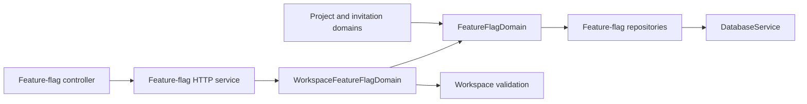
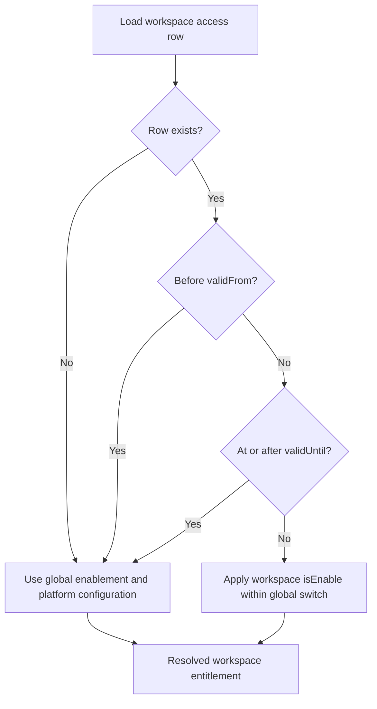
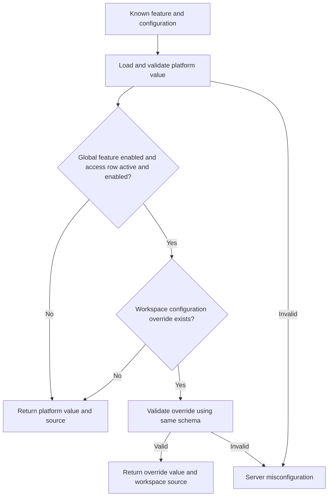
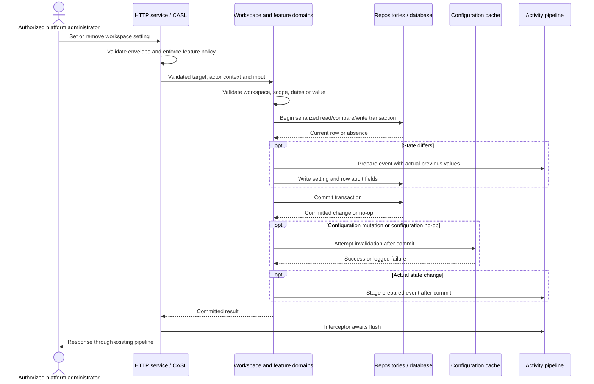

# Workspace Feature Flag Configuration and Access

Status: proposed design. The contracts below describe the intended implementation, not the current runtime.

## Overview

The platform manages feature availability and configuration for each workspace. Tenant members read the effective settings; they never change them. Workspace access is a separate entitlement from a user's CASL permissions and from operational rollout.

- `FeatureFlag` is a seeded feature identified by `(namespace, key)`. It holds the global enablement switch, rollout, and user targets. Workspaces inherit its enablement when no active workspace access override applies.
- `FeatureFlagWorkspaceAccess` is an optional workspace access override for one feature, with an optional validity window.
- `FeatureFlagConfig` is one seeded configuration and its platform value.
- `FeatureFlagConfigWorkspaceOverride` is an optional workspace replacement for one configuration value. Configuration overrides share the access row's effective window; they have no independent validity dates.
- `FeatureFlagConfigSchemas` is the code-owned catalog and value-schema map.

An operation proceeds only when the global feature is enabled, the workspace is entitled when applicable, the caller passes operational rollout, and the existing authorization and business rules permit it. A grant never grants a CASL permission. A configuration value never grants feature access.

The initial configuration is `workspace / invitation / expiredInDays`. The design supports temporary workspace configuration uplifts without implementing prices, subscriptions, payments, or billing synchronization.

Goals:

1. Keep feature and configuration identifiers code-owned and seeded.
2. Let authorized platform administrators manage defaults, workspace grants, dates, and configuration overrides.
3. Resolve access predictably at validity boundaries, including after expiry and deletion.
4. Return availability and effective configuration to members without exposing targeting or administrative diagnostics.
5. Enforce the same workspace entitlement from HTTP, queue, CLI, and internal business entry points.
6. Add catalog entries without workspace backfills or per-feature tables.

## Related Documents

- [Feature Flag][ref-doc-feature-flag]: global evaluation, rollout, and user targeting
- [Authorization][ref-doc-authorization]: CASL subjects, actions, and request abilities
- [Workspace][ref-doc-workspace]: tenancy, membership, and workspace selection
- [Request Validation][ref-doc-request-validation]: zod schemas and the validation pipe
- [Database][ref-doc-database]: persistence and seeding
- [Activity Log][ref-doc-activity-log]: action contracts and persistence
- [Status Codes][ref-doc-status-codes]: module error registry

## Table of Contents

- [Decisions](#decisions)
- [Data Model](#data-model)
- [Configuration Schemas](#configuration-schemas)
- [Validation](#validation)
- [Evaluation](#evaluation)
- [Worked Example](#worked-example)
- [Guard and Domain Enforcement](#guard-and-domain-enforcement)
- [Cache](#cache)
- [Lifecycle](#lifecycle)
- [API](#api)
- [Activity Log](#activity-log)
- [Status Codes](#status-codes)
- [Simplifications and Alternatives](#simplifications-and-alternatives)
- [Acceptance Scenarios](#acceptance-scenarios)
- [Decisions to Confirm Before Implementation](#decisions-to-confirm-before-implementation)
- [Out of Scope](#out-of-scope)
- [Implementation Boundaries](#implementation-boundaries)

## Decisions

### Platform administration and tenant discovery

Only platform administrators with the relevant CASL permissions mutate feature settings. A workspace owner or administrator role alone grants no mutation access. Every active member can read the effective features and configurations for their selected workspace.

Three independent questions remain separate:

| Question | Authority | Example |
| --- | --- | --- |
| Is the capability operationally available? | Global switch, targeting, rollout | Temporarily stop project operations |
| Is this workspace entitled to it? | Global feature state and active workspace access row | Temporarily customize or deny projects for one workspace |
| May this user perform this action? | Existing CASL policies and resource boundaries | Read projects but deny project creation |

A workspace entitlement is shared by its members. User-based rollout can still expose the capability to only some entitled members. Stable workspace availability normally uses 100% rollout. Neither targeting nor a favorable rollout bucket bypasses an active workspace denial or a globally disabled feature.

### Separate access from configuration

Access rows supply workspace enablement and the shared validity window for workspace customization. Configuration override rows supply replacement parameter values during an active enabling window. They retain separate writes and audit events, but configuration effectiveness depends on the access row.

Each workspace-feature pair has at most one access row. PUT replaces that row, including its complete validity window. There is no schedule history or priority resolution in the access table. Activity logs retain mutation history.

Each workspace-configuration pair has at most one configuration override. Values replace the complete platform value; objects are not deep-merged.

### Inheritance is an explicit contract

- With no access row, before its start, or at/after its end, workspace enablement inherits `FeatureFlag.isEnable` and configuration uses platform values.
- An active access row can restrict enablement through `isEnable: false`. Its `isEnable: true` cannot bypass a globally disabled feature.
- Workspace configuration overrides apply only when the global feature is enabled and the workspace has an active access row with `isEnable: true`.
- An active denial or global disablement resolves platform configuration values and rejects feature operations.
- Deleting an access row restores global enablement and platform configuration immediately for subsequent evaluations.
- Deleting one configuration override restores that platform value without changing the access row.

There is one platform enablement control, `FeatureFlag.isEnable`. A globally enabled feature supplies baseline access to every workspace, subject to rollout and CASL. A valid workspace access row enables a temporary configuration uplift or explicitly denies access. Expiry restores baseline enablement and configuration; it does not automatically disable an otherwise globally enabled feature.

Stored configuration overrides remain after access expiry or deletion but are inactive. A later active enabling access row reactivates those stored values. Administrators can inspect and remove them independently. Creating configuration overrides without an active access row stages values without applying them.

An override equal to the current platform value is retained. While eligible, it pins that value against later platform changes. Workspace creation writes neither access rows nor configuration overrides.

### Code-owned scope and identity

The initial workspace-addressable features are `workspace.invitation`, `workspace.joinRequest`, and `workspace.project`. User authentication and platform analytics features have global evaluation only. Workspace access writes for those global features are rejected; member discovery includes only workspace-addressable features.

Scope is derived from the code-owned catalog, never from a client-supplied scope or an arbitrary workspace header. A namespace groups feature identities and does not create parent-child evaluation. Invitation, join request, and project are independent capabilities.

The schema map owns supported identifiers and configuration types. Seed data owns descriptions and initial values. Administrators edit operational controls, platform values, access rows, and configuration overrides. They cannot create or delete catalog entries or edit keys and schemas.

### Module ownership

The feature-flag module owns its models, repositories, evaluation, configuration resolution, cache, and HTTP contracts. Its global domain module exports the evaluator and resolver.

The workspace module owns workspace validation and `WorkspaceFeatureFlagDomain`, which validates an active target workspace and delegates to the feature-flag domain. It never queries feature-flag models directly. The feature-flag domain accepts validated workspace context and never injects the workspace domain.

The feature-flag HTTP service consumes the workspace composition domain through `WorkspaceDomainModule`. The workspace domain consumes the global feature-flag domain. There is no reverse domain dependency, `forwardRef`, or cross-feature repository injection.



## Data Model

### FeatureFlag

The final feature row has these controls in addition to identity, description, and audit fields:

| Field | Meaning |
| --- | --- |
| `namespace`, `key` | Seeded camelCase identifiers, neither containing a dot |
| `isEnable` | Global operational switch, authoritative for every workspace |
| `rolloutPercent` | Integer percentage from 0 through 100 |
| `targetUsers` | Authenticated user allow-list bypassing rollout only |
| `configs` | Related platform configuration rows |
| `workspaceAccesses` | Related workspace access rows |

Identity has `@@unique([namespace, key])`. Configuration is represented by related rows, not `FeatureFlag.metadata`.

The initial three workspace features are globally enabled. Workspaces inherit that same enablement outside an active workspace override. Global disablement stops the feature for every workspace, including those with active enabling rows.

### FeatureFlagWorkspaceAccess

Table `feature_flag_workspace_accesses`:

| Field | Type | Meaning |
| --- | --- | --- |
| `id` | uuid | UUIDv7 identity |
| `featureFlagId` | uuid | FK to `FeatureFlag`, `onDelete: Cascade` |
| `workspaceId` | uuid | FK to `Workspace`, `onDelete: Cascade` |
| `isEnable` | boolean | Explicit enablement or denial while the row is active |
| `validFrom` | DateTime nullable | Inclusive lower bound; null means no lower bound |
| `validUntil` | DateTime nullable | Exclusive upper bound; null means no upper bound |
| `createdAt`, `createdBy`, `updatedAt`, `updatedBy` | audit fields | Creation and latest mutation |

Indexes: `@@unique([workspaceId, featureFlagId])` and `@@index([featureFlagId])`. The leading workspace column serves workspace reads; the feature index serves reverse lookups and cascades. No time index is needed for read-time evaluation of one row per pair.

The row has no price, subscription identifier, status enum, or duplicated namespace. `scheduled`, `active`, and `expired` are derived states, not persisted values. Both date bounds null means an indefinite override.

### FeatureFlagConfig

Table `feature_flag_configs`:

| Field | Type | Meaning |
| --- | --- | --- |
| `id` | uuid | UUIDv7 identity |
| `featureFlagId` | uuid | FK to `FeatureFlag`, `onDelete: Cascade` |
| `key` | string | Seeded configuration key |
| `description` | string | Seeded description |
| `value` | json | Platform value, validated against its code-owned schema |
| `createdAt`, `createdBy`, `updatedAt`, `updatedBy` | audit fields | Creation and latest mutation |

Identity has `@@unique([featureFlagId, key])`; its leading column already indexes feature reads.

### FeatureFlagConfigWorkspaceOverride

Table `feature_flag_config_workspace_overrides`:

| Field | Type | Meaning |
| --- | --- | --- |
| `id` | uuid | UUIDv7 identity |
| `featureFlagConfigId` | uuid | FK to `FeatureFlagConfig`, `onDelete: Cascade` |
| `workspaceId` | uuid | FK to `Workspace`, `onDelete: Cascade` |
| `value` | json | Complete replacement value |
| `createdAt`, `createdBy`, `updatedAt`, `updatedBy` | audit fields | Creation and latest mutation |

Indexes: `@@unique([workspaceId, featureFlagConfigId])` and `@@index([featureFlagConfigId])`.

The configuration identifies its feature, so the override has no duplicated `featureFlagId`. Configuration overrides carry no independent validity dates. They are stored after access expiry or deletion, but apply only during an active enabling access window while the global feature is enabled.

## Configuration Schemas

The feature-flag module keeps one three-level zod schema map. Empty configuration objects represent features with no parameters.

```typescript
export const FeatureFlagConfigSchemas = {
    user: {
        loginGoogle: {},
        loginApple: {},
        loginCredential: {},
        signUp: {},
        changePassword: {},
        forgotPassword: {},
    },
    workspace: {
        invitation: {
            expiredInDays: z.enum(EnumWorkspaceInviteExpiry),
        },
        joinRequest: {},
        project: {},
    },
    analytic: {
        auth: {},
        users: {},
        devices: {},
        workspaces: {},
        apiKeys: {},
        projects: {},
        termPolicies: {},
        fraud: {},
        anomaly: {},
    },
} as const satisfies Record<string, Record<string, Record<string, z.ZodType>>>;
```

Derived namespace, feature, configuration, and value types preserve literal keys for internal calls. Schema lookup accepts the persisted namespace, feature key, and configuration key, never a schema chosen by the request.

The initial seed supplies `workspace.invitation.expiredInDays = EnumWorkspaceInviteExpiry.sevenDays`. Invite creation and resend use that effective default only when the request omits `expiryDuration`. An explicit validated request value takes precedence. This configuration is a default, not a maximum or a paid entitlement limit.

Schema parsing validates both platform values and overrides. An invalid persisted platform value or selected workspace override fails as server misconfiguration; it never silently falls back. The configuration contract excludes credentials and tokens, including nested values.

Seed/schema parity covers both directions: every feature and configuration in the map has a seed entry, every seeded identifier has a definition, and every seed value parses. Features with empty configuration maps participate in that check.

## Validation

| Layer | Validates |
| --- | --- |
| Request pipe | Strict envelope, UUIDs, booleans, JSON values, timestamp syntax and bounds |
| Domain | Persisted identity, code-owned scope, active workspace, schema-selected value, date relationship |
| Database | Unique workspace pairs, required foreign keys, audit storage |

Configuration PUT or PATCH takes `{ value }`, with `value` accepted as JSON at the envelope boundary and parsed against the persisted configuration's schema in the domain. Extra fields and path IDs repeated in the body are rejected.

An access PUT takes all three fields:

```json
{
  "isEnable": true,
  "validFrom": "2026-12-01T00:00:00Z",
  "validUntil": "2027-01-01T00:00:00Z"
}
```

- Each bound is a timestamp with an explicit UTC offset or null. Date-only and timezone-less strings are rejected. Parsed request fields become dates and are stored in UTC.
- Both non-null bounds satisfy `validFrom < validUntil`. Equal and reversed bounds are invalid.
- Null clears a bound; omitted bounds are invalid on PUT, so replacement has one meaning.
- Past windows are accepted. They resolve through inheritance and remain visible in administrative diagnostics.
- An invalid date relationship is a client error. Invalid persisted dates or a workspace access row for a global-only feature are server misconfiguration.
- Global and configuration controls can be edited while a feature is disabled. Restoration of access never depends on passing the feature's own gate.

The status PATCH accepts a non-empty subset of `isEnable`, `rolloutPercent`, and `targetUserIds`. Omitted fields remain unchanged; an empty target list clears targets. The declared request and repository write cover every accepted field.

## Evaluation

### Validity window

One evaluation captures `now` through `HelperDateService`. Every row in a discovery response uses the same captured instant. Clock synchronization across application nodes is an operational prerequisite.

An access row is active when both conditions hold:

```text
(validFrom is null OR validFrom <= now)
AND
(validUntil is null OR now < validUntil)
```



The state is `absent`, `scheduled`, `active`, or `expired`. For a valid row, a future start takes precedence over active state, and a reached end marks it expired. The source is `workspace` only while the row is active; otherwise it is `platform`. A missing bound skips its respective comparison. Expiry leaves the stored row intact, and no background job changes its state.

### Availability and rollout

For a workspace feature:

```text
workspaceEnabled = global isEnable
    AND (access row is inactive or absent OR access row isEnable)

availableForCaller = workspaceEnabled
    AND (authenticated user is targeted OR caller passes rollout)
```

With no active access row, the workspace inherits global enablement. For a global-only feature, workspace access rows are not evaluated. Missing workspace context on a workspace business operation is a context error, never an invitation to use the global-only path.

User targets bypass only rollout. Hashing uses SHA-256 over `namespace:key:identifier`, first eight hexadecimal characters modulo 100, compared with `rolloutPercent`. Authenticated users always use `userId`; they cannot select a bucket through the anonymous header. Anonymous callers at 100% need no identifier; below 100%, a missing or malformed configured anonymous header fails closed.

Rollout is deployment machinery, not payment evidence. Two members of one entitled workspace can receive different rollout results. A configuration uplift intended to be consistently available uses full rollout. This baseline-plus-override model does not express a globally disabled capability enabled only for paying workspaces; a separate entitlement requirement would be needed for that future product.

### Configuration resolution

- `resolvePlatformConfig(namespace, featureKey, configKey)` returns the platform value.
- `resolveWorkspaceConfig(workspaceId, namespace, featureKey, configKey)` returns a workspace override only when present and eligible under the active enabling access window and global switch; otherwise it returns the platform value. It accepts workspace-addressable features only.
- The result includes the parsed value and internal source, `platform` or `workspace`.
- Configuration resolution alone never asserts availability or CASL permission. Business entry points evaluate access before consuming settings or performing side effects.



An invalid platform value is diagnosed even when an override exists. Selected workspace values are validated before use; malformed values fail as server misconfiguration rather than falling back. Inactive stored overrides are administrative data, not effective values. A globally disabled feature or active workspace denial resolves platform configuration for member discovery. Rollout and CASL do not select configuration values. Reading a value does not permit executing the feature.

The resolver reads authoritative feature and access state before selecting cached configuration values. It uses the same captured instant and state snapshot for enablement and configuration within one evaluation, including discovery and domain admission. It does not cache eligibility or infer eligibility from the presence of a cached configuration override. A standalone resolver call captures a fresh evaluation context.

## Worked Example

This example illustrates a temporary workspace configuration uplift for a globally available project capability. `maxProjects` is illustrative, not part of the initial seeded configuration catalog.

```text
Feature: workspace.project
  isEnable: true
  rolloutPercent: 100

Platform configuration:
  maxProjects: 5

Workspace A access:
  isEnable: true
  validFrom: 2026-12-01T00:00:00Z
  validUntil: 2027-01-01T00:00:00Z

Workspace A configuration override:
  maxProjects: 20
```

| Situation | Workspace enablement | Effective configuration | Operation |
| --- | --- | --- | --- |
| Before the start | Inherits global true | 5 | Baseline feature; rollout, CASL and business rules apply |
| Exactly at the start | Active access row enables customization | 20 | CASL and business rules still apply |
| During the window | Active access row enables customization | 20 | A member without create permission cannot create |
| Exactly at the end | Inherits global true | 5 | Baseline feature; rollout, CASL and business rules apply |
| Global switch disabled | Disabled for every workspace | 5 | Globally unavailable |
| Grant deleted | Inherits global true | 5 | Baseline feature; rollout, CASL and business rules apply |
| Configuration override deleted during the grant | Active access row remains enabled | 5 | Platform configuration applies |
| Global switch re-enabled after expiry | Inherits global true | 5 | Baseline feature; rollout, CASL and business rules apply |
| Active workspace denial | Disabled for this workspace | 5 | Workspace access denied |

A future quota such as `maxProjects` needs its own atomic enforcement against concurrent creation. This design supplies the setting; it does not introduce quota accounting or claim that a count followed by create is safe.

An active denial disables a workspace while the global feature remains enabled. Once that denial expires, the workspace inherits global enablement and platform configuration again. Re-enabling the global switch during an active enabling window also reactivates its stored configuration overrides.

## Guard and Domain Enforcement

### HTTP and business entry points

The global feature guard remains in its existing position after authentication and before user/workspace guards. It evaluates global operational availability and caller rollout; it does not read workspace context that has not yet been resolved.

Workspace business entry points additionally evaluate the complete workspace verdict using validated workspace identity and explicit caller context. This assertion includes global availability, entitlement dates, and rollout, so internal callers cannot bypass the global switch. Repeating the deterministic rollout check at the domain boundary does not choose a different cohort.

Policy guards and HTTP services continue enforcing CASL for the actual operation. No grant is converted into an unconditional CASL allow rule. Domains receive explicit inputs and remain callable without request-store abilities; they never read authorization context from CLS.

```mermaid
sequenceDiagram
    actor Member
    participant Guards as Authentication and route guards
    participant Policy as Existing CASL boundary
    participant HTTP as HTTP service
    participant Domain as Owning business domain
    participant Flags as FeatureFlagDomain
    participant DB as Feature-flag repositories / DB
    Member->>Guards: Request workspace operation
    Guards->>Flags: Global availability and caller rollout
    Flags->>DB: Read authoritative controls and targets
    DB-->>Flags: Feature state
    Guards->>Guards: Resolve user, workspace and membership
    Guards->>Policy: Enforce operation permissions
    Policy-->>HTTP: Authorized request and applicable predicate
    HTTP->>Domain: Business call with validated workspace and caller
    Domain->>Flags: Assert complete workspace availability
    Flags->>DB: Read feature and workspace access together
    DB-->>Flags: Controls, targets and access window
    alt Available at captured now
        Flags-->>Domain: Allowed
        Domain->>Flags: Resolve configuration using admission evaluation context
        Flags-->>Domain: Effective parsed value
        Domain->>Domain: Enforce business invariants and perform work
        Domain-->>Member: Result through HTTP response
    else Active workspace denial or operationally unavailable
        Flags-->>Member: Typed denial; no business side effect
    end
```

A workspace entitlement failure can occur after CASL permits an operation. Error precedence follows the actual route stack, not the conceptual ordering of the availability formula.

### Nonstandard workspace selection

- Invitation preview and claim derive the workspace from the validated invite token or resolved invite record. They never accept a replacement workspace from a header.
- Invite-based sign-up evaluates the target workspace's invitation entitlement before onboarding side effects.
- Join-request creation resolves the requested workspace independently and evaluates that workspace's join-request feature.
- Every workspace-scoped project read or mutation evaluates `workspace.project`.
- Queue and CLI business operations pass validated workspace identity and an explicit execution identity. System execution uses global switch and entitlement checks but no user-based rollout; it never invents a user or anonymous bucket. User-initiated deferred work retains the initiating user identity for rollout.
- Cleanup uses dedicated lifecycle entry points and remains available without feature entitlement. A generic boolean bypass parameter is not exposed on normal business methods.

Access is evaluated at the start of the domain operation. An operation already admitted may finish after expiry or a concurrent revocation. Deferred business work checks again when execution starts. The configuration selected at admission remains the operation's configuration snapshot even if the access window ends during execution. No design here cancels in-flight transactions or recalls already sent invitations or notifications.

### Disabled-feature behavior

The proposed initial policy gates these operations on global disablement, an active workspace denial, or failed rollout. Expired grants restore baseline access and configuration, so expiry alone does not reject an operation:

| Feature | Interactive operations gated | Lifecycle cleanup retained |
| --- | --- | --- |
| `workspace.invitation` | Create, resend, preview, claim, invite-based sign-up, list, revoke | Expiry sweep and workspace deletion |
| `workspace.joinRequest` | Create, list, accept, reject | Cancellation during workspace deletion |
| `workspace.project` | All user-scope project reads and mutations | Workspace-deletion cleanup |

Existing projects, invitations, and join requests remain stored. Re-enabling access restores interactive management subject to each record's own validity. Feature grant expiry does not change an invitation's token expiry or extend an expired invitation. General workspace lifecycle, member feature discovery, and platform feature administration remain available under their usual authorization.

### Global catalog behavior

Provider flags govern both existing-user login and provider-assisted account creation. `user.loginGoogle` and `user.loginApple` do not implicitly evaluate `user.loginCredential` or `user.signUp`. Credential sign-up, password change, and forgot-password each use their own feature.

Analytics have nine independent global-only features: `auth`, `users`, `devices`, `workspaces`, `apiKeys`, `projects`, `termPolicies`, `fraud`, and `anomaly`. Corresponding admin route families use the global feature guard and existing `analytic:read` permission. They do not use workspace grants.

## Cache

### Authoritative access reads

The recommended first implementation reads feature controls, targets, and the relevant workspace access row directly from the primary database for each availability assertion. A relational read loads those controls and the selected workspace row together. Discovery batches its feature/access reads instead of issuing one query per member-visible feature.

Access verdicts, access rows, and operational controls used to grant access are not served from Redis. This keeps expiry and revocation independent of cache invalidation, avoids stale-fill races, and gives a precise guarantee: an evaluation whose authoritative read begins after a committed change observes the new access state. In-flight evaluations and transactions retain the admission semantics described above.

Database failures fail closed with the existing server-error handling. They never become an inherited default or an empty access row. A replica with unbounded lag is not an authority for access evaluation.

### Configuration cache

- `FeatureFlag:{namespace}:{key}` caches platform configuration rows and their values for resolution only.
- `FeatureFlag:Workspace:{workspaceId}:Config:{namespace}:{key}` caches workspace configuration override rows, including an empty result.
- `FeatureFlagCache` owns every cache operation, configured key pattern, and TTL. The global entry may contain feature identity but never supplies an authoritative access verdict.
- Cache read failures fall through to repositories. Cache writes and deletes are best-effort and logged on failure.
- A platform-value mutation commits, then attempts global configuration-entry deletion.
- A configuration-override mutation commits, then attempts deletion of that workspace-feature configuration entry.
- Access writes require no configuration cache deletion because access state is authoritative on every resolution and cached rows contain raw values only. Deleting or expiring an access row immediately makes cached workspace values ineligible.
- Each cache entry has a finite configured TTL. Failed invalidation or a read racing a mutation can leave stale configuration until TTL expiry. These are configuration freshness limits, not permission guarantees.
- Transactional configuration resolution uses `*InTx` repository methods and bypasses Redis. Settings used for future security or quota invariants take that authoritative path.
- Member and administrator discovery responses are not response-cached; they depend on workspace, caller, current time, and permissions.

The existing one-hour operational cache is not a suitable authority for workspace restrictions or override eligibility. A stricter cached access design would need an explicit revocation-consistency contract; it is deferred until measured database load justifies that complexity.

## Lifecycle

### Seed and catalog integrity

The seed materializes the complete code-owned catalog with descriptions, explicit global state, full initial rollout, and initial configuration values. The initial workspace features are globally enabled, which also supplies baseline workspace enablement.

- Missing feature and configuration rows are created.
- Existing operator-set switches, rollout, targets, values, and workspace rows remain untouched. Only descriptions are refreshed.
- Every seeded value parses against its schema before writing.
- Unknown identifiers and orphaned persisted catalog rows are integrity failures, not automatic deletes.
- Removing a catalog entry includes an explicit owner-managed cleanup decision for its access and configuration data. Re-running the seed alone does not retire it.

Catalog additions update the schema map, seed, parity tests, and enforcement call sites together. New workspace grants need no workspace backfill.

### Access renewal, denial, and expiry

PUT replaces one access row. A renewal that preserves a started window usually keeps `validFrom` and extends `validUntil`. Replacing an active row with a future window immediately restores global enablement and platform configuration until that future window starts. The model cannot retain current access and queue a second independent future change at once.

DELETE restores global enablement and platform configuration. An administrator who intends an explicit denial writes an active `isEnable: false` row; deleting a grant never disables a globally enabled feature. Stored configuration overrides remain inactive until a subsequent active enabling row reactivates them.

Expiry performs no write, deletion, activity event, or scheduled task. Diagnostics derive the state using the current time. Billing or expiry notifications are separate future workflows.

### Workspace lifecycle

Workspace creation inserts no feature settings. Soft deletion retains access and configuration rows, but workspace validation rejects feature reads and writes for the deleted workspace. Restore reuses retained settings and evaluates their dates at restore time. Hard deletion cascades both kinds of workspace row. Stale configuration cache entries expire naturally and cannot grant access.

## API

All paths are relative to the existing API prefix and version. Controllers delegate through HTTP services; response schemas declare every exposed field.

### Permission matrix

| Surface | Required authorization |
| --- | --- |
| Platform feature list | Platform `FeatureFlag:read` |
| Global status, platform config, access PUT/DELETE, config override PUT/DELETE | Platform `FeatureFlag:read` and `FeatureFlag:update` |
| Administrator workspace diagnostics | Platform `FeatureFlag:read` |
| Member discovery | Authenticated active user and active membership in the selected workspace |
| Business feature operation | Its existing CASL subjects/actions plus complete feature availability |

A platform `FeatureFlag:update` policy authorizes management of workspace settings for that feature across workspaces. Workspace membership never supplies that permission. The initial design does not add workspace-restricted platform feature-management permissions.

Conditional feature policies are evaluated against the actual parent `FeatureFlag` record, including when a request names a configuration ID. A type-only route check is not sufficient for a conditioned mutation. List and diagnostics queries apply the caller's feature read predicate, composed with the mandatory catalog scope. Inverted CASL rules remain authoritative. No role-name checks or parallel permission engine are introduced.

### Platform administration

| Method | Path | Purpose |
| --- | --- | --- |
| GET | `/admin/feature-flag/list` | Paginated features, controls, configurations, platform values |
| PATCH | `/admin/feature-flag/update/:featureFlagId/status` | Global switch, rollout, and targets |
| PATCH | `/admin/feature-flag/configs/:featureFlagConfigId` | Update one platform configuration value |

The status request declares its mutable fields explicitly. There is no separate default-workspace enablement field or catalog create/delete API.

### Workspace administration

| Method | Path | Purpose |
| --- | --- | --- |
| GET | `/admin/feature-flag/workspaces/:workspaceId` | Paginated workspace feature diagnostics |
| PUT | `/admin/feature-flag/workspaces/:workspaceId/features/:featureFlagId/access` | Replace access enablement and both validity bounds |
| DELETE | `/admin/feature-flag/workspaces/:workspaceId/features/:featureFlagId/access` | Restore global enablement and platform configuration |
| PUT | `/admin/feature-flag/workspaces/:workspaceId/configs/:featureFlagConfigId/override` | Replace one configuration override with `{ value }` |
| DELETE | `/admin/feature-flag/workspaces/:workspaceId/configs/:featureFlagConfigId/override` | Restore the platform configuration value |

Admin routes take the target workspace from the path and never select it through `x-workspace-id`. Targets are validated even for idempotent DELETE. An unknown feature or configuration is 404; a known global-only feature is invalid scope. Deleting a missing override for a valid pair is a successful no-op.

A mutation returns the committed row for PUT/PATCH; DELETE returns no data. Administrator GET reports the persisted row, its derived state, source, global switch, resolved workspace enablement, and the next access-window boundary if one exists. It includes platform, stored override, and effective configuration values, plus whether each stored override is currently eligible. A stored value remains visible administratively even when inheritance makes it inactive. This response does not pretend to evaluate rollout or business permissions for an arbitrary workspace member using the administrator's identity.

### Workspace member discovery

GET `/user/feature-flag/workspace` returns a paginated list of workspace-addressable features for the active workspace, including unavailable features so the client can describe disabled capabilities. Identity comes from validated workspace and membership context.

Each feature exposes:

| Field | Meaning |
| --- | --- |
| `id`, `namespace`, `key`, `description` | Public catalog identity |
| `workspaceEnabled` | Effective entitlement at the captured instant |
| `availableForCaller` | Global enablement, entitlement, and this member's rollout result |
| `validUntil` | End of the active workspace customization window, or null |
| `nextChangeAt` | Next future start/end boundary of this access row, or null |
| `configs` | Configuration `id`, `key`, `description`, and effective `value` |

Response metadata includes `evaluatedAt`. `validUntil` describes the current override's boundary, not a promise that availability ends then: inheritance may keep access enabled. `nextChangeAt` is an access-row evaluation boundary, not a guarantee of a visible state change; an administrator can edit settings earlier.

The member response excludes separate platform-value fields, override sources, user targets, rollout percentages, audit actors, and administrative reasons. It does not expose a generic `canUse` field: permissions vary by action and concrete resource. Clients use the existing permission surface for action controls, and server requests always enforce current rules again.

Configurations are visible even while a feature is unavailable, so schemas contain no secrets. The discovery route is protected by membership, not by any optional feature it reports.

## Activity Log

| Action | Metadata |
| --- | --- |
| Existing global status update action | Changed operational controls and targets |
| `adminFeatureFlagConfigUpdate` | Feature identity, config key, previous and resulting value |
| `adminFeatureFlagWorkspaceAccessSet` | Feature identity, previous and resulting enablement and validity bounds |
| `adminFeatureFlagWorkspaceAccessDelete` | Feature identity and removed access settings |
| `adminFeatureFlagConfigWorkspaceOverrideSet` | Feature identity, config key, previous and resulting value |
| `adminFeatureFlagConfigWorkspaceOverrideDelete` | Feature identity, config key, removed value |

Metadata stays flat and contract-validated; JSON values are encoded consistently and timestamps serialized in UTC. No action logs credentials. The actor uses `user: payload`; workspace mutations use `workspace: target` with the path-selected workspace.

The proposed implementation follows the existing activity pipeline: prepare and validate the event before the write, stage after commit, and let the activity interceptor flush. Row audit fields are written with the mutation. Activity persistence is not in the business transaction; an activity flush failure after commit does not roll back access state. A database-atomic entitlement audit would require an explicit extension to that pipeline and is not assumed here.

Only a real state change stages an event. Identical PUT and missing-row DELETE are successful no-ops; configuration no-ops still attempt relevant cache deletion. Expiry causes no mutation event.



### Concurrent administration

The proposed first version uses last committed write wins; it has no ETag, version column, or compare-and-set API. Upsert and DELETE are serialized per pair by the owning persistence operation so simultaneous first writes cannot create duplicate rows. A read/compare/write sequence uses a transaction with database serialization, with conflicts surfaced rather than silently retried. The unique pair indexes remain the final integrity protection.

Previous values in an event come from the serialized mutation, not a stale preflight HTTP read. Successful identical PUTs converge on one row; a concurrent serialization conflict can require an explicit client retry. Only the mutation that changes state produces an event. Competing different edits can overwrite one another, and the admin interface refreshes from the committed response. Access and configuration mutations are independent: a failed grant write does not undo an earlier configuration override.

## Status Codes

Existing module errors retain their identities:

| Member | HTTP | Meaning |
| --- | --- | --- |
| `notFound` | 404 | Unknown administrative feature ID |
| `serviceUnavailable` | 503 | Global disablement or failed operational rollout |
| `predefinedKeyNotFound` | 500 | Missing seeded feature/configuration or missing code schema for an internal reference |
| `predefinedKeyTypeInvalid` | 500 | Invalid persisted value or access definition |

The proposed configuration error is `configInvalid` (400). Additional named contracts are `configNotFound` (404), `workspaceAccessDenied` (403), and `workspaceAccessInvalid` (400, date relationship or unsupported workspace scope). Numeric allocation follows the module registry during implementation; this design does not reserve speculative numbers.

An active workspace denial returns `workspaceAccessDenied`, independently of user permission denial. An absent, future, expired, or deleted access row inherits the global feature state; those states do not independently deny access. CASL denial uses the existing policy exception. Invalid envelopes use request validation. Unknown or deleted workspaces use workspace exceptions. A missing validated workspace context is a server context error. No billing-specific 402 response is introduced.

## Simplifications and Alternatives

| Area | Chosen design | Complexity avoided or tradeoff |
| --- | --- | --- |
| Access and configuration | Separate typed rows with one shared access window | No independent configuration validity windows or JSON entitlement policy |
| Platform enablement | One global switch inherited by workspaces | No separate default-workspace enablement state |
| Temporal access | One nullable window per pair | No overlapping grants, priority rules, scheduler, or mutable expiry status |
| Time evaluation | Compare with captured server time on read | No expiry job or boundary cache invalidation |
| Access consistency | Database reads | More database traffic, but no stale entitlement grants or distributed invalidation protocol |
| Configuration freshness | Existing best-effort cache model | Bounded stale settings accepted for non-authoritative defaults |
| Permission management | Reuse platform `FeatureFlag` policies and existing business policies | No per-feature roles or mirrored CASL grants |
| Scope | Explicit workspace-addressable catalog | No nullable project/workspace foreign keys or polymorphic scope IDs |
| Initial catalog | Invitation expiry only | No generic quota engine or speculative paid parameter catalog |
| Discovery | Existing paginated feature rows with computed fields | No separate frontend policy engine or cached authorization response |
| Audit | Existing prepare/stage/flush pipeline | No new outbox solely for feature settings; atomic billing audit deferred |

A combined workspace-feature JSON record is a viable alternative when all settings always change together. Here, configuration keys retain individual validation and audit events while sharing one feature-level eligibility window. Separate rows preserve those contracts without embedding untyped configuration JSON into the access record.

A schedule table or billing/subscription model is appropriate only when there are multiple future periods, overlapping purchase sources, or automatic payment reconciliation. The one-row override deliberately cannot represent those cases.

## Acceptance Scenarios

These scenarios define behavior for later test-first implementation. They are not claims about passing tests in the current runtime.

| Area | Scenarios |
| --- | --- |
| Inheritance | Missing, future, expired, and deleted access rows use global enablement and platform values; active denial blocks; active enabling window applies stored configuration overrides |
| Boundaries | Before/at/after start and end; inclusive start, exclusive end; either/both null; equivalent timezone offsets; one clock instant per response |
| Dates | Equal/reversed bounds rejected; timezone-less/date-only input rejected; past window accepted; malformed persisted dates fail closed |
| Precedence | Global off beats grant and target; target beats rollout but not entitlement; 0/100 rollout; user identity ignores anonymous override |
| Global enablement | Global false disables every workspace and selects platform values; global true supplies baseline access; re-enabling during an active enabling window reactivates stored overrides |
| Permissions | Platform update allowed only through CASL; conditioned parent-feature policy checked on config mutation; matching inverted deny wins; workspace owner alone cannot mutate |
| Isolation | Workspace A grants/configs never affect B; admin path wins over header; member discovery rejects nonmember or deleted workspace |
| Scope | Global-only feature rejected on workspace mutation; workspace business call missing context fails; no implicit parent flag |
| Configuration | Full replacement, no deep merge; invalid request value rejected; invalid stored platform or selected override fails; explicit invite expiry takes precedence; no access granted by config |
| Discovery | Unavailable rows included; caller rollout reflected; effective values only; action permission not inferred; one evaluatedAt; pagination stays within authorized scope |
| Renewal | Extending end preserves customization; future replacement restores baseline now; deletion/expiry retain but deactivate stored config; a new enabling window reactivates it |
| Administration | Set/remove allowed while disabled; repeated identical PUT/DELETE no extra event; concurrent writes preserve uniqueness and accurate previous values |
| Failure | Database error never becomes inheritance; failed config-cache invalidation cannot grant access; activity failure does not roll back committed access |
| Entry points | HTTP and direct domain calls enforce access; queued user work re-evaluates at execution; system work checks entitlement without a user bucket |
| Lifecycle | Expiry keeps business data; cleanup still runs; soft delete blocks access; hard delete cascades settings; restore re-evaluates dates |
| Catalog | Bidirectional seed parity; seed preserves operator values and grants; orphaned rows reported; global enablement explicitly seeded |

## Decisions to Confirm Before Implementation

Platform-only administration, one inherited global enablement switch, and validity-controlled workspace configuration are settled. Missing, future, expired, or deleted access rows restore platform values. The following recommendations make the draft concrete and remain visible for product and implementation review:

1. **Read and recovery while disabled:** gate all project reads and mutations, invitation list/revoke, and join-request management on global disablement or an active workspace denial as listed above. Data stays stored. Expiry restores baseline access and values. A read-only mode or export access while disabled would change that operation matrix.
2. **Consistency and audit:** use authoritative database availability reads, admission-time semantics for in-flight work, and the existing non-atomic activity pipeline. Stronger billing audit or cancellation guarantees would require additional machinery.
3. **Initial global state:** keep all three initial workspace features globally enabled. This design supports temporary configuration uplifts and workspace restrictions; exclusive paid-feature access with global enablement off is outside this model.
4. **Administrative contention:** accept last committed write wins. If operators need stale-edit protection, a conditional update contract is a separate requirement.

Concrete DTO names, select constants, helper decomposition, and transaction mechanics within these contracts are implementation choices. No product implementation starts from an unreviewed draft.

## Out of Scope

- Tenant-authored changes, including changes by workspace owners.
- Billing, prices, subscription periods, payment webhooks, automatic renewal, or refunds.
- Multiple future windows, overlapping entitlements, independently dated configuration overrides, expiry notifications, and grace periods.
- Workspace-based rollout buckets or workspace allow-lists. Entitlement is workspace-based; operational rollout stays user-based.
- Project-level overrides, inheritance hierarchies, external flag services, or a generic rule engine.
- Quota accounting, concurrent resource limits, data deletion on expiry, or cancellation of work already admitted.
- Exclusive paid-feature grants that bypass global disablement.
- Runtime creation or deletion of the seeded catalog.

## Implementation Boundaries

This is a design specification, not an executable implementation plan. The implementation covers schema/client changes, seeded catalog and parity checks, typed resolvers, authoritative access evaluation, admin/member contracts, CASL enforcement, activity contracts, errors/messages, and owning business entry points.

New behavior follows test-first development in the mirrored unit-spec tree. Controllers and repositories are verified through their owning contracts and runtime wiring rather than introduced as unit-test subjects. Module boot checks cover the one-way dependencies and route registration.

Applying the PostgreSQL schema is an owner operation through `pnpm db:migrate`. The final schema introduces namespaced feature uniqueness, unique workspace-feature access pairs, unique workspace-configuration override pairs, and cascade relations. Runtime access and resolver paths depend on those models being applied and the complete catalog being seeded. Existing feature rows and metadata need an explicit owner-approved replacement/data-disposal procedure; an automatic destructive conversion is not implied by this design.

The runtime documentation for feature flags, authorization, workspace behavior, activity logs, and error codes is aligned after implementation. No source code, schema, or database is changed by this specification update.

<!-- REFERENCES -->

[ref-doc-feature-flag]: ../feature-flag.md
[ref-doc-authorization]: ../authorization.md
[ref-doc-workspace]: ../workspace.md
[ref-doc-request-validation]: ../request-validation.md
[ref-doc-database]: ../database.md
[ref-doc-activity-log]: ../activity-log.md
[ref-doc-status-codes]: ../status-codes.md
