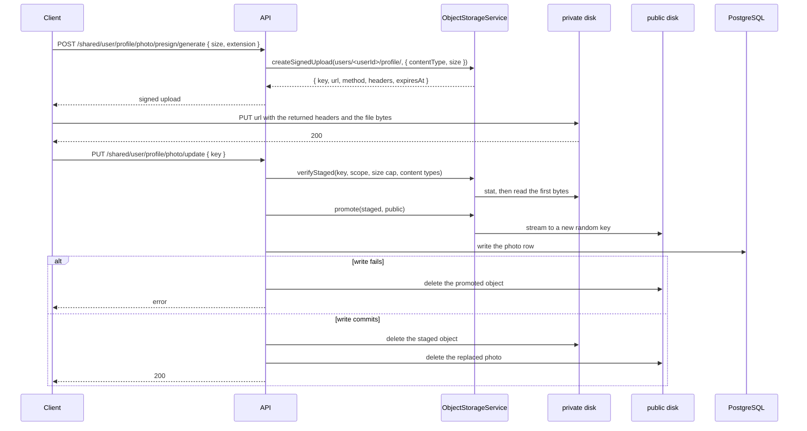

# File Upload and Object Storage Documentation

Multipart parsing, file validation, and CSV processing live in `src/common/file`. Object storage lives in `src/common/storage`.

## Overview

Three ways a file reaches the API:

- **Parsed multipart.** `FileUploadSingle`, `FileUploadMultiple`, and `FileUploadMultipleFields` buffer the file in memory for a pipe chain that reads and discards it, such as a CSV import. Nothing is stored.
- **Stored multipart.** `StorageUploadSingle` streams one file through the API onto a storage disk after detecting its type from the bytes. The handler receives the stored asset, never a buffer.
- **Signed direct upload.** The API issues a short-lived signed `PUT`; the client sends the bytes straight to the private disk under `incoming/`; a completion call with `{ key }` verifies the staged object and promotes it to its final key. The bytes never pass through the API on a remote driver.

Features reach storage through `ObjectStorageService` only. It works over two named disks, `public` and `private`, backed by the local filesystem or by an S3-compatible bucket depending on `STORAGE_DRIVER`. Provider setup (buckets, CORS, lifecycle, permissions, encryption, rotation): [Third Party Integration][ref-doc-third-party].

## Related Documents

- [Request Validation Documentation][ref-doc-request-validation] - Request schemas and pipes
- [Handling Error Documentation][ref-doc-handling-error] - Upload exceptions
- [Language Message Documentation][ref-doc-message] - i18n for upload errors
- [Doc Documentation][ref-doc-doc] - OpenAPI for multipart and signed upload routes
- [Third Party Integration][ref-doc-third-party] - Storage drivers, S3 and R2 configuration, bucket setup
- [Environment Documentation][ref-doc-environment] - `STORAGE_*` variables
- [Term Policy Documentation][ref-doc-term-policy] - Term policy content upload, publication, and download

## Table of Contents

- [Overview](#overview)
- [Related Documents](#related-documents)
- [Decorators](#decorators)
  - [FileUploadSingle](#fileuploadsingle)
  - [FileUploadMultiple](#fileuploadmultiple)
  - [FileUploadMultipleFields](#fileuploadmultiplefields)
  - [Upload Transport Errors](#upload-transport-errors)
- [Enums](#enums)
- [Pipes](#pipes)
  - [FileExtensionPipe](#fileextensionpipe)
  - [FileCsvParsePipe](#filecsvparsepipe)
  - [FileCsvValidationPipe](#filecsvvalidationpipe)
- [CSV Import Flow](#csv-import-flow)
- [Usage](#usage)
  - [Multiple Files Upload](#multiple-files-upload)
  - [CSV Import](#csv-import)
  - [Multiple Field Upload](#multiple-field-upload)
- [Error Handling](#error-handling)
- [Message Translation](#message-translation)
- [Object Storage](#object-storage)
  - [Disks and Visibility](#disks-and-visibility)
  - [ObjectStorageService](#objectstorageservice)
  - [Stored Assets in Responses](#stored-assets-in-responses)
  - [Object Keys](#object-keys)
- [Stored Multipart Upload](#stored-multipart-upload)
- [Signed Direct Upload](#signed-direct-upload)
  - [Issue](#issue)
  - [Complete](#complete)
  - [Flow Diagram](#flow-diagram)
  - [Client Example](#client-example)
  - [Term Policy Content](#term-policy-content)
- [Signed Download](#signed-download)
- [Storage and the Database](#storage-and-the-database)
- [Local-Driver Routes](#local-driver-routes)
- [Storage Errors](#storage-errors)

## Decorators

The defaults come from `src/common/file/constants/file.constant.ts`:

- `FileSizeInBytes` is `bytes('10mb')`
- `FileMaxMultiple` is `3`

The `options` argument on every decorator is itself optional, but `IFileUploadSingle` and `IFileUploadMultiple` declare their fields as required. Pass the whole object or none of it.

Each decorator also emits multipart OpenAPI (`ApiConsumes('multipart/form-data')` plus a binary `ApiBody` from the field name(s)) and the upload error kit from `DocFileErrorResponses` in `src/common/doc/constants/doc.constant.ts`. Flow: [Doc Documentation][ref-doc-doc].

### FileUploadSingle

Handles single file upload with configurable field name and size limits. It also caps the request at one file.

**Parameters:**
- `options.field`: Field name in form-data (default when `options` is omitted: `'file'`)
- `options.fileSize`: Maximum file size in bytes (default when `options` is omitted: `FileSizeInBytes`)

**Example:**
```typescript
@FileUploadSingle({ field: 'photo', fileSize: bytes('5mb') })
```

### FileUploadMultiple

Handles multiple files upload with the same field name.

**Parameters:**
- `options.field`: Field name in form-data (default when `options` is omitted: `'files'`)
- `options.maxFiles`: Maximum number of files (default when `options` is omitted: `FileMaxMultiple`)
- `options.fileSize`: Maximum file size per file in bytes (default when `options` is omitted: `FileSizeInBytes`)

**Example:**
```typescript
@FileUploadMultiple({ field: 'documents', maxFiles: 5, fileSize: bytes('5mb') })
```

### FileUploadMultipleFields

Handles multiple files from different form fields.

**Parameters:**
- `fields`: Array of field configurations
  - `field`: Field name
  - `maxFiles`: Maximum files for this field
- `options.fileSize` (optional): Maximum file size per file in bytes (default: `FileSizeInBytes`)

The global `limits.files` is the sum of the declared per-field `maxFiles`, so the request-wide cap admits exactly what the per-field caps allow.

**Example:**
```typescript
@FileUploadMultipleFields(
  [
    { field: 'avatar', maxFiles: 1 },
    { field: 'documents', maxFiles: 2 }
  ],
  { fileSize: bytes('15mb') }
)
```

### Upload Transport Errors

All three decorators compose `FileUploadErrorInterceptor` (`src/common/file/interceptors/file.upload-error.interceptor.ts`) outermost, ahead of the multer interceptor it wraps. Multer and busboy signal a limit failure as a framework `HttpException` carrying a fixed message; the interceptor matches that message against Nest's `multerExceptions` / `busboyExceptions` and rethrows a typed file exception. The client message comes from the exception's own path (`file.error.exceedMaxSizeUpload`, …), not from a second catalog.

| Condition | Framework message | Exception | statusCode | HTTP |
|---|---|---|---|---|
| A file exceeds `fileSize` | `File too large` | `FileExceedMaxSizeUploadException` | 50106 | 413 |
| The request carries more files than the global `limits.files` | `Too many files` | `FileExceedMaxFilesException` | 50107 | 422 |
| A file arrives on a field the route did not declare, or past that field's `maxFiles` | `Unexpected field` | `FileFieldUnexpectedException` | 50108 | 422 |
| A malformed multipart body, or a part / field / nesting limit | `Multipart: Boundary not found`, `Too many parts`, `Field name too long`, and the rest of Nest's multipart messages | `FileMultipartInvalidException` | 50109 | 422 |

The framework appends ` - <field>` to several of those messages, so the interceptor matches on the segment before the first ` - `. A message outside the table passes through untouched.

`StorageUploadSingle` composes the same interceptor ahead of `StorageUploadInterceptor`, so a stored upload reports its limits through the same exceptions.

## Enums

File extension enums for validation. These enums are used with `FileExtensionPipe` to restrict allowed file types for uploads.

### Available Enums

- `EnumFileExtensionImage`: Image files
  - `jpg`, `jpeg`, `png`

- `EnumFileExtensionDocument`: Document files
  - `pdf`, `csv`

- `EnumFileExtensionAudio`: Audio files
  - `mpeg`, `m4a`, `mp3`

- `EnumFileExtensionVideo`: Video files
  - `mp4`

- `EnumFileExtensionTemplate`: Template files
  - `hbs`

- `EnumFileExtension`: both a const object merging every group above and a union type of the five enums

**When to Use:**
- Mix members of several enums to accept more than one kind: `[EnumFileExtensionImage.jpg, EnumFileExtensionDocument.pdf]`
- Use specific enum for strict type control: only `EnumFileExtensionImage` values
- CSV enum is typically used with `FileCsvParsePipe` for data import features

## Pipes

### FileExtensionPipe

A mixin pipe built by `FileExtensionPipe(allowedExtensions)`. The declared extension and the bytes both have to agree with the allow-list. The pipe returns the value untouched; it never rewrites it.

For each file:

1. The declared extension comes off `file.originalname` through `FileService.extractExtensionFromFilename`, and has to be a member of `allowedExtensions`.
2. The first bytes of `file.buffer` are sniffed through `FileService.sniffExtensionFromBuffer`, which wraps the `file-type` package. The sniffed type is accepted when `FileExtensionContract` (`src/common/file/contracts/file.extension.contract.ts`) maps some member of the allow-list onto it.

`csv` is the signature-less member of `FileExtensionContract`: its entry is an empty array. A sniff that returns nothing is accepted when the declared extension is `csv` and that member is in the allow-list, and rejected for every other member. `hbs` is not in the table; templates are not uploaded through this pipe. Adding an uploadable extension to a group enum means adding its row to that table.

**Usage:**
Pass an array of allowed file extensions from the enum constants. A single file and an array of files are both accepted, and every element of an array is validated: one rejected file rejects the request.

**Passes through without validating:**
- A falsy value
- An empty object or an empty array

**Throws:**
- `FileExtensionInvalidException`: `originalname` is missing, the declared extension is not in the allow-list, the sniffed type maps to no member of the allow-list, or nothing was sniffed for an extension that carries a signature

### FileCsvParsePipe

Parses CSV (.csv) files into structured data array with rows and columns. This pipe converts raw file buffer into usable JavaScript objects using semicolon (;) as delimiter.

**Returns:**
Array of parsed row objects `T[]`, or `undefined` when no file was uploaded

**Supports:**
- CSV files (.csv) with semicolon delimiter
- Headers in first row become object property names
- Empty lines are automatically skipped
- Empty cells are parsed as `null`

**Throws:**
- `FileRequiredException`: Buffer is missing or zero-length
- `FileExtensionInvalidException`: Missing `originalname`, or an extension other than `csv`

### FileCsvValidationPipe

Validates every parsed CSV row against a zod request schema and reports the failures row by row.

**How it Works:**
1. Receives parsed data from `FileCsvParsePipe`
2. Rejects an empty row set, and a row set larger than the configured row cap
3. Runs each row through the schema, keeping the parsed output
4. A request schema is `z.strictObject`, so an unknown column fails the row
5. Collects all validation issues with row context, never failing fast on the first bad row
6. Throws `FileImportException` if any row failed

**Parameters:**
- The zod schema each row is validated against
- `options.maxDataImportConfigKey` (optional): config key holding the row cap (default `'file.maxDataImport'`, which is `100`)

The pipe factory runs at decoration time, before config is resolved, so it takes the config KEY and reads the value in the constructor. The user import passes `'user.maxDataImport'`, which is `50`.

**Throws:**
- `FileRequiredExtractFirstException`: No rows were passed in
- `FileExceedMaxDataImportException`: Row count exceeds the row cap read from the configured key
- `FileImportException`: Contains detailed validation errors with row context

## CSV Import Flow

CSV upload processing:

```mermaid
flowchart TD
    A[Client Upload<br/>CSV File] --> B[ @UploadedFile Decorator]
    B --> B2{FileRequiredPipe()}
    
    B2 -->|Missing File| B3[Throw FileRequiredException]
    B2 -->|Present| C{FileExtensionPipe}
    
    C -->|Invalid Extension| D[Throw FileExtensionInvalidException]
    C -->|Valid Extension| E{FileCsvParsePipe}
    
    E -->|Empty Buffer| F[Throw FileRequiredException]
    E -->|Not a .csv| G[Throw FileExtensionInvalidException]
    E -->|Success| H[Parse CSV to Array]
    
    H --> I{FileCsvValidationPipe}
    
    I -->|No Rows| I2[Throw FileRequiredExtractFirstException]
    I -->|Rows > configured row cap| I3[Throw FileExceedMaxDataImportException]
    I -->|Within Cap| J[Run Each Row Through the Schema]
    J --> K[Collect the Standard Schema issues]
    
    K -->|Row Issues| L[Collect Issues with Row Context]
    L --> M[Throw FileImportException]
    
    K -->|All Valid| N[Return Validated Data Array]
    N --> O[Controller Receives Data Array]
    O --> P[Process Validated Data]
    
    P --> Q[Save to Database]
    Q --> R[Return Success Response]
    
    style A fill:#e1f5ff
    style B3 fill:#ffe1e1
    style D fill:#ffe1e1
    style F fill:#ffe1e1
    style G fill:#ffe1e1
    style I2 fill:#ffe1e1
    style I3 fill:#ffe1e1
    style M fill:#ffe1e1
    style N fill:#e1ffe1
    style R fill:#e1ffe1
```

## Usage

### Multiple Files Upload

`@FileUploadMultiple` wires `FilesInterceptor` for an array of files under one field. Defaults:

- field: `files`
- max count: `FileMaxMultiple` (`3`)
- size: `FileSizeInBytes` (`10mb`)

`FileExtensionPipe` takes that array: it validates every element, and one rejected file rejects the request.

```typescript
@FileUploadMultiple({ field: 'files', maxFiles: 3, fileSize: bytes('5mb') })
```

`POST /admin/user/import` is the route on `@FileUploadSingle`. The stored profile photo upload is on `@StorageUploadSingle` ([Stored Multipart Upload](#stored-multipart-upload)).

### CSV Import

Import and validate data from CSV files. The live example is `POST /admin/user/import` on `UserAdminController`.

The pipe chain order is the contract: presence, then extension, then parse, then per-row validation.

The row shape is an ordinary request schema. `UserImportRequestSchema` picks `email`, `name` and `username` off `UserCreateRequestSchema`, so the import reuses the same field constraints as user creation:

```typescript
/**
 * Validates one row of a user import CSV.
 * @public
 */
export const UserImportRequestSchema = UserCreateRequestSchema.pick({
    email: true,
    name: true,
    username: true,
});

/**
 * One row of a user import CSV.
 * @public
 */
export type UserImportRequestDto = z.infer<typeof UserImportRequestSchema>;
```

```typescript
@Doc({ summary: 'import users via csv file' })
@Response('user.import')
@TermPolicyAcceptanceProtected()
@PolicyProtected({
  subject: EnumPolicySubject.user,
  action: [EnumPolicyAction.read, EnumPolicyAction.create],
})
@RoleProtected(EnumRoleType.admin)
@UserProtected()
@AuthJwtAccessProtected()
@ApiKeyProtected()
@FileUploadSingle()
@RequestTimeout('1m')
@RequestThrottle({ user: true })
@HttpCode(HttpStatus.OK)
@Post('/import')
async import(
  @AuthJwtPayload('userId') createdBy: string,
  @UploadedFile(
    FileRequiredPipe(),
    FileExtensionPipe([EnumFileExtensionDocument.csv]),
    FileCsvParsePipe,
    FileCsvValidationPipe(UserImportRequestSchema, {
      maxDataImportConfigKey: 'user.maxDataImport',
    })
  )
  data: UserImportRequestDto[]
): Promise<void> {
  await this.userImportHttpService.importByAdmin(data, createdBy);
}
```

The row cap on this route is `user.maxDataImport`, which is `50`. The `adminUserImport` activity log is staged by the import flow, not declared on the route (see [Activity Log](activity-log.md)).

`FileCsvParsePipe` can also be used on its own when you only need the raw rows. It returns `T[]` of plain objects with no schema validation applied.

### Multiple Field Upload

`@FileUploadMultipleFields` wires `FileFieldsInterceptor` for named fields, each with its own `maxFiles`. Default size is `FileSizeInBytes`. No controller uses it.

```typescript
@FileUploadMultipleFields([
  { field: 'avatar', maxFiles: 1 },
  { field: 'documents', maxFiles: 1 },
  { field: 'certificates', maxFiles: 1 }
])
```

## Error Handling

### FileImportException

Thrown during CSV validation with detailed error context. The exception carries the exact row and its issues.

**Exception Structure:**

`FileImportException` extends `AppBaseException` and maps to HTTP 422. `AppValidationImportFilter` catches it and formats it into `ResponseErrorDto`:

```typescript
{
  statusCode: number;       // EnumRequestStatusCodeError.validation
  statusCodeKey: string;    // 'validation'
  module: string;           // 'file'
  message: string;
  metadata: object;         // standard response metadata
  errors: Array<{
    row: number;            // Row index (0-based)
    errors: Array<{
      key: string;          // camelCase zod issue code (e.g. 'invalidFormat', 'tooSmall')
      property: string;     // dotted property path
      message: string;      // Translated error message
    }>;
  }>;
}
```

### Common Errors

| Error Type | Status Code | HTTP | Message | Description |
|------------|-------------|------|---------|-------------|
| Invalid Extension | 50101 | 415 | `file.error.extensionInvalid` | The declared extension is not in the allow-list, or the sniffed bytes disagree with it |
| Empty File | 50100 | 422 | `file.error.required` | File buffer is empty or missing |
| Invalid Format | 50101 | 415 | `file.error.extensionInvalid` | File passed to CSV pipe is not a `.csv` file |
| Extract First | 50102 | 422 | `file.error.requiredExtractFirst` | Validation pipe received no rows |
| Exceed Max Import | 50103 | 422 | `file.error.exceedMaxDataImport` | Row count exceeds the configured row cap |
| Exceed Max Size Upload | 50106 | 413 | `file.error.exceedMaxSizeUpload` | A file exceeds the route's `fileSize` |
| Exceed Max Files | 50107 | 422 | `file.error.exceedMaxFiles` | The request carries more files than the route's global `limits.files` |
| Field Unexpected | 50108 | 422 | `file.error.fieldUnexpected` | A file arrived on a field the route does not accept |
| Multipart Invalid | 50109 | 422 | `file.error.multipartInvalid` | The multipart body is malformed, or a part / field limit was hit |
| Exceed Max Export | 50104 | 422 | `file.error.exceedMaxDataExport` | An export query returns more rows than its cap (`user.maxDataExport` for the user export) |
| Exceed Max Size Export | 50105 | 422 | `file.error.exceedMaxSizeExport` | The generated export file exceeds `file.maxSizeExportInBytes` (2 MB) |
| Validation Failed | 50300 | 422 | `file.error.validationDto` | Schema validation failed, with per-row details |

Every code except `50300` comes from `EnumFileStatusCodeError`. `Validation Failed` reuses `EnumRequestStatusCodeError.validation`, so its `statusCodeKey` is `validation` while its `module` is still `file`. The full catalog is [Status Codes](status-codes.md).

**Error Response Examples:**

```json
// Invalid Extension
{
  "statusCode": 50101,
  "statusCodeKey": "extensionInvalid",
  "module": "file",
  "message": "The file extension is invalid."
}

// Validation Errors
{
  "statusCode": 50300,
  "statusCodeKey": "validation",
  "module": "file",
  "message": "The imported data failed validation.",
  "errors": [
    {
      "row": 0,
      "errors": [
        {
          "key": "custom",
          "property": "email",
          "message": "email should be a valid email address."
        },
        {
          "key": "tooSmall",
          "property": "username",
          "message": "username is shorter than the minimum allowed."
        }
      ]
    }
  ]
}
```

## Message Translation

File validation errors are automatically translated using the i18n system. The `FileCsvValidationPipe` integrates with `MessageService` to provide localized error messages based on the user's language preference.

**How It Works:**

1. The schema's issues are collected per row
2. They are passed to `MessageService.setValidationImportMessage()`
3. The issue message is translated first, so a schema raising a message path speaks for itself; otherwise the camelCase issue code is looked up under `request.error.{key}`
4. `{property}` is interpolated with the last segment of the issue path
5. Localized messages are returned in the error response, each carrying `key`, `property`, and `message`

**Custom Error Messages:**

Add messages in `src/languages/<lang>/request.json`, one entry per zod issue code:

```json
{
  "error": {
    "tooSmall": "{property} is shorter than the minimum allowed.",
    "tooBig": "{property} is longer than the maximum allowed.",
    "invalidFormat": "{property} does not match the expected format."
  }
}
```

`{property}` is substituted with the last segment of the issue path.

See [Language Message Documentation][ref-doc-message] for i18n paths.

## Object Storage

### Disks and Visibility

`StorageMainModule` (`src/common/storage/storage.module.ts`) registers two named disks through `StorageDiskFactory` and exports `ObjectStorageService` globally.

| Disk | Holds | URL |
|---|---|---|
| `public` | Verified assets for unauthenticated delivery: profile photos, published term policy content | `publicUrl`, the public base URL plus the key |
| `private` | Draft term policy content, and every unverified signed upload under `incoming/` | `signedDownload`, issued after authorization |

| `STORAGE_DRIVER` | Disks |
|---|---|
| `local` | `LocalDisk` over `<STORAGE_LOCAL_ROOT>/public` and `<STORAGE_LOCAL_ROOT>/private`, served by the [local-driver routes](#local-driver-routes) |
| `s3` | `S3Disk` over `STORAGE_S3_PUBLIC_BUCKET` and `STORAGE_S3_PRIVATE_BUCKET`, on AWS S3 or an S3-compatible endpoint such as Cloudflare R2 |

Unit specs use `InMemoryDisk`. Startup validation fails when the chosen driver's variables are incomplete, so storage is always available once the app is up.

`EnumStorageVisibility` (`public` / `private`, a Prisma enum) names both the access policy and the disk. The feature chooses it; a request body never carries a visibility, a disk, a bucket, or a final key.

### ObjectStorageService

| Method | Does |
|---|---|
| `publicUrl(asset)` | URL of a public asset; throws on a private one |
| `toAssetResponse(asset)` | `{ key, visibility, contentType, url }`, with `url: null` for a private asset |
| `createSignedUpload(scopePrefix, { contentType, size })` | Signed `PUT` for a random key under `incoming/<scopePrefix>` on the private disk, with the length pinned |
| `verifyStaged(key, rules)` | Checks the key, then the real size and the sniffed type of a staged object |
| `promote(staged, target)` | Streams a verified staged object to a new random key on the target disk |
| `copyAcrossDisks(source, target)` | Streams an object to a new random key on another disk |
| `store(target, { body, contentType })` | Writes a buffer to a new random key |
| `createUploadEngine(target, contentTypes)` | Multer engine streaming one part to a disk (used by `StorageUploadSingle`) |
| `signedDownload(asset, { filename, disposition })` | `{ url, expiresAt }` for an existing object |
| `delete(asset)` / `deletePrefix(visibility, prefix)` | Removes one object, or every object under a prefix in batches of 1000 |
| `probe(visibility)` | `list` of at most one key under a 3-second abort, for the health check |

Every `@nestjs/storage` error is translated by `StorageErrorUtil` into a typed `storage` exception ([Storage Errors](#storage-errors)).

### Stored Assets in Responses

A stored asset persists `key`, `visibility`, `contentType`, `size` (`BigInt`), and `etag` (nullable) on its row (`UserPhoto`, `TermPolicyContent`). No bucket, URL, endpoint, or local path reaches the database, so a row survives a change of driver, host, or credentials.

The HTTP service resolves the URL at response time through `ObjectStorageService.toAssetResponse`. An embedded stored asset, such as the user `photo` inside a user, session, device, member, password-history, or activity-log response, has this shape:

```json
{
  "key": "users/0199a7a4-7c1e-7cc3-9d6e-4a6b2f1f0c11/profile/0199a7a4-8f2d-7a10-b3c5-1d2e3f4a5b6c.jpeg",
  "visibility": "public",
  "contentType": "image/jpeg",
  "url": "https://cdn.example.com/users/0199a7a4-7c1e-7cc3-9d6e-4a6b2f1f0c11/profile/0199a7a4-8f2d-7a10-b3c5-1d2e3f4a5b6c.jpeg"
}
```

`size` and `etag` stay in the database. A private asset carries `url: null` and is delivered by a [signed download](#signed-download). The user export carries the photo as its public URL string, or `null`.

### Object Keys

Every key is server-generated: `<scopePrefix><uuidv7>.<ext>`, where the extension follows the detected or declared content type. A key is never reused, which is what lets the local driver serve a public object with `Cache-Control: public, max-age=31536000, immutable`.

A key admits letters, digits, `.`, `_`, `-`, and `/`, at most 1024 characters, with no leading or trailing `/`, no empty segment, and no `.` or `..` segment.

| Owner | Scope prefix (config key) |
|---|---|
| Profile photo | `users/{userId}/profile/` (`user.photo.scopePrefixPattern`) |
| Term policy content | `term-policies/{type}/v{version}/{language}/` (`termPolicy.contentScopePrefixPattern`) |

A signed upload is staged under `incoming/` followed by the scope prefix.

## Stored Multipart Upload

`POST /shared/user/profile/photo/upload` on `UserSharedController` stores the profile photo through the API:

```typescript
@Doc({ summary: 'upload photo profile' })
@Response('user.uploadPhotoProfile')
@TermPolicyAcceptanceProtected()
@UserProtected()
@AuthJwtAccessProtected()
@ApiKeyProtected()
@StorageUploadSingle({
    fieldName: 'file',
    visibility: EnumStorageVisibility.public,
    scopePrefixPatternConfigKey: 'user.photo.scopePrefixPattern',
    maxSizeInBytesConfigKey: 'user.photo.maxSizeInBytes',
    extensions: Object.values(EnumFileExtensionImage),
})
@RequestTimeout('1m')
@RequestThrottle({ user: true, route: EnumRequestThrottleRoute.moderate })
@HttpCode(HttpStatus.OK)
@Post('/profile/photo/upload')
async uploadPhotoProfile(
    @AuthJwtPayload('userId')
    userId: string,
    @StoredUpload()
    stored: IStoredAsset
): Promise<void> {
    await this.userProfileHttpService.uploadPhotoProfile(userId, stored);
}
```

- `StorageUploadSingle` composes `FileUploadErrorInterceptor` outermost, then `StorageUploadInterceptor`, and emits the multipart OpenAPI body and the upload error kit.
- The interceptor fills the scope prefix from the authenticated user, resolves the size cap from the config key (10 MB for the photo), and runs multer with `uploadToDisk` and a one-file limit. The type is detected from the bytes before anything is written; a type outside `extensions` is `FileExtensionInvalidException` and nothing is kept. An oversize stream is `FileExceedMaxSizeUploadException` and nothing becomes visible.
- `@StoredUpload()` returns the `IStoredAsset` the interceptor stored in the request context.
- `UserProfileDomain.uploadPhotoProfile` writes the photo row and stages `userUpdatePhotoProfile`. A failed write deletes the new object; after the write commits, the replaced photo object is deleted best-effort.

## Signed Direct Upload

A signed upload is not an asset: it is an untrusted private object until completion verifies and promotes it.

### Issue

`POST /shared/user/profile/photo/presign/generate` takes the declared size and extension:

```json
{ "size": 102400, "extension": "jpg" }
```

`size` is a positive integer. The domain rejects a size below 1 with `storage` `sizeInvalid` (422) and one above `user.photo.maxSizeInBytes` with `user` `photoSizeExceeded` (`51028`, 413). `extension` is an `EnumFileExtensionImage` member, mapped to its content type. `createSignedUpload` then signs a `PUT` for a random key under `incoming/users/<userId>/profile/` on the private disk, with `contentLength` pinned to the declared size:

```json
{
  "key": "incoming/users/0199a7a4-7c1e-7cc3-9d6e-4a6b2f1f0c11/profile/0199a7a4-8f2d-7a10-b3c5-1d2e3f4a5b6c.jpeg",
  "url": "<signed URL>",
  "method": "PUT",
  "headers": { "content-type": "image/jpeg", "content-length": "102400" },
  "expiresAt": "2026-01-01T00:10:00.000Z"
}
```

The client sends that method to that URL with those headers unchanged. The signature fixes the content type and the length, and it lives 10 minutes (`storage.signedUpload.expiresInMs`).

### Complete

`PUT /shared/user/profile/photo/update` takes the key and nothing else:

```json
{ "key": "incoming/users/0199a7a4-7c1e-7cc3-9d6e-4a6b2f1f0c11/profile/0199a7a4-8f2d-7a10-b3c5-1d2e3f4a5b6c.jpeg" }
```

1. `verifyStaged` checks the key first: a malformed key, or one outside `incoming/<caller's scope>`, is `keyInvalid` and the object is never read.
2. It reads the real size; zero or above the cap is `sizeInvalid`. A missing object is `objectNotFound`.
3. It sniffs the type from the first bytes (up to 4096). A type outside the allow-list, or none, is `contentTypeInvalid`. A rejected staged object is deleted best-effort.
4. `promote` streams the verified object to a new random key under `users/<userId>/profile/` on the public disk.
5. The repository writes the promoted metadata. A failed write deletes the promoted object.
6. After the write commits, the staged object and the replaced photo are deleted best-effort; a cleanup failure is logged and the request still succeeds.

Two completions of one key take no lock: the first to read the staged object wins, and the other fails `objectNotFound` once it is gone. Every issue and completion route carries `@RequestThrottle({ user: true, route: EnumRequestThrottleRoute.moderate })`.

### Flow Diagram



### Client Example

The same code runs against the local driver and against S3 or R2, because the URL and the headers come from the API.

```typescript
async function uploadProfilePhoto(file: File, accessToken: string, apiKey: string) {
  const api = 'http://localhost:3000/api/v1';
  const auth = {
    'Content-Type': 'application/json',
    Authorization: `Bearer ${accessToken}`,
    'x-api-key': apiKey,
  };

  const issued = await fetch(`${api}/shared/user/profile/photo/presign/generate`, {
    method: 'POST',
    headers: auth,
    body: JSON.stringify({
      extension: file.name.split('.').pop(),
      size: file.size,
    }),
  });
  const { data: upload } = await issued.json();

  const put = await fetch(upload.url, {
    method: upload.method,
    headers: upload.headers,
    body: file,
  });
  if (!put.ok) {
    throw new Error(`Upload failed with ${put.status}`);
  }

  const completed = await fetch(`${api}/shared/user/profile/photo/update`, {
    method: 'PUT',
    headers: auth,
    body: JSON.stringify({ key: upload.key }),
  });
  if (!completed.ok) {
    throw new Error(`Completion failed with ${completed.status}`);
  }
}
```

The same flow with `curl` against the local driver:

```bash
curl -s -X POST http://localhost:3000/api/v1/shared/user/profile/photo/presign/generate \
  -H "Authorization: Bearer $ACCESS_TOKEN" -H "x-api-key: $API_KEY" \
  -H 'Content-Type: application/json' \
  -d "{\"extension\":\"jpg\",\"size\":$(wc -c < photo.jpg)}" > upload.json

curl -s -X PUT "$(jq -r '.data.url' upload.json)" \
  -H "content-type: $(jq -r '.data.headers["content-type"]' upload.json)" \
  --data-binary @photo.jpg

curl -s -X PUT http://localhost:3000/api/v1/shared/user/profile/photo/update \
  -H "Authorization: Bearer $ACCESS_TOKEN" -H "x-api-key: $API_KEY" \
  -H 'Content-Type: application/json' \
  -d "{\"key\":\"$(jq -r '.data.key' upload.json)\"}"
```

`curl --data-binary` sends `content-length` from the file. Under the local driver the signed URL is `http://localhost:3000/api/storage/private?...`; under S3 or R2 it is the provider's own presigned URL, and the browser needs the CORS rule in [Third Party Integration][ref-doc-third-party].

### Term Policy Content

Term policy content follows the same issue, upload, complete sequence on the admin routes of `TermPolicyAdminController`:

- `POST /admin/term-policy/content/presign/generate` takes `{ type, version, language, size }`. A version already `published` is `TermPolicyStatusInvalidException`; a size below 1 is `storage` `sizeInvalid` (422), and one above `termPolicy.content.maxSizeInBytes` (1 MB) is `termPolicy` `contentSizeExceeded` (`51509`, 413). The content type is `text/x-handlebars-template`.
- `PUT /admin/term-policy/content/:termPolicyId/add` and `PUT /admin/term-policy/content/:termPolicyId/update` take `{ key, language }`. A template has no byte signature, so verification passes `TermPolicyUtil.detectTemplateContentType`, which accepts valid UTF-8 with no NUL byte. Draft content is promoted onto the private disk.
- `DELETE /admin/term-policy/content/:termPolicyId/remove` writes the row change first, then deletes the object.
- Publication copies every private content object to the public disk with `copyAcrossDisks` before its transaction runs. One failed copy deletes the copies already made and the transaction never runs; a failed transaction deletes every new copy. After the commit, the private originals are deleted best-effort.
- Deleting a draft clears its whole `term-policies/{type}/v{version}/` prefix on the private disk after the row is gone.

Flow and routes: [Term Policy][ref-doc-term-policy].

## Signed Download

`signedDownload(asset, { filename, disposition })` checks the object exists, then returns `{ url, expiresAt }` valid for 5 minutes (`storage.signedDownload.expiresInMs`). The URL is a bearer credential that cannot be revoked, so the authorization check runs before it is issued, and it never reaches a log line or activity metadata.

`GET /admin/term-policy/content/:termPolicyId/:language/get` is the route that uses it. A published (public) content answers its public URL with `expiresAt: null`; a draft (private) content answers a signed attachment download named after its type, version, and language.

## Storage and the Database

Storage and PostgreSQL share no transaction. Each workflow keeps one authoritative state and an explicit compensation:

- A database reference is written only after its object is verified and written.
- An authoritative object is deleted only after the database change that replaces or removes it commits.
- A failed database write deletes the object written for it; a staged object left behind expires under the `incoming/` lifecycle rule.
- A cleanup failure after a commit is logged and never rolled back into the domain.

## Local-Driver Routes

`StorageLocalController` makes the absolute URLs the API returns resolve under `STORAGE_DRIVER=local`. `StorageMainModule` registers it directly (outside the router scopes), version-neutral, under the global prefix:

| Route | Serves |
|---|---|
| `GET /api/storage/public/*key` | A public object, inline, with `Cache-Control: public, max-age=31536000, immutable` |
| `GET /api/storage/private?...` | A private object, after verifying the signature |
| `PUT /api/storage/private?...` | A signed upload into the private disk |

- `StorageLocalDriverGuard` answers 404 (`objectNotFound`) on every route when the driver is not `local`, so a remote deployment exposes none of them.
- The routes carry `@ApiExcludeController` and no API-key, auth, or per-user throttle guard: a browser follows the URL without API headers, and the signature is the guard.
- The serving routes set `Cross-Origin-Resource-Policy: cross-origin` over the Helmet default. The signed-upload route is excluded from `RequestBodyParserMiddleware`, so the raw body reaches `receiveSignedUpload`.

## Storage Errors

| Status code | Key | HTTP | When |
|---|---|---|---|
| `52300` | `serviceUnavailable` | 503 | The store refused the request, could not be reached, or the health probe timed out |
| `52301` | `objectNotFound` | 404 | The object does not exist, or a local-driver route under another driver |
| `52302` | `keyInvalid` | 400 | A malformed key, or a staged key outside the caller's scope |
| `52303` | `objectConflict` | 409 | The store reported a key conflict |
| `52304` | `contentTypeInvalid` | 422 | The sniffed type is not allowed, or the declared extension has no content type |
| `52305` | `sizeInvalid` | 422 | A declared size below 1, a staged object of zero bytes or above the cap, or a body length that does not match the signature |
| `52306` | `signedRequestInvalid` | 403 | A local signed URL that is invalid or expired |
| `52307` | `promotionFailed` | 500 | Copying a verified object to its final key failed |

Messages live in `src/languages/en/storage.json` under `storage.error.*`. Full catalog: [Status Codes](status-codes.md).

<!-- REFERENCES -->

[ref-doc-request-validation]: request-validation.md
[ref-doc-handling-error]: handling-error.md
[ref-doc-message]: language-message.md
[ref-doc-doc]: doc.md
[ref-doc-third-party]: third-party-integration.md
[ref-doc-environment]: environment.md
[ref-doc-term-policy]: term-policy.md
