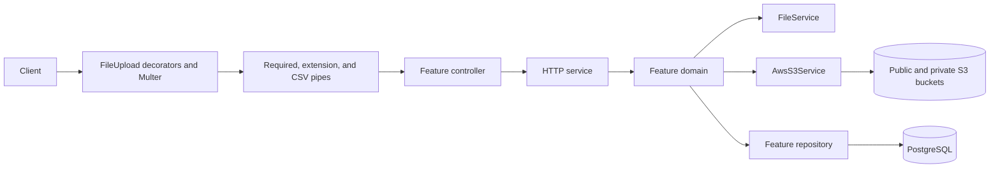
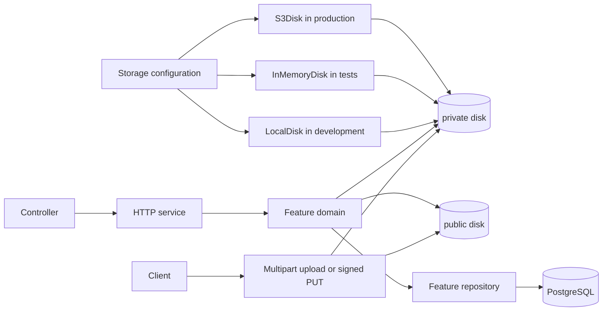
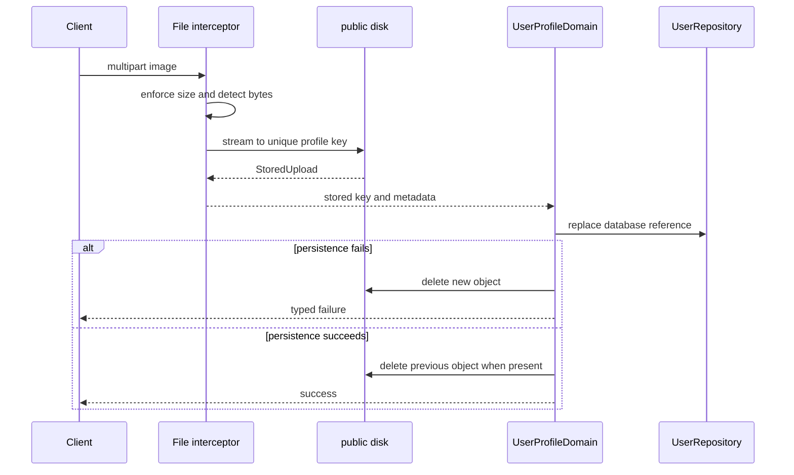
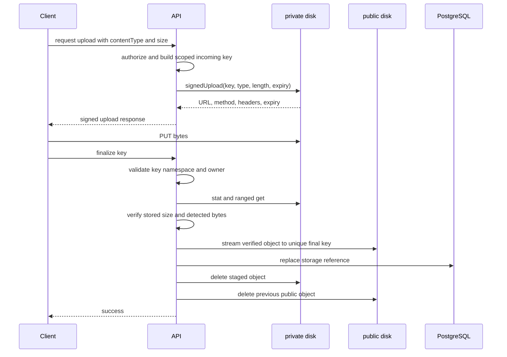

# File Storage Management Analysis and Overhaul

## Status

This document analyzes the current file and object-storage implementation and defines the target
architecture for a clean replacement. It is a design specification, not an implementation status
report.

The recommended design adopts the official NestJS `@nestjs/storage` package. HTTP file transport,
CSV processing, durable object storage, and feature business rules remain separate concerns.

The package API is part of this specification, not an interchangeable implementation detail. The
replacement uses `LocalDisk` in development, `S3Disk` for AWS S3 and Cloudflare R2 in production,
`InMemoryDisk` in ordinary tests, `@InjectDisk()` for feature dependencies, and the framework's
`signedUrl()`, `signedUpload()`, `uploadToDisk()`, `serveFile()`, `serveSignedUrl()`, and
`receiveSignedUpload()` helpers. No application wrapper reimplements those capabilities.

## Table of Contents

- [Goals](#goals)
- [Scope](#scope)
- [Executive Summary](#executive-summary)
- [Current Architecture](#current-architecture)
    - [Shared file kit](#shared-file-kit)
    - [S3 storage service](#s3-storage-service)
    - [Feature consumers](#feature-consumers)
    - [Persistence](#persistence)
    - [Configuration and operations](#configuration-and-operations)
    - [Tests](#tests)
- [Assessment](#assessment)
    - [What works well](#what-works-well)
    - [Findings](#findings)
- [Target Architecture](#target-architecture)
    - [Package compatibility and version policy](#package-compatibility-and-version-policy)
    - [Responsibility boundaries](#responsibility-boundaries)
    - [Named disks](#named-disks)
    - [Module placement](#module-placement)
    - [Storage records](#storage-records)
    - [HTTP contracts](#http-contracts)
- [Target Flows](#target-flows)
    - [Multipart profile-photo upload](#multipart-profile-photo-upload)
    - [Direct signed upload](#direct-signed-upload)
    - [Term-policy content](#term-policy-content)
    - [Downloads and generated exports](#downloads-and-generated-exports)
    - [Local storage HTTP transport](#local-storage-http-transport)
    - [Deletion and replacement](#deletion-and-replacement)
- [Configuration and Infrastructure](#configuration-and-infrastructure)
- [Cleanup and Simplification](#cleanup-and-simplification)
- [Implementation Sequence](#implementation-sequence)
- [Test Strategy](#test-strategy)
- [Acceptance Criteria](#acceptance-criteria)
- [Risks and Tradeoffs](#risks-and-tradeoffs)
- [References](#references)

## Goals

- Provide one provider-neutral storage API for local development, automated tests, and production.
- Stream ordinary uploads instead of holding complete files in application memory.
- Treat every direct upload as untrusted until the application verifies the stored object.
- Keep public and private assets physically separated by disk and bucket.
- Store stable object identity in PostgreSQL and derive environment-specific URLs at read time.
- Make object replacement, publication, and failure cleanup explicit.
- Remove custom S3 mechanics already supplied by NestJS.
- Preserve CSV import, CSV/PDF export, typed application exceptions, and the repository layering model.
- Make the storage surface straightforward to test without AWS credentials or network access.
- Use the official package's atomic writes, streamed bodies, typed errors, signing, content
  detection, range support, retry, multipart, and test-disk capabilities instead of recreating
  them locally.

## Scope

The analysis starts at `src/common/file/` and follows every connected runtime surface:

- `src/common/file/` upload decorators, pipes, DTOs, exceptions, enums, and `FileService`.
- `src/common/aws/` S3 module, service, interfaces, DTOs, configuration, and exceptions.
- `src/common/response/` generated file downloads.
- User profile-photo multipart and presigned-upload flows.
- Term-policy content upload, publication, download, and deletion flows.
- Storage-related health indicators and migration seeders.
- Storage columns in `UserPhoto` and `TermPolicyContent`.
- Environment validation, dependencies, unit tests, and e2e coverage.

SES remains an AWS integration, but its behavior is outside the storage redesign. The work only
separates it from S3-specific module wiring that becomes obsolete.

## Executive Summary

The current implementation contains two different concepts under adjacent shared modules.
`src/common/file/` handles HTTP multipart parsing, byte validation, CSV conversion, and download
formatting. `src/common/aws/` implements an S3 client and also acts as the durable storage API.
The boundary works for the existing S3 deployment, but it makes features depend on a provider,
duplicates framework storage behavior, and leaves important upload-finalization checks to the
client.

The most important issue is the direct-upload completion flow. The API creates a presigned PUT
URL, then accepts a client-provided `key` and `size` and converts those values into a database
record with `AwsS3Service.mapPresign()`. Completion does not prove that the object exists, that it
was created for the current actor and workflow, what size storage actually holds, or whether its
bytes match the accepted media type. Profile-photo signed uploads also target the public bucket, so
unverified content can become publicly reachable before completion.

The target architecture uses `@nestjs/storage` with two named disks:

- `private` is the default disk and receives direct uploads under an `incoming/` prefix.
- `public` contains assets that completed feature validation and may be served through a public
  URL or CDN.

Local disks provide a complete development environment, in-memory disks isolate tests, and
S3-compatible object-store disks back production. Feature domains inject the named disks and
retain ownership of keys, authorization, validation, persistence, promotion, and cleanup. The
shared file kit continues to own multipart transport and CSV/download concerns, but it no longer
implements object storage.

AWS S3 is the default production profile. Cloudflare R2 is an explicitly supported alternative
through the same `S3Disk` implementation with an R2 endpoint and `region: 'auto'`; it is not a
separate application driver or code path.

The replacement is a direct transition. The boilerplate has no compatibility requirement, so the
new design removes S3-shaped DTOs, route names, database columns, and service methods instead of
carrying adapters or deprecated aliases.

## Current Architecture



### Shared file kit

`FileModule.forRoot()` is global and exports `FileService`. The service currently combines:

- Semicolon-delimited CSV serialization and parsing through Papa Parse.
- Random storage-key generation.
- Extension, filename, and MIME extraction.
- Download-filename sanitization.
- File-signature detection through `file-type`.

The upload decorators wrap Nest's Express/Multer interceptors and attach OpenAPI metadata and
typed file-error responses:

- `FileUploadSingle()` uses `FileInterceptor`.
- `FileUploadMultiple()` uses `FilesInterceptor`.
- `FileUploadMultipleFields()` uses `FileFieldsInterceptor`.
- `FileUploadErrorInterceptor` translates Multer and Busboy messages into application
  exceptions.

The pipe chain handles required files, declared extensions, magic-byte detection, CSV parsing,
row limits, and row-schema validation. This follows Nest's pipe-based validation model and keeps
controllers limited to delegation.

`ResponseFileInterceptor` is a separate outbound concern. It converts a completed CSV string or
PDF buffer into `StreamableFile`, enforces the configured response-size limit, builds a safe
`Content-Disposition` header, and attaches the standard response metadata.

### S3 storage service

`AwsS3Service` is a large provider-specific service with four distinct responsibilities:

1. Runtime object operations such as get, put, list, copy, and delete.
2. Direct-upload and multipart signature generation.
3. URL and metadata construction.
4. Bucket control-plane changes for CORS, lifecycle, policies, ownership, and public access.

It constructs `S3Client` directly from long-lived application configuration. Nearly every
method checks whether credentials initialized the client and returns `null`, an empty collection,
or no value when S3 is disabled. `mapPresign()` is the exception: it reads bucket configuration
without the initialization guard, which is why the disabled-S3 e2e path returns an application 500.

The service derives content type from the object-key extension. Stored-object responses expose
S3 bucket, access level, completed URL, optional CDN URL, extension, MIME type, and size.

### Feature consumers

#### User profile photos

The user module provides two upload styles:

- `POST /shared/user/profile/photo/upload` buffers a multipart image, validates its extension and
  bytes, creates an S3 key, writes the buffer to the public bucket, and persists the returned S3
  metadata.
- `POST /shared/user/profile/photo/presign/generate` creates a public-bucket PUT URL.
  `PUT /shared/user/profile/photo/update` then trusts the submitted key and size and persists a
  mapped S3 record.

Neither path deletes the previous profile-photo object after a successful replacement. The
multipart path also leaves the new object behind if persistence fails after the upload.

#### Term-policy content

Term-policy content uses private presigned uploads and later copies objects into the public bucket
when a policy is published. Add, update, and create operations convert client-submitted keys and
sizes with `mapPresign()` without checking stored objects.

Publication calls `copyItems()`, which uses `Promise.allSettled()` and returns only successful
copies. A partial copy can therefore become a shorter `newContents` array without raising the
provider failures that caused the missing entries. Policy deletion runs the database delete and
directory delete concurrently, so either side can succeed while the other fails.

Template seeders load Handlebars files into buffers, upload them privately, and copy them to the
public bucket. The storage calls are embedded in four nearly identical import methods.

### Persistence

`UserPhoto` and `TermPolicyContent` store a provider-shaped snapshot:

| Column         | Characteristic                                     |
| -------------- | -------------------------------------------------- |
| `bucket`       | S3 deployment detail                               |
| `key`          | Stable object identity                             |
| `cdnUrl`       | Derived from environment configuration             |
| `completedUrl` | Derived from environment configuration             |
| `mime`         | Derived from the filename rather than stored bytes |
| `extension`    | Derivable from the key or content type             |
| `access`       | Public/private bucket selection                    |
| `size`         | Present only on term-policy content                |

Persisting URLs makes a database row stale when a bucket hostname, CDN hostname, or storage
provider changes. Exposing those columns through `AwsS3ResponseSchema` also leaks provider
details into unrelated user, workspace, device, and term-policy response contracts.

### Configuration and operations

S3 configuration is part of `aws.config.ts` and uses custom credential variable names. The
bucket fields are nullable at the configuration boundary but asserted into non-null runtime
interfaces. This allows partially populated configuration to survive boot and fail later in a
request.

`MigrationAwsS3ConfigSeed` changes bucket policy, CORS, lifecycle, ownership, and public-access
settings. These are deployment infrastructure concerns rather than application seed data. The
lifecycle rule aborts incomplete multipart uploads, but it does not expire completed objects that
were uploaded to a staging prefix and never finalized.

The AWS health endpoint checks both S3 buckets and SES. That grouping assumes storage is always
AWS-backed and does not fit local or another S3-compatible driver.

### Tests

The file pipes and service have focused unit coverage. `AwsS3Service` tests mock the SDK command
dispatcher and cover a broad method surface, but they verify command construction rather than a
portable storage contract. The test suite does not currently exercise the user multipart upload,
signed upload, object promotion, or cleanup against a functioning storage backend. The e2e suite
records the disabled-S3 `mapPresign()` failure and leaves the real upload scenarios as TODO cases.

## Assessment

### What works well

- Controllers delegate to HTTP services and domains instead of performing storage work inline.
- Multipart limits are applied before feature logic.
- Upload transport errors are translated into typed application exceptions.
- Image uploads compare the declared extension with detected bytes.
- CSV rows are validated through the normal request schemas and collect all row failures.
- Public and private objects already use separate buckets.
- Presigned URLs keep large direct-upload bodies away from the API process.
- Download filenames are sanitized before entering response headers.
- Storage health is represented in the existing Terminus health surface.

These behaviors remain requirements of the replacement even where their implementation changes.

### Findings

| Priority | Finding                                                         | Consequence                                                                                                         | Target treatment                                                                                     |
| -------- | --------------------------------------------------------------- | ------------------------------------------------------------------------------------------------------------------- | ---------------------------------------------------------------------------------------------------- |
| Critical | Direct-upload completion trusts `key` and `size`                | Missing, foreign, oversized, or invalid objects can be persisted; profile content can be public before verification | Stage privately, bind keys to actor/workflow, verify with `stat()` and byte inspection, then promote |
| High     | Storage metadata is created by `mapPresign()` without I/O       | Database state can refer to an object that was never uploaded                                                       | Remove mapping-only completion; storage metadata comes from the stored object                        |
| High     | `AwsS3Service` mixes data plane and bucket control plane        | Large blast radius, provider lock-in, and difficult tests                                                           | Use `StorageDisk` for runtime operations and deployment infrastructure for bucket policy             |
| High     | Multipart profile uploads buffer whole files                    | Per-request memory grows with upload concurrency                                                                    | Use `uploadToDisk()` streaming storage engine for images                                             |
| High     | Replacement and failure cleanup are incomplete                  | Public and private buckets accumulate orphaned objects                                                              | Define compensation ordering and lifecycle cleanup                                                   |
| High     | `copyItems()` hides individual failures                         | A published policy can lose localized content                                                                       | Treat any copy failure as a failed publication and delete completed copies                           |
| High     | S3 configuration can be partially initialized                   | Failures appear during requests instead of application startup                                                      | Validate the selected driver and all required disk settings at boot                                  |
| Medium   | Provider URLs and bucket details are persisted and returned     | Environment changes require data updates and API consumers learn infrastructure details                             | Persist disk and key; derive URLs at response time                                                   |
| Medium   | Content type comes from the key extension                       | Metadata can disagree with stored bytes                                                                             | Use detected type for streamed images and verified metadata for finalized uploads                    |
| Medium   | Static credential fields bypass standard deployment conventions | Session credentials and role-based deployments require custom work                                                  | Use standard AWS variables or an injected rotating credential function                               |
| Medium   | S3 and SES share one module and health group                    | Storage cannot switch drivers independently                                                                         | Separate storage module and readiness check; leave SES under AWS                                     |
| Medium   | Bucket policy mutations are seed commands                       | Application releases can mutate infrastructure with broad permissions                                               | Provision policies, encryption, lifecycle, and CORS outside application seeds                        |
| Medium   | The shared file surface contains unused primitives              | More DTOs, enums, methods, and tests move with every change                                                         | Delete unconsumed members after the new flows land                                                   |
| Low      | Multiple-file OpenAPI schemas describe a single binary string   | Generated clients can receive an inaccurate multipart contract                                                      | Emit array schemas for multiple fields if those decorators remain                                    |
| Low      | CSV parsing ignores parser errors                               | Malformed CSV can reach row validation in an ambiguous form                                                         | Convert parser errors into the existing typed import-error surface                                   |

## Target Architecture



### Package compatibility and version policy

`@nestjs/storage` is new and still pre-1.0. The implementation pins the reviewed package release
exactly rather than accepting an unreviewed API change through a broad range. At the time of this
design the reviewed release is `0.0.3`, whose peer range requires `@nestjs/common` and
`@nestjs/core` `^12.1.0`. This repository currently declares `^12.0.3`, so the storage change also
updates the aligned Nest runtime, platform, testing, CLI, and schematics packages to a compatible
12.x minor. A peer-dependency override is not an acceptable substitute.

The lockfile records the exact transitive graph. Future `@nestjs/storage` upgrades review the
official changelog/source and rerun the local, memory, S3-compatible, signing, and HTTP-helper
contract tests before changing the pin.

### Responsibility boundaries

| Concern                                             | Owner                                                             |
| --------------------------------------------------- | ----------------------------------------------------------------- |
| Multipart parsing and request limits                | Nest platform interceptor composed by the file decorator          |
| Streaming a multipart body to storage               | `uploadToDisk()`                                                  |
| Local public and signed HTTP transport              | `serveFile()`, `serveSignedUrl()`, `receiveSignedUpload()`         |
| CSV parsing and row validation                      | `src/common/file/`                                                |
| Disk creation and driver selection                  | `src/common/storage/` with `LocalDisk`, `S3Disk`, `InMemoryDisk`   |
| Key namespace and accepted content                  | Owning feature domain and constants                               |
| Direct-upload authorization and finalization        | Owning feature domain                                             |
| Object reference persistence                        | Owning feature repository                                         |
| Public or signed response URL                       | HTTP service through `url()` or `signedUrl()`                      |
| Bucket policy, CORS, lifecycle, encryption, and IAM | Deployment infrastructure                                         |
| Generated CSV/PDF download                          | Existing response interceptor                                     |

Feature domains inject both disks explicitly so a future default-disk change cannot alter a
visibility boundary:

```ts
constructor(
    @InjectDisk(EnumStorageDisk.public)
    private readonly publicDisk: StorageDisk,
    @InjectDisk(EnumStorageDisk.private)
    private readonly privateDisk: StorageDisk
) {}
```

The default disk remains `private` as defense in depth, but visibility-sensitive application code
still uses `@InjectDisk()` explicitly. The `Storage` registry and `storage.disk(reference.disk)` are
used only by shared response mapping that genuinely selects a persisted disk at runtime.

A project-specific facade that duplicates `put()`, `get()`, `stat()`, `exists()`, `delete()`,
`copy()`, `move()`, `url()`, `signedUrl()`, or `signedUpload()` adds no policy and is omitted.
Feature methods add authorization, key ownership, compensation, and application-error mapping.

### Named disks

#### `private`

- Default disk.
- Private bucket in production.
- Signed downloads only.
- Direct uploads first land under `incoming/<feature>/<owner-or-subject>/...`.
- An object is considered untrusted while it remains under `incoming/`.
- A lifecycle rule expires abandoned `incoming/` objects after one day.
- A lifecycle rule aborts incomplete multipart uploads after one day.
- `signedUrl()` is the only application API that produces a private download link.
- `signedUpload()` is the only application API that produces a direct-upload link.

#### `public`

- Public bucket or CDN-backed bucket in production.
- Holds profile photos and published term-policy content.
- Keys are immutable and unique so browsers and CDNs can cache them safely.
- Public URLs are created with `disk.url(key)` at response-mapping time.
- Public writes set an immutable cache policy; private objects never receive public cache headers.

The disk name expresses visibility. Per-object access flags are removed because they permit a
single incorrect value to expose an object in the wrong security boundary.

### Module placement

`src/common/storage/` contains only provider-neutral storage wiring:

```text
src/common/storage/
├── constants/storage.constant.ts
├── enums/storage.enum.ts
├── factories/storage.options.factory.ts
└── storage.module.ts
```

`StorageMainModule` imports `StorageModule.forRootAsync()` once and is imported by `CommonModule`.
The extra project module is composition only; it has no `forRoot()` API and no storage facade.
The official module is global by default, so feature modules do not import it individually.

The options factory returns concrete disk instances and a private default:

```ts
return {
    default: EnumStorageDisk.private,
    disks: {
        [EnumStorageDisk.public]: publicDisk,
        [EnumStorageDisk.private]: privateDisk,
    },
};
```

For a local driver, the factory creates two isolated `LocalDisk` roots. The public disk has a
`publicUrl` targeting the application public-file route. The private disk has `signedUrls` with
the application signed-file route and an ordered signing-key array. The first key signs new URLs;
all keys verify old URLs during rotation. Each key is at least 32 characters.

```ts
const publicDisk = new LocalDisk({
    root: `${root}/public`,
    publicUrl: `${publicAppUrl}/api/storage/public`,
});
const privateDisk = new LocalDisk({
    root: `${root}/private`,
    signedUrls: {
        baseUrl: `${publicAppUrl}/api/storage/files`,
        keys: signingKeys,
    },
});
```

For an object-store driver, the factory creates two `S3Disk` instances. AWS S3 omits `endpoint`;
R2 supplies its account endpoint and `region: 'auto'`; MinIO is test-only and additionally sets
`forcePathStyle: true`. The public disk alone receives `publicUrl`. Neither object-store disk uses
the local `signedUrls` option because the object store verifies its own presigned requests.

```ts
const shared = {
    region,
    endpoint: provider === EnumStorageS3Provider.r2 ? endpoint : undefined,
    retry: retryAttempts,
    timeout: timeoutInMs,
    multipart: { partSize: multipartPartSizeInBytes, concurrency: multipartConcurrency },
    batchDelete: true,
    ...(provider === EnumStorageS3Provider.aws && kmsKeyId
        ? { serverSideEncryption: 'aws:kms' as const, kmsKeyId }
        : {}),
};
const publicDisk = new S3Disk({ ...shared, bucket: publicBucket, publicUrl });
const privateDisk = new S3Disk({ ...shared, bucket: privateBucket });
```

`S3Disk` reads `AWS_ACCESS_KEY_ID`, `AWS_SECRET_ACCESS_KEY`, and optional `AWS_SESSION_TOKEN` by
default. A `credentials` function is supplied only when the deployment uses a rotating source.

`src/common/file/` remains global for reusable transport and conversion behavior. Its final
surface consists of:

- Buffered single-file transport for CSV import.
- Streamed single-file transport composition for stored uploads.
- Local-disk controllers that compose the official serving and signed-upload helpers.
- Typed multipart error translation.
- CSV parse and row-validation pipes.
- CSV serialization and safe download filename helpers.
- File import/export exceptions and response documentation.

Feature-specific accepted content types, size limits, key paths, and cache-control values live in
their owning feature. The common module does not learn user or term-policy paths.

### Storage records

The durable reference contains only data that remains meaningful when the driver, bucket, or
hostname changes.

```ts
interface IStorageReference {
    disk: EnumStorageDisk;
    key: string;
    contentType: string;
}
```

`TermPolicyContent` retains `size` because content size is already part of that domain record.
`UserPhoto` does not require a new size column. A fresh size is available from `stat()` when a
workflow needs it.

Prisma owns the persisted disk enum:

```prisma
enum EnumStorageDisk {
  public
  private
}
```

The data migration performs these mappings:

| Existing value                | Target value     |
| ----------------------------- | ---------------- |
| `access = public`             | `disk = public`  |
| `access = private`            | `disk = private` |
| `mime`                        | `contentType`    |
| `key`                         | `key`            |
| `size` on term-policy content | `size`           |

After the backfill, `bucket`, `cdnUrl`, `completedUrl`, `mime`, `extension`, and `access` are
removed. The migration changes stored rows but does not move objects between existing buckets;
the logical disk mapping points to those buckets.

Response mapping resolves a URL from the stored disk and key. Public records use `url()`. Private
records use a short-lived `signedUrl()` only on an authorized download request. A private URL is
never stored in PostgreSQL or embedded in a long-lived response record.

### HTTP contracts

#### Signed upload creation

Request:

```json
{
    "contentType": "image/png",
    "size": 204800
}
```

Response data:

```json
{
    "key": "incoming/user-profile/<user-id>/<uuid>",
    "url": "https://storage.example.com/...",
    "method": "PUT",
    "headers": {
        "content-type": "image/png"
    },
    "expiresAt": "2026-10-06T15:00:00.000Z"
}
```

The response replaces `presignUrl` and `expiredInSeconds` with the provider-neutral shape returned
by `privateDisk.signedUpload(key, { contentType, contentLength: size, expiresIn: '10m' })`. The
required HTTP method and headers are explicit and must be sent unchanged by the client. Both S3 and
the local `receiveSignedUpload()` route reject a different content type or body length.

#### Signed upload completion

Request:

```json
{
    "key": "incoming/user-profile/<user-id>/<uuid>"
}
```

The client does not send size, content type, bucket, disk, URL, or extension at completion. The
domain reads authoritative metadata from storage.

The signed transport enforces the exact type and length declared at upload creation. Completion
does not recreate that signing contract or persist a custom upload-session table: it independently
checks the feature key namespace, object existence, actual size against the feature limit, and
detected bytes. Final object keys are deterministic from the unguessable staging UUID, making a
concurrent retry target the same object rather than create additional public orphans. Once staging
is deleted, a later retry returns the feature's typed consumed-or-missing upload response.

#### Stored file response

Public API responses use a provider-neutral shape:

```json
{
    "key": "users/<user-id>/profile/<uuid>.png",
    "url": "https://cdn.example.com/users/.../photo.png",
    "contentType": "image/png"
}
```

Bucket names, storage access flags, raw object endpoints, and CDN configuration do not enter the
HTTP contract.

Private download responses use the same provider-neutral URL field, but it is returned only by an
authorized download operation and is produced with:

```ts
await privateDisk.signedUrl(key, {
    expiresIn: '5m',
    filename,
    disposition: 'attachment',
});
```

Signed URLs are never stored, cached in durable response records, or logged. They cannot be revoked
individually, so their lifetime stays short.

#### Route shape

The user profile surface becomes:

| Method and path                           | Behavior                                                            |
| ----------------------------------------- | ------------------------------------------------------------------- |
| `POST /shared/user/profile/photo`         | Stream a multipart image to storage and set it as the profile photo |
| `POST /shared/user/profile/photo/uploads` | Create a private signed upload                                      |
| `PUT /shared/user/profile/photo`          | Verify and finalize a signed upload                                 |

The old `/upload`, `/presign/generate`, and `/update` suffixes are removed. No compatibility routes
or deprecated DTOs remain.

Term-policy routes use the same `content/uploads` vocabulary for signed-upload creation. Existing
add, update, create, publish, and authorized-download operations remain business operations, but
their request and response schemas use provider-neutral upload and object shapes.

## Target Flows

### Multipart profile-photo upload



`uploadToDisk()` receives the public disk name, accepted image content types, immutable cache
control, and a feature-owned UUID key callback. The Multer interceptor retains explicit `fileSize`
and `files: 1` limits. The storage engine detects the type from bytes, rejects mismatches before a
file is committed, performs an atomic write, and returns `StoredUpload`. Feature code uses
`StoredUpload.contentType`, never the client-claimed `mimetype`.

The storage engine has already written the object when the domain runs. The domain therefore owns
compensation: a database failure deletes the new object. The previous object is deleted only after
the new reference commits, so a deletion failure cannot leave the user pointing at a missing
photo.

### Direct signed upload



Creation validates the announced content type and size before calling `privateDisk.signedUpload()`.
The signature binds the PUT to that type and length. Completion still treats the declared type as
a client claim and validates the stored bytes again.

The completion key has an exact feature and owner prefix. A profile-photo completion for one user
cannot finalize another user's upload or a private term-policy object. The remaining key component
uses a generated UUID rather than client input.

For supported image formats, completion calls `stat()`, reads only the leading range with `get({
range })`, and calls the package's `detectContentType()`. The final key reuses the staging UUID with
the verified extension, so concurrent retries target the same immutable identity. The complete
`get().body` stream is passed directly to `publicDisk.put()` with verified `contentType`, exact
`contentLength`, immutable cache control, and an abort signal where the request lifecycle provides
one. Cross-disk promotion never buffers the whole object and does not call `copy()`, which is a
same-disk operation.

Failure before the database update deletes any newly created public object and leaves the previous
database reference intact. Failure after a successful database update retains the new reference.
Staging or previous-object deletion failures are logged and measured for retry; they do not turn
already-committed business state into a failed HTTP response.

### Term-policy content

Term-policy uploads use the private disk for both staging and draft storage:

1. Upload creation builds `incoming/term-policy/<type>/<version>/<language>/<uuid>`.
2. Add, update, or create validates that the key belongs to the declared type, version, and
   language.
3. The domain verifies existence and stored size, reads the bounded text with `getText()`, confirms
   valid UTF-8, and validates that Handlebars can compile it before calling `privateDisk.move()` to
   the draft key.
4. PostgreSQL stores the private disk, final draft key, content type, language, and size.
5. Publication promotes every draft object to a unique public key and requires the number of
   promoted objects to equal the number of localized contents.
6. The database publication transaction begins only after all promotions succeed.
7. A failed database transaction deletes the new public writes.

Publication streams each private `get().body` to `publicDisk.put()` because package `copy()` and
`move()` operate within one disk. It never uses `Promise.allSettled()` to hide provider failures.
Parallel promotions may still run, but any rejected operation fails publication and triggers
cleanup of every successful public write.

Authorized draft downloads call `privateDisk.signedUrl()` with a short expiry. Published content
responses derive public URLs from `publicDisk.url()`.

### Downloads and generated exports

Stored-object downloads and generated exports remain distinct:

- Stored objects use public URLs, signed URLs, or `serveFile()` where application-served local
  storage is enabled.
- Generated CSV and PDF responses continue through `ResponseFileInterceptor` because they are
  request results rather than durable objects.

The export row cap remains the primary memory bound. The existing response-size limit remains a
backstop after the buffer has been produced. This overhaul does not persist generated exports.

CSV import remains buffered because parsing and validating every row requires the complete
document under the current Papa Parse integration. Its upload size and row-count caps keep that
bounded. Papa Parse errors are collected and returned through the typed import error path before
row-schema validation.

### Local storage HTTP transport

Local disks require application routes because there is no bucket or CDN to receive their URLs.
The routes stay registered in every environment; on S3/R2, signed URLs point at the object store
and the signed local helpers answer 404. The public route calls `serveFile()` only for `LocalDisk`
and otherwise returns 404, so production traffic cannot bypass the configured bucket/CDN URL and
proxy public objects through the API.

The storage transport controller is version-neutral and mounted directly under the global prefix
at stable `/storage/public/*` and `/storage/files` paths. Signed URLs therefore do not become
invalid merely because the business API version changes.

- The public-file route calls `serveFile(publicDisk, key, { req, res, disposition: 'inline' })`.
  It inherits range, ETag, conditional-request, content-length, cache-control, safe disposition,
  and `X-Content-Type-Options: nosniff` behavior from the package.
- The private GET route calls `serveSignedUrl(privateDisk, { req, res })`.
- The private PUT route calls `receiveSignedUpload(privateDisk, { req, res, maxSize })`.
- The PUT route receives the unread request stream. The existing request body parser must continue
  to bypass it; no JSON, text, or raw-body middleware may consume it first.
- Local `publicUrl` and `signedUrls.baseUrl` use an externally reachable configured application
  base URL, not the bind host, so `0.0.0.0`, reverse proxies, and HTTPS do not produce invalid links.

### Deletion and replacement

Object storage and PostgreSQL do not share a transaction. Ordering favors a valid database
reference over immediate physical cleanup:

| Operation            | Ordering                                                                                           |
| -------------------- | -------------------------------------------------------------------------------------------------- |
| Create new reference | Store and verify object, write database row, compensate object on database failure                 |
| Replace reference    | Store new object, update database, delete previous object                                          |
| Remove reference     | Remove database reference, then delete object                                                      |
| Publish objects      | Promote and verify objects, commit the database transaction, compensate successful writes          |

A failed post-commit delete produces an orphan rather than a broken reference. The application
returns the already-committed business result, records the cleanup failure, and retries cleanup;
it does not return an error that encourages the client to repeat a successful mutation. Staged
objects have automatic lifecycle expiry. Public orphans are observable through cleanup metrics or
a later reconciliation job if their rate justifies that additional machinery.

## Configuration and Infrastructure

The new `storage.config.ts` namespace contains driver and disk configuration. A representative
shape is:

```ts
interface IConfigStorage {
    driver: EnumStorageDriver;
    publicAppUrl: string;
    signedDownloadExpiredInSeconds: number;
    signedUploadExpiredInSeconds: number;
    local: {
        root: string;
        signingKeys: string[];
    };
    s3: {
        provider: EnumStorageS3Provider;
        endpoint: string | null;
        region: string;
        forcePathStyle: boolean;
        publicBucket: string;
        publicUrl: string;
        privateBucket: string;
        timeoutInMs: number;
        retryAttempts: number;
        multipartPartSizeInBytes: number;
        multipartConcurrency: number;
        serverSideEncryption: 'aws:kms' | null;
        kmsKeyId: string | null;
    };
}
```

Environment variables use storage terminology instead of S3 service terminology:

```text
STORAGE_DRIVER=local
STORAGE_PUBLIC_APP_URL=http://localhost:3000
STORAGE_LOCAL_ROOT=storage
STORAGE_SIGNING_KEYS=
STORAGE_SIGNED_DOWNLOAD_EXPIRED=5m
STORAGE_SIGNED_UPLOAD_EXPIRED=10m
STORAGE_S3_PROVIDER=aws
STORAGE_S3_ENDPOINT=
STORAGE_S3_REGION=
STORAGE_S3_FORCE_PATH_STYLE=false
STORAGE_PUBLIC_BUCKET=
STORAGE_PUBLIC_URL=
STORAGE_PRIVATE_BUCKET=
STORAGE_S3_TIMEOUT=30s
STORAGE_S3_RETRY_ATTEMPTS=3
STORAGE_S3_MULTIPART_PART_SIZE=8mb
STORAGE_S3_MULTIPART_CONCURRENCY=4
STORAGE_S3_SERVER_SIDE_ENCRYPTION=
STORAGE_S3_KMS_KEY_ID=
AWS_ACCESS_KEY_ID=
AWS_SECRET_ACCESS_KEY=
AWS_SESSION_TOKEN=
```

Validation is conditional:

- `local` requires an external application URL, a root from which the factory derives distinct
  public/private roots, and at least one signing key of 32 or more characters.
- `s3` requires an explicit `aws` or `r2` provider profile, region, distinct public/private
  buckets, public URL, bounded timeout/retry, and valid multipart settings.
- The application rejects a local driver in production.
- AWS S3 omits `endpoint` and path-style addressing.
- Cloudflare R2 uses `S3Disk` with its account endpoint, `region: 'auto'`, and no AWS KMS options.
- MinIO is test-only and uses its endpoint with `forcePathStyle: true`.
- Credentials use the standard AWS names supported by `S3Disk`. A rotating credential function
  can be injected when the deployment uses another source.

The factory sets `S3Disk` options explicitly: `timeout`, retry count/backoff, multipart part size
and concurrency, `batchDelete`, and—on AWS when configured—`serverSideEncryption` and `kmsKeyId`.
R2 always encrypts at rest. The public disk alone receives `publicUrl`; the private disk must throw
if code attempts `url()` rather than `signedUrl()`.

The local driver provides working uploads and signed URLs without AWS. Storage is therefore a
configured capability rather than an optional service that silently returns `null`.

Deployment infrastructure owns:

- Separate public and private buckets.
- Public bucket or CDN read policy.
- Private-bucket access denial.
- Server-side encryption and optional KMS key.
- Browser PUT CORS for the deployed web origins and `Content-Type` header.
- Expiration of `incoming/` objects after one day.
- Abort of incomplete multipart uploads after one day.
- Least-privilege object and list permissions for the application identity.

`MigrationAwsS3ConfigSeed` is removed. `MigrationTemplateTermPolicySeed` injects storage disks and
continues to create baseline term-policy content without changing bucket configuration.

Storage readiness uses a provider-neutral `HealthStorageIndicator`. It calls a bounded and timed
`list({ limit: 1 })` on each named disk. The required S3 `ListBucket` permission also lets missing
object checks return 404 instead of an ambiguous 403. The system health surface exposes a storage
check with `storagePublic` and `storagePrivate` details. The AWS health check retains SES only.

## Cleanup and Simplification

The transition removes obsolete S3 runtime code:

- `AwsS3Service` and its service spec.
- S3 interfaces, request/response DTOs, enums, constants, and exceptions under `src/common/aws/`.
- `@aws-sdk/client-s3`, `@aws-sdk/s3-request-presigner`, and `@smithy/types` when no remaining
  import requires them.
- `MigrationAwsS3ConfigSeed` and its module registration.
- `HealthAwsS3BucketIndicator` and its tests.
- S3-specific imports from user and term-policy modules.

`@nestjs/storage` already implements SigV4 over `fetch`, atomic local/object-store writes, bounded
multipart uploads, retry/backoff, ranges, conditional responses, batch deletion, key validation,
and local HMAC signing. The application does not retain AWS SDK code, custom presigning, multipart
session DTOs, storage key-shape guards, temporary-write handling, or provider response mapping for
those capabilities.

The AWS shared module is narrowed to SES. Its module name becomes `AwsSesModule`, and only modules
that inject `AwsSESService` import it. Storage wiring is global and independent of SES.

The file kit is reduced after all consumers move:

- Remove `createRandomFilename()` and `IFileRandomFilenameOptions`; feature keys use UUIDs and
  feature path builders.
- Remove image, audio, video, and template extension enums where content types or fixed feature
  constants replace them.
- Remove `FileExtensionContract`, `sniffExtensionFromBuffer()`, and the direct `file-type`
  dependency when `uploadToDisk()` owns image-byte detection.
- Replace the CSV extension chain with one CSV parse pipe that checks presence, size, filename,
  parser errors, and rows in a single ordered transport flow.
- Remove multiple-upload request DTOs and decorators because no route consumes them. A future
  multi-file route composes Nest's `FilesInterceptor` or `FileFieldsInterceptor` with the same
  storage engine when it has a concrete contract.
- Retain the typed multipart error interceptor and adapt it to storage-engine HTTP failures.
- Retain CSV/document extension values used by generated downloads.
- Retain safe filename and MIME resolution used by `ResponseFileInterceptor`.

Storage failures are mapped at the feature boundary rather than exposed as provider errors:

| Package error                           | Application treatment                                      |
| --------------------------------------- | ---------------------------------------------------------- |
| `StorageFileNotFoundError`              | Typed missing/consumed upload or content-not-found error   |
| `StorageInvalidKeyError`                | Typed invalid-upload/key response                          |
| `StorageBodyLengthError`                | Typed upload-size response                                 |
| `StorageRangeNotSatisfiableError`       | Typed range response where application-served              |
| `StorageKeyConflictError`               | Configuration/key-layout failure, logged without secrets   |
| `StorageSignedUrlError`                 | Typed invalid/expired signed-request response               |
| `StorageServiceError`                   | Typed storage-unavailable response plus safe provider data |

Logs never contain credentials, signatures, signed URLs, or request bodies. Provider operation,
safe error code, upstream status, and request ID may be retained for diagnosis.

The feature cleanup removes:

- `generatePhotoProfilePresign()` and `updatePhotoProfile()` naming in favor of upload creation
  and finalization.
- Client-supplied size in completion DTOs and feature interfaces.
- S3-shaped `IAwsS3` and `IAwsS3Presign` types.
- `mapPublicContent()` filename matching; promotion results remain paired with their source
  language by construction.
- Four duplicated term-policy template import methods; one private method receives policy type,
  template filename, and target language.
- Persisted and response-level `bucket`, `cdnUrl`, `completedUrl`, `mime`, `extension`, and
  `access` fields.
- The e2e test that codifies the disabled-S3 500 once the storage driver always initializes.

## Implementation Sequence

### Phase 1: Storage foundation

1. Upgrade the aligned NestJS 12 packages to satisfy the storage peer range, pin the reviewed
   `@nestjs/storage` release, and update the lockfile.
2. Add the storage configuration namespace and concrete `LocalDisk`/`S3Disk` options factory,
   including AWS and R2 profiles.
3. Create the global storage module with explicit public/private names and a private default.
4. Add the local `serveFile()`, `serveSignedUrl()`, and `receiveSignedUpload()` controller routes.
5. Add configuration and boot tests, including conditional environment validation.
6. Add the provider-neutral storage enum, reference interface, DTOs, and typed storage error
   mappings.
7. Add the provider-neutral readiness indicator.

This phase does not route production features through the new disks yet. It establishes the
contract and proves each environment can boot.

### Phase 2: Profile photos

1. Write failing domain and e2e tests for streamed multipart upload, signed staging, finalization,
   wrong-owner keys, invalid bytes, signed length mismatch, and cleanup.
2. Replace the three profile-photo routes and DTOs with the target contracts.
3. Stream multipart uploads with `uploadToDisk()` and consume `StoredUpload.contentType`.
4. Implement `privateDisk.signedUpload()` creation and verified streamed promotion.
5. Replace custom download/presign mapping with `publicDisk.url()` and
   `privateDisk.signedUrl()`.
6. Derive public photo URLs while mapping user responses and CSV exports.

### Phase 3: Term-policy content

1. Write failing tests for staged template validation, private draft storage, complete publication,
   compensation, signed download, and deletion ordering.
2. Replace S3 DTOs and interfaces in term-policy services and domains.
3. Implement verified finalization, private `move()`, native `signedUrl()`, and streamed all-or-fail
   cross-disk publication.
4. Move the template seeder to the private and public disks and consolidate its duplicated methods.

### Phase 4: Persistence migration

1. Add `EnumStorageDisk` and the provider-neutral columns to Prisma.
2. Generate the SQL migration that backfills disk and content type before dropping old columns.
3. Update repository write shapes, selects, response schemas, fixtures, and tests.
4. Run `pnpm db:generate` and validate the generated client.
5. Hand `pnpm db:migrate` to the owner because it opens the database and applies the data-changing
   migration.

The application code and schema migration deploy together. There is no dual-read, dual-write, or
deprecated response interval.

### Phase 5: Removal and operations

1. Remove `AwsS3Service`, S3 types, S3 DTOs, SDK dependencies, obsolete file helpers, and old tests.
2. Narrow the AWS module to SES.
3. Remove the S3 configuration seeder.
4. Apply bucket CORS, encryption, IAM, and lifecycle policies through deployment infrastructure.
5. Update durable file-upload, environment, project-structure, health, and third-party integration
   documentation to describe the implemented final state.

## Test Strategy

### Storage module

- Local factory creates two isolated `LocalDisk` roots and produces public and signed URLs.
- AWS factory creates two `S3Disk` instances without a custom endpoint.
- R2 factory creates two `S3Disk` instances with the account endpoint and `region: 'auto'`.
- MinIO contract setup uses `S3Disk` with `forcePathStyle: true`.
- Missing selected-driver configuration fails during module initialization.
- Production with a local driver fails during module initialization.
- Each named disk resolves through `@InjectDisk()`; an unconfigured name fails at boot.
- A private disk cannot produce a public `url()`.
- Local signing accepts the current and rotating previous key, rejects altered/expired URLs, and
  uses the first configured key for new signatures.
- Storage errors map to the appropriate typed application exceptions without exposing provider
  credentials or signed URLs in logs.

### Local HTTP helpers

- `serveFile()` preserves content type, length, ETag, range, conditional, cache, disposition, and
  `nosniff` behavior.
- `serveSignedUrl()` accepts an unmodified valid link and rejects changed key, expiry, filename,
  method, or signature.
- `receiveSignedUpload()` receives the unread PUT stream and enforces the signed content type and
  exact length.
- The signed helper routes return 404 when the selected disk is S3/R2 and the signed URL targets
  the object store instead.

### Multipart upload

- A valid JPEG or PNG is streamed to the public disk and persisted.
- A file whose declared type differs from its bytes is rejected and leaves no object.
- A file over the configured limit is rejected with the typed size exception and leaves no object.
- A missing or unexpected multipart field produces the existing typed error envelope.
- A repository failure deletes the new object.
- A successful replacement deletes the previous object after the new reference commits.

### Signed upload

- Creation rejects unsupported content types, zero or excessive sizes, and unauthorized subjects.
- The returned signature binds content type and length.
- Completion rejects an absolute, malformed, foreign-feature, or other-user key.
- Completion rejects a key that does not exist.
- The local/S3 signed PUT rejects a body length or content type different from the creation
  contract; completion independently rejects an oversized object or invalid detected byte type and
  deletes invalid staging data.
- Successful completion promotes the object, persists authoritative metadata, deletes staging,
  and removes the previous object.
- Repeating completion for an already consumed staging key returns the feature's typed invalid
  upload response.
- Concurrent completion targets the same deterministic final key and cannot create multiple public
  identities.

### Term-policy content

- Invalid UTF-8 and invalid Handlebars fail before a draft reference is stored.
- Language, policy type, and version have to match the staging key namespace.
- Draft downloads use short-lived private signed URLs.
- Publication with any failed promotion does not change policy state and removes completed writes.
- Successful publication writes every language and exposes public URLs.
- Deletion removes the database references before object cleanup.

### Persistence and response mapping

- Migration maps every existing access value to the corresponding disk.
- Every migrated row retains its object key and content type.
- User, workspace, device, export, and term-policy responses contain the provider-neutral file
  shape.
- Changing the configured public URL changes new responses without updating database rows.
- Private records never serialize a durable direct object URL.

### CSV and generated files

- Existing CSV delimiter, null-cell, row-limit, and schema-validation behavior remains intact.
- CSV parser errors produce typed row/import errors.
- CSV and PDF downloads preserve content type, safe disposition, metadata headers, and size caps.

### Verification gate

Implementation completion includes:

```bash
pnpm test <path-fragment>
pnpm typecheck
pnpm lint
pnpm spell
pnpm test
pnpm build
pnpm start:dev
```

S3-specific behavior is verified separately against MinIO through `S3Disk`, including presigned
PUT/GET, multipart, retry, ranges, list, and batch-delete semantics. R2 receives factory/configuration
coverage because it uses the same protocol and disk implementation. Normal unit and e2e suites
override `STORAGE_MODULE_OPTIONS` with named `InMemoryDisk` instances, so they require no network or
cloud credentials. A focused `LocalDisk` suite uses a temporary directory to cover filesystem and
application-served signing behavior.

## Acceptance Criteria

- Application features contain no import from S3 request/response DTOs or `AwsS3Service`.
- Development, test, and production use the same `StorageDisk` contract.
- Features inject visibility-specific disks with `@InjectDisk()`; the default disk is private.
- Development uses `LocalDisk`, ordinary tests use `InMemoryDisk`, and AWS/R2 production profiles
  use `S3Disk`.
- Profile multipart uploads stream to storage and do not expose full file buffers to feature code.
- Direct uploads remain private until the API verifies and promotes them.
- Completion trusts no client-supplied object metadata beyond the scoped staging key.
- Feature domains enforce key ownership and content rules before persistence.
- PostgreSQL stores disk, key, and verified content type rather than provider URLs and buckets.
- Public URLs and private signed URLs are derived when responses are built.
- Private downloads use `privateDisk.signedUrl()` and direct uploads use
  `privateDisk.signedUpload()`; no custom signing code remains.
- Local public files, signed downloads, and signed uploads use `serveFile()`, `serveSignedUrl()`,
  and `receiveSignedUpload()` with unread request streams.
- Partial term-policy publication cannot commit.
- Object cleanup behavior is defined for persistence, promotion, replacement, and deletion
  failures.
- Bucket policies and lifecycle rules are absent from application seeders.
- Storage tests run through in-memory disks; provider integration tests cover `S3Disk` behavior.
- Obsolete SDK dependencies, S3 code, unused upload primitives, and stale tests are removed.
- The application boots successfully after module-wiring changes.

## Risks and Tradeoffs

### Official package maturity

`@nestjs/storage` is the official NestJS integration and matches this repository's NestJS 12
baseline after the aligned Nest packages meet its peer range, but it is newer than the custom S3
service and remains pre-1.0. The manifest pins the reviewed release rather than taking an
unreviewed API change, the lockfile pins its graph, and contract tests cover every disk method and
HTTP helper the application relies on. An upgrade reads the official release notes/source and
reruns local, memory, and S3 integration coverage.

### Direct transition

Removing S3-shaped response fields and route suffixes is intentionally breaking. The repository is
a boilerplate without external consumers, so carrying compatibility code would make the starter
more complex for every future project. The schema migration and application changes deploy as one
unit.

### Cross-system consistency

Storage and PostgreSQL cannot commit atomically. Compensation reduces inconsistency but cannot
make it impossible during process termination or provider outages. The chosen ordering preserves
valid database references first and accepts recoverable orphaned objects as the safer failure
mode. Staging lifecycle rules bound private orphans; metrics determine whether a public-object
reconciliation job is later warranted.

### Local signed routes

Local disks require application routes for public files, signed downloads, and direct PUT uploads.
Production S3/R2 public and signed URLs bypass those routes. The routes remain registered in all
environments; signed helpers answer only when the selected disk uses application-served signatures.
The PUT route must retain an unread body stream, and externally generated URLs come from configured
public application/CDN URLs rather than the server bind address.

### S3-compatible provider differences

`S3Disk` deliberately covers AWS S3, R2, and MinIO, but their configuration is not identical. AWS
uses a region and optional KMS settings without a custom endpoint. R2 uses the account endpoint,
`region: 'auto'`, and its built-in encryption. MinIO uses an endpoint plus path-style addressing
and exists only in integration tests. Factory tests lock these differences so provider switching
does not become conditional logic in features.

### Content detection limits

Nest storage detects common image formats and PDF from leading bytes. Text formats such as CSV and
Handlebars require format-specific validation. CSV goes through parsing and row schemas.
Handlebars goes through UTF-8 decoding and compilation before it becomes draft content.

## References

- [NestJS file storage](https://docs.nestjs.com/application/file-storage)
- [NestJS storage source and package metadata](https://github.com/nestjs/storage)
- [Announcing `@nestjs/storage`](https://trilon.io/blog/announcing-nestjs-storage)
- [NestJS file upload and streaming](https://docs.nestjs.com/techniques/file-upload)
- [Amazon S3 lifecycle configuration elements](https://docs.aws.amazon.com/AmazonS3/latest/userguide/intro-lifecycle-rules.html)
- [Amazon S3 object integrity checks](https://docs.aws.amazon.com/AmazonS3/latest/userguide/checking-object-integrity-upload.html)
- [AWS presigned URL foundational best practices](https://docs.aws.amazon.com/prescriptive-guidance/latest/presigned-url-best-practices/foundational-best-practices.html)
