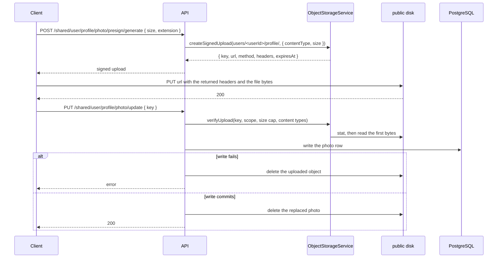

# Storage Documentation

Object storage lives in `src/common/storage`: two named disks, `public` and `private`, behind one service, `ObjectStorageService`. Multipart parsing, file validation, and CSV processing are in [File Upload][ref-doc-file-upload].

## Overview

Two ways a file reaches storage:

- **Stored multipart.** `StorageUploadSingle` streams one file through the API onto a storage disk after detecting its type from the bytes. The handler receives the stored asset, never a buffer.
- **Signed direct upload.** The API issues a short-lived signed `PUT` for the final key; the client sends the bytes straight to the public disk; a completion call with `{ key }` verifies the object in place. There is no temporary area and no copy. The bytes never pass through the API on a remote driver.

Features reach storage through `ObjectStorageService` only. The disks are backed by the local filesystem or by an S3-compatible bucket depending on `STORAGE_DRIVER`. Provider setup (buckets, CORS, lifecycle, permissions, encryption, rotation): [Third Party Integration][ref-doc-third-party].

## Related Documents

- [File Upload Documentation][ref-doc-file-upload] - Multipart parsing, file pipes, and CSV import
- [Third Party Integration][ref-doc-third-party] - Storage drivers, S3 and R2 configuration, bucket setup
- [Environment Documentation][ref-doc-environment] - `STORAGE_*` variables
- [Term Policy Documentation][ref-doc-term-policy] - Term policy content upload, publication, and download
- [Handling Error Documentation][ref-doc-handling-error] - Storage exceptions
- [Doc Documentation][ref-doc-doc] - OpenAPI for stored and signed upload routes

## Table of Contents

- [Overview](#overview)
- [Related Documents](#related-documents)
- [Disks and Visibility](#disks-and-visibility)
- [ObjectStorageService](#objectstorageservice)
- [Stored Assets in Responses](#stored-assets-in-responses)
- [Object Keys](#object-keys)
- [Stored Multipart Upload](#stored-multipart-upload)
- [Signed Direct Upload](#signed-direct-upload)
  - [Issue](#issue)
  - [Complete](#complete)
  - [Flow Diagram](#flow-diagram)
  - [Client Example](#client-example)
  - [Term Policy Content](#term-policy-content)
- [Signed Download](#signed-download)
- [Storage and the Database](#storage-and-the-database)
- [Local-Driver Routes](#local-driver-routes)
- [Storage Errors](#storage-errors)

## Disks and Visibility

`StorageMainModule` (`src/common/storage/storage.module.ts`) registers two named disks through `StorageDiskFactory` and exports `ObjectStorageService` globally.

| Disk | Holds | URL |
|---|---|---|
| `public` | Every upload, verified or not yet verified: profile photos, term policy content | `publicUrl`, the public base URL plus the key |
| `private` | Protected documents. No feature stores to it today; the health probe and the signed-download path use it | `signedDownload`, issued after authorization |

| `STORAGE_DRIVER` | Disks |
|---|---|
| `local` | `LocalDisk` over `<STORAGE_LOCAL_ROOT>/public` and `<STORAGE_LOCAL_ROOT>/private`, served by the [local-driver routes](#local-driver-routes) |
| `s3` | `S3Disk` over `STORAGE_S3_PUBLIC_BUCKET` and `STORAGE_S3_PRIVATE_BUCKET`, on AWS S3 or an S3-compatible endpoint such as Cloudflare R2 |

Unit specs use `InMemoryDisk`. Startup validation fails when the chosen driver's variables are incomplete, so storage is always available once the app is up.

`EnumStorageVisibility` (`public` / `private`, a Prisma enum) names both the access policy and the disk. The feature chooses it; a request body never carries a visibility, a disk, a bucket, or a final key.

## ObjectStorageService

| Method | Does |
|---|---|
| `publicUrl(asset)` | URL of a public asset; throws on a private one |
| `toAssetResponse(asset)` | `{ key, visibility, contentType, url }`, with `url: null` for a private asset |
| `createSignedUpload(scopePrefix, { contentType, size })` | Signed `PUT` for a random key under `<scopePrefix>` on the public disk, with the length pinned |
| `verifyUpload(key, rules)` | Checks the key, then the real size and the sniffed type of the uploaded object; a rejected object is deleted |
| `store(target, { body, contentType })` | Writes a buffer to a new random key |
| `createUploadEngine(target, contentTypes)` | Multer engine streaming one part to a disk (used by `StorageUploadSingle`) |
| `signedDownload(asset, { filename, disposition })` | `{ url, expiresAt }` for an existing object |
| `delete(asset)` / `deletePrefix(visibility, prefix)` | Removes one object, or every object under a prefix in batches of 1000 |
| `probe(visibility)` | `list` of at most one key under a 3-second abort, for the health check |

Every `@nestjs/storage` error is translated by `StorageErrorUtil` into a typed `storage` exception ([Storage Errors](#storage-errors)).

## Stored Assets in Responses

A stored asset persists `key`, `visibility`, `contentType`, `size` (`BigInt`), and `etag` (nullable) on its row (`UserPhoto`, `TermPolicyContent`). No bucket, URL, endpoint, or local path reaches the database, so a row survives a change of driver, host, or credentials.

The HTTP service resolves the URL at response time through `ObjectStorageService.toAssetResponse`. An embedded stored asset, such as the user `photo` inside a user, session, device, member, password-history, or activity-log response, has this shape:

```json
{
  "key": "users/0199a7a4-7c1e-7cc3-9d6e-4a6b2f1f0c11/profile/0199a7a4-8f2d-7a10-b3c5-1d2e3f4a5b6c.jpeg",
  "visibility": "public",
  "contentType": "image/jpeg",
  "url": "https://cdn.example.com/users/0199a7a4-7c1e-7cc3-9d6e-4a6b2f1f0c11/profile/0199a7a4-8f2d-7a10-b3c5-1d2e3f4a5b6c.jpeg"
}
```

`size` and `etag` stay in the database. A private asset carries `url: null` and is delivered by a [signed download](#signed-download). The user export carries the photo as its public URL string, or `null`.

## Object Keys

Every key is server-generated: `<scopePrefix><uuidv7>.<ext>`, where the extension follows the detected or declared content type. A key is never reused, which is what lets the local driver serve a public object with `Cache-Control: public, max-age=31536000, immutable`.

A key admits letters, digits, `.`, `_`, `-`, and `/`, at most 1024 characters, with no leading or trailing `/`, no empty segment, and no `.` or `..` segment.

| Owner | Scope prefix (config key) |
|---|---|
| Profile photo | `users/{userId}/profile/` (`user.photo.scopePrefixPattern`) |
| Term policy content | `term-policies/{type}/v{version}/{language}/` (`termPolicy.contentScopePrefixPattern`) |

A signed upload writes straight to its final key under the scope prefix on the public disk. The key `createSignedUpload` returns is the key the row stores.

## Stored Multipart Upload

`POST /shared/user/profile/photo/upload` on `UserSharedController` stores the profile photo through the API:

```typescript
@Doc({ summary: 'upload photo profile' })
@Response('user.uploadPhotoProfile')
@TermPolicyAcceptanceProtected()
@UserProtected()
@AuthJwtAccessProtected()
@ApiKeyProtected()
@StorageUploadSingle({
    fieldName: 'file',
    visibility: EnumStorageVisibility.public,
    scopePrefixPatternConfigKey: 'user.photo.scopePrefixPattern',
    maxSizeInBytesConfigKey: 'user.photo.maxSizeInBytes',
    extensions: Object.values(EnumFileExtensionImage),
})
@RequestTimeout('1m')
@RequestThrottle({ user: true, route: EnumRequestThrottleRoute.moderate })
@HttpCode(HttpStatus.OK)
@Post('/profile/photo/upload')
async uploadPhotoProfile(
    @AuthJwtPayload('userId')
    userId: string,
    @StoredUpload()
    stored: IStoredAsset
): Promise<void> {
    await this.userProfileHttpService.uploadPhotoProfile(userId, stored);
}
```

- `StorageUploadSingle` composes `FileUploadErrorInterceptor` outermost, then `StorageUploadInterceptor`, and emits the multipart OpenAPI body and the upload error kit.
- The interceptor fills the scope prefix from the authenticated user, resolves the size cap from the config key (10 MB for the photo), and runs multer with `uploadToDisk` and a one-file limit. The type is detected from the bytes before anything is written; a type outside `extensions` is `FileExtensionInvalidException` and nothing is kept. An oversize stream is `FileExceedMaxSizeUploadException` and nothing becomes visible.
- `@StoredUpload()` returns the `IStoredAsset` the interceptor stored in the request context.
- `UserProfileDomain.uploadPhotoProfile` writes the photo row and stages `userUpdatePhotoProfile`. A failed write deletes the new object; after the write commits, the replaced photo object is deleted best-effort.

## Signed Direct Upload

A signed upload is not an asset until completion verifies it: the object already sits at its final key on the public disk, but no row references it, and a rejected object is deleted.

### Issue

`POST /shared/user/profile/photo/presign/generate` takes the declared size and extension:

```json
{ "size": 102400, "extension": "jpg" }
```

`size` is a positive integer. The domain rejects a size below 1 with `storage` `sizeInvalid` (422) and one above `user.photo.maxSizeInBytes` with `user` `photoSizeExceeded` (`51028`, 413). `extension` is an `EnumFileExtensionImage` member, mapped to its content type. `createSignedUpload` then signs a `PUT` for a random key under `users/<userId>/profile/` on the public disk, with `contentLength` pinned to the declared size:

```json
{
  "key": "users/0199a7a4-7c1e-7cc3-9d6e-4a6b2f1f0c11/profile/0199a7a4-8f2d-7a10-b3c5-1d2e3f4a5b6c.jpeg",
  "url": "<signed URL>",
  "method": "PUT",
  "headers": { "content-type": "image/jpeg", "content-length": "102400" },
  "expiresAt": "2026-01-01T00:10:00.000Z"
}
```

The client sends that method to that URL with those headers unchanged. The signature fixes the content type and the length, and it lives 10 minutes (`storage.signedUpload.expiresInMs`).

### Complete

`PUT /shared/user/profile/photo/update` takes the key and nothing else:

```json
{ "key": "users/0199a7a4-7c1e-7cc3-9d6e-4a6b2f1f0c11/profile/0199a7a4-8f2d-7a10-b3c5-1d2e3f4a5b6c.jpeg" }
```

1. `verifyUpload` checks the key first: a malformed key, or one outside the caller's scope prefix, is `keyInvalid` and the object is never read.
2. It reads the real size; zero or above the cap is `sizeInvalid`. A missing object is `objectNotFound`.
3. It sniffs the type from the first bytes (up to 4096). A type outside the allow-list, or none, is `contentTypeInvalid`. A rejected object is deleted best-effort and the rejection is logged.
4. The repository writes the verified metadata under the same key. A failed write deletes the uploaded object.
5. After the write commits, the replaced photo is deleted best-effort; a cleanup failure is logged and the request still succeeds.

Two completions of one key take no lock: both verify the object and write the same row, and the replaced-photo cleanup skips a previous row that already holds the same key. Every issue and completion route carries `@RequestThrottle({ user: true, route: EnumRequestThrottleRoute.moderate })`.

### Flow Diagram



### Client Example

The same code runs against the local driver and against S3 or R2, because the URL and the headers come from the API.

```typescript
async function uploadProfilePhoto(file: File, accessToken: string, apiKey: string) {
  const api = 'http://localhost:3000/api/v1';
  const auth = {
    'Content-Type': 'application/json',
    Authorization: `Bearer ${accessToken}`,
    'x-api-key': apiKey,
  };

  const issued = await fetch(`${api}/shared/user/profile/photo/presign/generate`, {
    method: 'POST',
    headers: auth,
    body: JSON.stringify({
      extension: file.name.split('.').pop(),
      size: file.size,
    }),
  });
  const { data: upload } = await issued.json();

  const put = await fetch(upload.url, {
    method: upload.method,
    headers: upload.headers,
    body: file,
  });
  if (!put.ok) {
    throw new Error(`Upload failed with ${put.status}`);
  }

  const completed = await fetch(`${api}/shared/user/profile/photo/update`, {
    method: 'PUT',
    headers: auth,
    body: JSON.stringify({ key: upload.key }),
  });
  if (!completed.ok) {
    throw new Error(`Completion failed with ${completed.status}`);
  }
}
```

The same flow with `curl` against the local driver:

```bash
curl -s -X POST http://localhost:3000/api/v1/shared/user/profile/photo/presign/generate \
  -H "Authorization: Bearer $ACCESS_TOKEN" -H "x-api-key: $API_KEY" \
  -H 'Content-Type: application/json' \
  -d "{\"extension\":\"jpg\",\"size\":$(wc -c < photo.jpg)}" > upload.json

curl -s -X PUT "$(jq -r '.data.url' upload.json)" \
  -H "content-type: $(jq -r '.data.headers["content-type"]' upload.json)" \
  --data-binary @photo.jpg

curl -s -X PUT http://localhost:3000/api/v1/shared/user/profile/photo/update \
  -H "Authorization: Bearer $ACCESS_TOKEN" -H "x-api-key: $API_KEY" \
  -H 'Content-Type: application/json' \
  -d "{\"key\":\"$(jq -r '.data.key' upload.json)\"}"
```

`curl --data-binary` sends `content-length` from the file. Under the local driver the signed URL is `http://localhost:3000/api/storage/upload?...`; under S3 or R2 it is the provider's own presigned URL, and the browser needs the CORS rule in [Third Party Integration][ref-doc-third-party].

### Term Policy Content

Term policy content follows the same issue, upload, complete sequence on the admin routes of `TermPolicyAdminController`:

- `POST /admin/term-policy/content/presign/generate` takes `{ type, version, language, size }`. A version already `published` is `TermPolicyStatusInvalidException`; a size below 1 is `storage` `sizeInvalid` (422), and one above `termPolicy.content.maxSizeInBytes` (1 MB) is `termPolicy` `contentSizeExceeded` (`51509`, 413). The content type is `text/x-handlebars-template`.
- `PUT /admin/term-policy/content/:termPolicyId/add` and `PUT /admin/term-policy/content/:termPolicyId/update` take `{ key, language }`. A template has no byte signature, so verification passes `TermPolicyUtil.detectTemplateContentType`, which accepts valid UTF-8 with no NUL byte. The verified object stays at its key on the public disk.
- `DELETE /admin/term-policy/content/:termPolicyId/remove` writes the row change first, then deletes the object.
- Publication moves no object: it flips the status inside one transaction. Draft content is already on the public disk, so a draft's content URL is readable by anyone holding the key from the moment it is verified.
- Deleting a draft clears its whole `term-policies/{type}/v{version}/` prefix on the public disk after the row is gone.

Flow and routes: [Term Policy][ref-doc-term-policy].

## Signed Download

`signedDownload(asset, { filename, disposition })` checks the object exists, then returns `{ url, expiresAt }` valid for 5 minutes (`storage.signedDownload.expiresInMs`). The URL is a bearer credential that cannot be revoked, so the authorization check runs before it is issued, and it never reaches a log line or activity metadata.

`GET /admin/term-policy/content/:termPolicyId/:language/get` calls it for a private content row. Term policy content is stored public, so the route answers its public URL with `expiresAt: null`; the signed attachment branch stays for a row whose `visibility` is `private`.

## Storage and the Database

Storage and PostgreSQL share no transaction. Each workflow keeps one authoritative state and an explicit compensation:

- A database reference is written only after its object is verified and written.
- An authoritative object is deleted only after the database change that replaces or removes it commits.
- A failed database write deletes the object written for it; an uploaded object that is never completed stays on the public disk, because no prefix separates it from verified assets for a lifecycle rule.
- A cleanup failure after a commit is logged and never rolled back into the domain.

## Local-Driver Routes

`StorageLocalController` makes the absolute URLs the API returns resolve under `STORAGE_DRIVER=local`. `StorageMainModule` registers it directly (outside the router scopes), version-neutral, under the global prefix:

| Route | Serves |
|---|---|
| `GET /api/storage/public/*key` | A public object, inline, with `Cache-Control: public, max-age=31536000, immutable` |
| `GET /api/storage/private?...` | A private object, after verifying the signature |
| `PUT /api/storage/private?...` | A signed upload into the private disk |
| `PUT /api/storage/upload?...` | A signed upload into the public disk, the route behind `createSignedUpload` |

- `StorageLocalDriverGuard` answers 404 (`objectNotFound`) on every route when the driver is not `local`, so a remote deployment exposes none of them.
- The routes carry `@ApiExcludeController` and no API-key, auth, or per-user throttle guard: a browser follows the URL without API headers, and the signature is the guard.
- The serving routes set `Cross-Origin-Resource-Policy: cross-origin` over the Helmet default. The signed-upload routes (`storage/private` and `storage/upload`) are excluded from `RequestBodyParserMiddleware`, so the raw body reaches `receiveSignedUpload`.

## Storage Errors

| Status code | Key | HTTP | When |
|---|---|---|---|
| `52300` | `serviceUnavailable` | 503 | The store refused the request, could not be reached, or the health probe timed out |
| `52301` | `objectNotFound` | 404 | The object does not exist, or a local-driver route under another driver |
| `52302` | `keyInvalid` | 400 | A malformed key, or an upload key outside the caller's scope |
| `52303` | `objectConflict` | 409 | The store reported a key conflict |
| `52304` | `contentTypeInvalid` | 422 | The sniffed type is not allowed, or the declared extension has no content type |
| `52305` | `sizeInvalid` | 422 | A declared size below 1, an uploaded object of zero bytes or above the cap, or a body length that does not match the signature |
| `52306` | `signedRequestInvalid` | 403 | A local signed URL that is invalid or expired |

Messages live in `src/languages/en/storage.json` under `storage.error.*`. Full catalog: [Status Codes](status-codes.md).

<!-- REFERENCES -->

[ref-doc-file-upload]: file-upload.md
[ref-doc-third-party]: third-party-integration.md
[ref-doc-environment]: environment.md
[ref-doc-term-policy]: term-policy.md#term-policy-content
[ref-doc-handling-error]: handling-error.md
[ref-doc-doc]: doc.md
