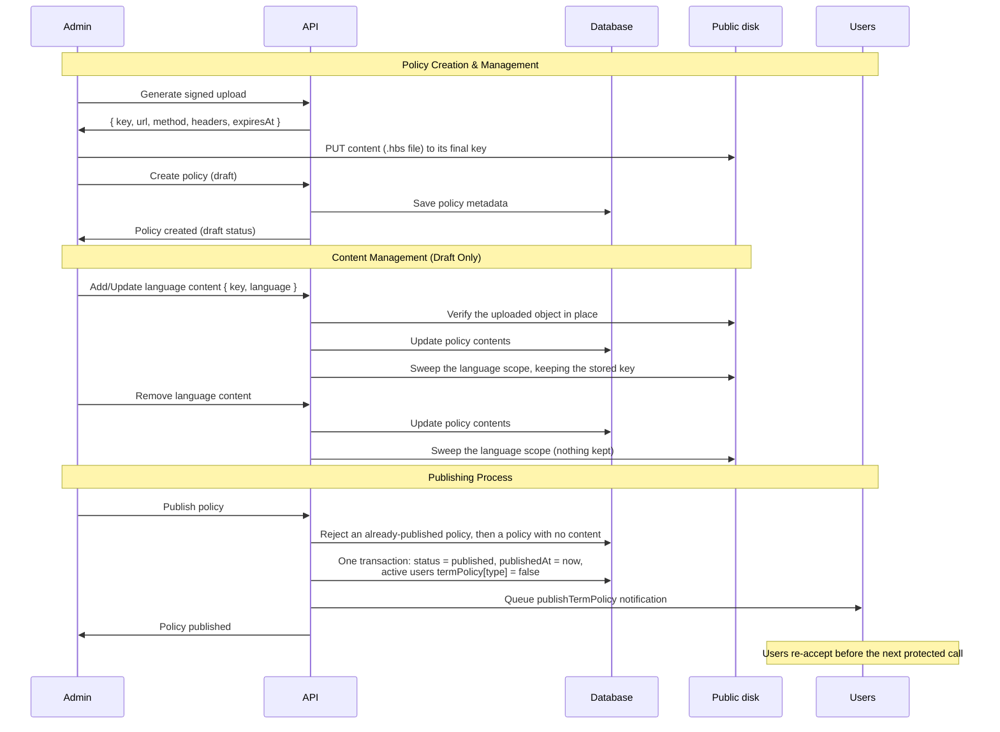
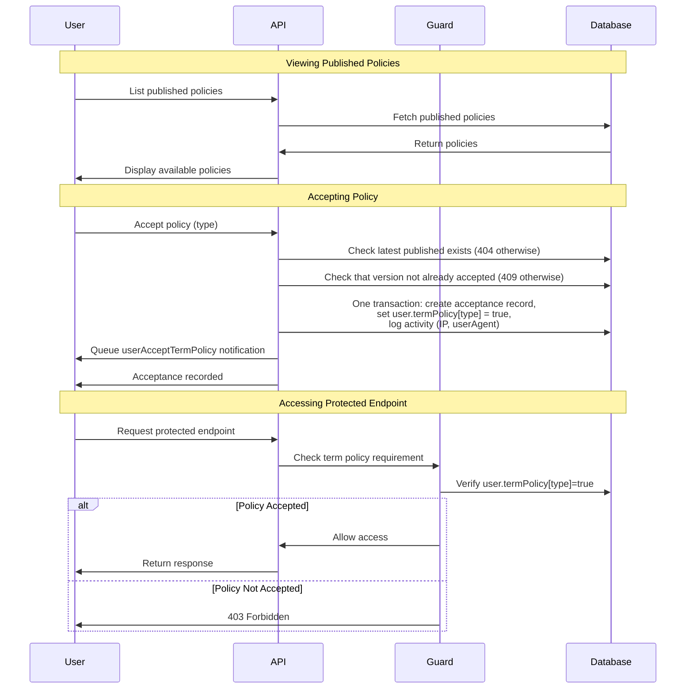
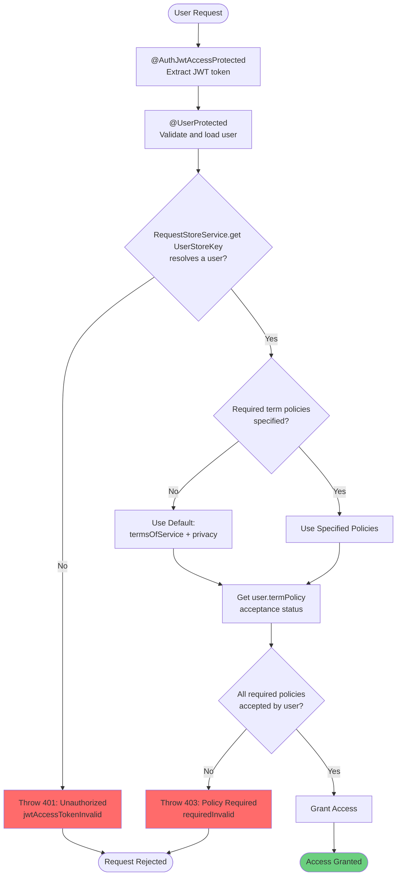

# Term Policy Document

## Overview

Term Policy stores versioned legal documents (terms of service, privacy policy, marketing consent, cookie policy) and records user acceptance.

## Related Documents

- [Database Documentation][ref-doc-database] - Migration, seeding, and schema
- [Authorization Documentation][ref-doc-authorization] - Admin RBAC on term-policy routes
- [Authentication Documentation][ref-doc-authentication] - JWT and session context
- [Storage Documentation][ref-doc-storage] - Signed content upload, verification, and signed download
- [Analytic Documentation][ref-doc-analytic] - Admin acceptance-rate and time-to-accept metrics under `/admin/analytic/term-policies/*`
- [Email Documentation][ref-doc-email] - SES templates for policy publication (not the HTML bodies)

## Table of Contents

- [Overview](#overview)
- [Related Documents](#related-documents)
- [Policy Types](#policy-types)
- [Policy Status](#policy-status)
  - [Draft Status](#draft-status)
  - [Published Status](#published-status)
- [Flow](#flow)
  - [Admin Flow Diagram](#admin-flow-diagram)
  - [User Flow Diagram](#user-flow-diagram)
- [User Endpoints](#user-endpoints)
  - [List Published Policies](#list-published-policies)
  - [Accept Policy](#accept-policy)
  - [View Acceptance History](#view-acceptance-history)
- [Admin Endpoints](#admin-endpoints)
  - [Generate Signed Upload](#generate-signed-upload)
  - [Create Policy](#create-policy)
  - [Add Content](#add-content)
  - [Update Content](#update-content)
  - [Remove Content](#remove-content)
  - [Get Content](#get-content)
  - [Publish Policy](#publish-policy)
  - [List Policies](#list-policies)
  - [Delete Policy](#delete-policy)
- [TermPolicyAcceptanceProtected](#termpolicyacceptanceprotected)
  - [Basic Usage](#basic-usage)
  - [How It Works](#how-it-works)
  - [Important Notes](#important-notes)
- [Migration & Seeding](#migration--seeding)
- [Contribution](#contribution)

## Policy Types

Four policy types are available via `EnumTermPolicyType`:

| Type | Description |
|------|-------------|
| `termsOfService` | Terms of Service agreement |
| `privacy` | Privacy Policy |
| `marketing` | Marketing consent |
| `cookies` | Cookie Policy |

Each type can have multiple versions. A user reaches protected endpoints only after accepting the latest published version.

## Policy Status

Term policies follow a two-stage status:

### Draft Status
- Policy created by admin
- Content files stored on the **public** disk, at their final key from the moment they are verified
- Can be edited, updated, or deleted
- Not visible to users
- Key: `term-policies/{type}/v{version}/{language}/<uuidv7>.hbs` (prefix from `termPolicy.contentScopePrefixPattern`)

### Published Status
- Policy published by admin
- Content files stay where they were verified, on the **public** disk
- Cannot be edited or deleted
- Visible to all users
- **Invalidates all existing user acceptances** for that policy type
- Every active user re-accepts the new version before reaching protected endpoints again
- Key: unchanged by publication

Each content row stores `key`, `visibility`, `contentType`, `size`, and `etag`. Publication moves no object and rewrites no content row; it only sets the status and `publishedAt`.

Publishing a new version sets `termPolicy[type]` to `false` for every active, non-deleted user, so each one accepts the new version before reaching protected endpoints again.

## Flow

### Admin Flow Diagram



Publishing is the one admin action that fans out to every user: after the transaction commits it queues a `publishTermPolicy` job, which emails every active user who still has the `transactional` + `email` notification setting enabled, in batches of `email.batchSize`.

### User Flow Diagram



## User Endpoints

Users interact with term policies through acceptance and viewing their acceptance history.

### List Published Policies

Users can view all published policies available for acceptance:

```typescript
GET /public/term-policy/list
```

Returns policies with cursor pagination, optionally filtered by type.

### Accept Policy

To accept a specific policy type:

```typescript
POST /shared/user/term-policy/accept
{
  "type": "termsOfService"
}
```

The request names only the type; the server resolves it to the **latest published version** of that type and records the acceptance against that record. The duplicate check is per policy record, not per type, so a user who accepted version 1 accepts version 2 again once it is published. Accepting the same version twice returns `409` (`alreadyAccepted`). When no published policy exists for the type, it returns `404` (`notFound`).

### View Acceptance History

Users can view their acceptance history:

```typescript
GET /shared/user/term-policy/acceptance/list
```

Returns all policies the user has accepted with timestamps and policy details.

## Admin Endpoints

Admins manage the complete lifecycle of term policies from creation to publishing.

### Generate Signed Upload

Issue a signed upload for one language's content:

```typescript
POST /admin/term-policy/content/presign/generate
{
  "type": "termsOfService",
  "version": 1,
  "language": "en",
  "size": 1024
}
```

The API derives the key itself, `term-policies/{type}/v{version}/{language}/<uuidv7>.hbs` on the public disk; the client does not supply it.

Response: the signed upload `{ key, url, method, headers, expiresAt }`. The client sends `method` to `url` with `headers` unchanged, within 2 minutes.

- a type and version already published returns `400` (`statusInvalid`)
- a `size` below 1 returns `422` (`storage` `sizeInvalid`)
- a `size` above `termPolicy.content.maxSizeInBytes` (1 MB) returns `413` (`contentSizeExceeded`)

### Create Policy

Create new policy with initial content:

```typescript
POST /admin/term-policy/create
```

### Add Content

Add new language variant to draft policy:

```typescript
PUT /admin/term-policy/content/:termPolicyId/add
{
  "key": "term-policies/termsOfService/v1/en/0199a7a4-8f2d-7a10-b3c5-1d2e3f4a5b6c.hbs",
  "language": "en"
}
```

The body is the key from the signed upload and the language. Verification checks the key is under that type, version, and language, reads the real size, and accepts valid UTF-8 text with no NUL byte as a template. The verified object stays at that key on the public disk; a language that already has content returns `409` (`contentExist`).

### Update Content

Replace existing language content in draft policy:

```typescript
PUT /admin/term-policy/content/:termPolicyId/update
```

Same body and verification as add. A language with no content returns `404` (`contentNotFound`). The replaced object is reclaimed by the sweep of that language's scope after the row update commits.

### Remove Content

Remove specific language variant from draft policy:

```typescript
DELETE /admin/term-policy/content/:termPolicyId/remove
```

### Get Content

Get a URL to download policy content:

```typescript
GET /admin/term-policy/content/:termPolicyId/:language/get
```

Works on draft and published policies alike, and answers `{ url }`. Content is stored public, so the answer is the public URL for a draft and a published policy alike.

### Publish Policy

Publish policy and invalidate all user acceptances:

```typescript
PATCH /admin/term-policy/publish/:termPolicyId
```
Publishing:

- sets `termPolicy[type]` to `false` for every active, non-deleted user, so each one accepts again
- an already-published policy returns `400` (`statusInvalid`)
- a policy with no content returns `400` (`contentEmpty`)

Once published, a policy cannot be edited or deleted, and its content files live on the public disk.

### List Policies

List all policies with optional filters:

```typescript
GET /admin/term-policy/list?type=termsOfService&status=draft
```

Offset pagination, unlike the public list. `type` and `status` each accept a comma-delimited set of values.

### Delete Policy

Delete draft policy and its stored content:

```typescript
DELETE /admin/term-policy/delete/:termPolicyId
```
Only draft policies can be deleted; anything else returns `400` (`statusInvalid`). The record is hard deleted, then every object under `term-policies/{type}/v{version}/` on the public disk is removed best-effort.

## TermPolicyAcceptanceProtected

The `@TermPolicyAcceptanceProtected()` decorator protects endpoints by requiring users to accept specific policies before accessing them.

The guard reads the user out of the request store, which `@UserProtected()` fills and `@AuthJwtAccessProtected()` feeds. Without both, it resolves no user and throws `401 Unauthorized` (`jwtAccessTokenInvalid`).

**Decorator order** (from top to bottom):

```typescript
@TermPolicyAcceptanceProtected()
@UserProtected()
@AuthJwtAccessProtected()
```

### Basic Usage

```typescript
@Controller({
  version: '1',
  path: '/user/term-policy',
})
export class TermPolicySharedController {
  @Doc({ summary: 'List of terms or policies accepted by the user' })
  @ResponsePagination('termPolicy.listAccepted', {
    schema: TermPolicyUserAcceptanceResponseSchema,
  })
  @TermPolicyAcceptanceProtected()
  @UserProtected()
  @AuthJwtAccessProtected()
  @ApiKeyProtected()
  @RequestThrottle({ user: true })
  @Get('/acceptance/list')
  async listAccepted(
    @Query({ schema: TermPolicyAcceptedListRequestSchema })
    query: TermPolicyAcceptedListRequestDto,
    @AuthJwtPayload('userId') userId: string
  ): Promise<IResponsePaginationReturn<ITermPolicyUserAcceptance>> {
    return this.termPolicyAcceptanceHttpService.getListUserAccepted(
      userId,
      query
    );
  }

  @Doc({ summary: 'User accepts term or policy' })
  @Response('termPolicy.accept')
  @TermPolicyAcceptanceProtected()
  @UserProtected()
  @AuthJwtAccessProtected()
  @ApiKeyProtected()
  @RequestThrottle({ user: true })
  @HttpCode(HttpStatus.OK)
  @Post('/accept')
  async accept(
    @UserCurrent() user: IUser,
    @Body({ schema: TermPolicyAcceptRequestSchema }) body: TermPolicyAcceptRequestDto
  ): Promise<IResponseReturn<void>> {
    return this.termPolicyAcceptanceHttpService.userAccept(user, body);
  }
}
```

The decorator takes optional `EnumTermPolicyType` arguments. With none, it requires `termsOfService` and `privacy`. Shared and admin routes in this checkout pass no arguments.

### How It Works



### Important Notes

- `@TermPolicyAcceptanceProtected()` reads the user `@UserProtected()` stored, which depends on `@AuthJwtAccessProtected()`
- Decorator order from top to bottom: `@TermPolicyAcceptanceProtected()` → `@UserProtected()` → `@AuthJwtAccessProtected()`
- For more details about `@AuthJwtAccessProtected()`, see [Authentication Documentation][ref-doc-authentication]
- For more details about `@UserProtected()`, see [Authorization Documentation][ref-doc-authorization]
- Without the required decorators, the guard finds no user and throws `401 Unauthorized` (`jwtAccessTokenInvalid`)
- If no term policies are specified, it defaults to requiring `termsOfService` and `privacy` acceptance
- Access is granted only when the user has accepted every specified term policy
- A user missing any required acceptance gets `403 Forbidden` (`requiredInvalid`)
- Incorrect decorator ordering fails the same way as a missing decorator: the guard runs before the user is in the store, so the request is rejected with `401`

## Migration & Seeding

Two seeds cover term policies:

```
src/migration/seeds/migration.term-policy.seed.ts           # command: termPolicy
src/migration/seeds/migration.template-term-policy.seed.ts  # command: templateTermPolicy
```

- `termPolicy` is the seed wired into `pnpm migration:seed` and `pnpm migration:remove`. It upserts the rows in `src/migration/data/migration.term-policy.data.ts`: one version 1 record per type, all `published`, with empty `contents`. Details of that seed (actor, order, remove): [Database Documentation][ref-doc-database].
- `templateTermPolicy` is run on its own. For each type it writes the bundled `.hbs` document to a new key on the public disk, then upserts a published version 1 record whose single `en` content entry is that object, replacing the record's previous content rows. Its `remove()` deletes the version 1 content rows, then their stored objects; the term policy rows stay, because the `termPolicy` seed owns them.

```bash
pnpm migration templateTermPolicy --type seed
pnpm migration templateTermPolicy --type remove
```

## Contribution

Special thanks to [Gzerox][ref-contributor-gzerox] for contributing to the Term Policy module implementation.


<!-- REFERENCES -->

[ref-doc-database]: database.md
[ref-doc-authorization]: authorization.md
[ref-doc-authentication]: authentication.md
[ref-doc-storage]: storage.md#term-policy-content
[ref-doc-analytic]: analytic.md
[ref-doc-email]: email.md

[ref-contributor-gzerox]: https://github.com/Gzerox
